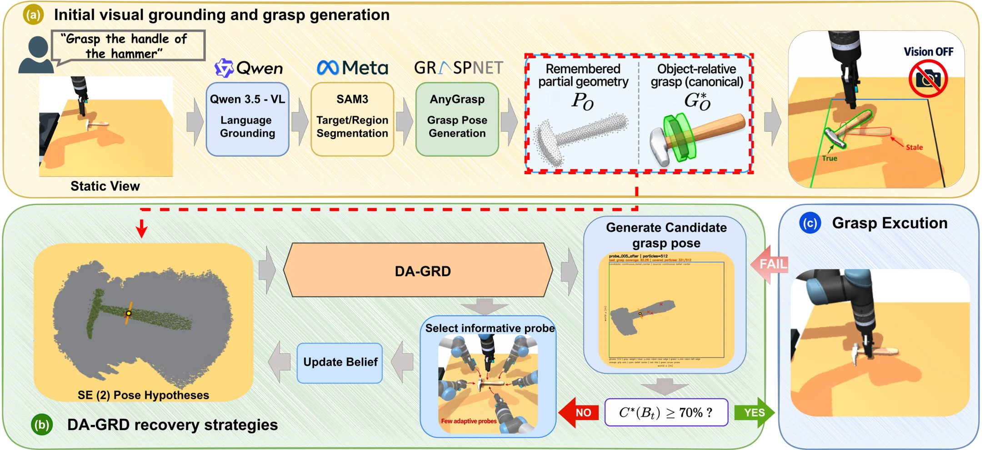

<!-- Generated by scripts/generate.py; edit data/works.json and data/media.json. -->

[← Back to the Awesome index](../../../README.md) · [Interactive website](https://chang-xinhai.github.io/Awesome-RGBDT-Manipulation/?collection=policy&item=da-grd#library)

# DA-GRD

DA-GRD: Decision-Aware Grasp-Relevant Disambiguation for tactile recovery under perception-to-execution mismatches

**2026-09-24 · Preprint · A*STAR IAIC / Nanyang Technological University / Tsinghua University**

**[Paper](https://arxiv.org/abs/2609.29065)**

Belief-space tactile probing recovers executable task grasps after object motion makes an initial visual grasp stale.

*DA-GRD: Decision-Aware Grasp-Relevant Disambiguation for tactile recovery under perception-to-execution mismatches authors · [Figure source](https://arxiv.org/abs/2609.29065) · Original rights retained.*

| Field | Reported value and source scope |
| :-- | :-- |
| Record type | policy |
| Policy family | Model-based planning [1](https://arxiv.org/abs/2609.29065)  |
| Base model and architecture | Weighted planar pose belief, decision-aware probe selection and grasp-agreement stopping. [1](https://arxiv.org/abs/2609.29065)  |
| Model size and component | Not reported [1](https://arxiv.org/abs/2609.29065)  |
| Deployment inputs | Initial RGB-D grasp perception; subsequent sparse contact-hit/position observations without further vision. [1](https://arxiv.org/abs/2609.29065)  |
| Action outputs and horizon | Tactile probe motions and recovered task-conditioned grasps. [1](https://arxiv.org/abs/2609.29065)  |
| Training method | Analytic belief updates and active probe planning; no imitation/RL training claimed. [1](https://arxiv.org/abs/2609.29065)  |
| Training data | No learned policy training corpus required; object-model/grasp hypothesis priors support belief updates. [1](https://arxiv.org/abs/2609.29065)  |
| Training duration | Not reported [1](https://arxiv.org/abs/2609.29065)  |
| Training hardware | Not reported [1](https://arxiv.org/abs/2609.29065)  |
| Inference and control rates | Not reported [1](https://arxiv.org/abs/2609.29065)  |
| Evaluation scope | MuJoCo UR5/Robotiq 2 F-140 on 10 rigid objects; physical UR5transfer on 6 objects. [1](https://arxiv.org/abs/2609.29065)  |
| Observations / modalities | RGB · Depth · Tactile · Proprioception |
| Evaluation domain | Simulation · Real world |
| Embodiment | Parallel-jaw gripper |
| Release: code | Not verified |
| Release: weights | Not verified |
| Release: data | Not verified |
| Release: license | Not verified |
| Release: notes | Original paper reviewed; claimed future releases are not treated as currently available. |

**Scope and qualifications**

- RGB-D cameras are disabled after hidden perturbation; deployment is a staged RGB-D-to-touch pipeline.
- Simulated contact sensors report hit positions, not ground-truth object pose/contact normal/hidden mesh state.

**Primary evidence**

1. [Original paper and supplementary implementation details](https://arxiv.org/abs/2609.29065) — Primary full text reviewed; dataset, deployment modalities and training-only privileges are scoped separately.
