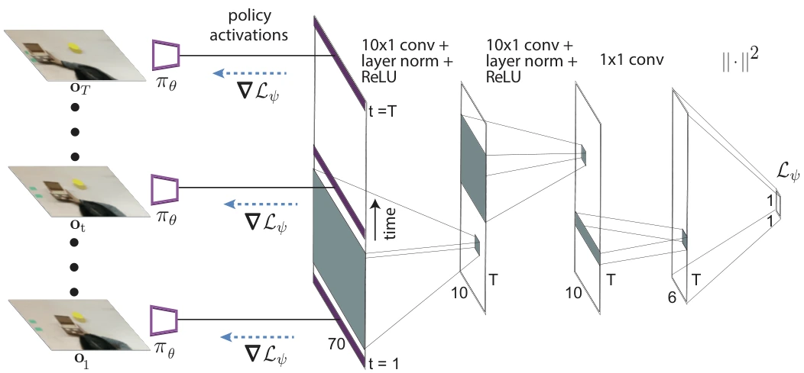

<!-- Generated by scripts/generate.py; edit data/works.json and data/media.json. -->

[← Back to the Awesome index](../../../README.md) · [Interactive website](https://chang-xinhai.github.io/Awesome-RGBDT-Manipulation/?collection=policy&item=daml#library)

# DAML

One-Shot Imitation from Observing Humans via Domain-Adaptive Meta-Learning

**2018-02-05 · ICRA 2018 · UC Berkeley**

**[Paper](https://arxiv.org/abs/1802.01557)** · [Project](https://sites.google.com/view/daml) · [Code](https://github.com/tianheyu927/mil)

Domain-adaptive meta-learning lets a robot imitate one human demonstration despite viewpoint and embodiment differences.

*DAML authors · [Figure source](https://arxiv.org/abs/1802.01557) · Original rights retained.*

| Field | Reported value and source scope |
| :-- | :-- |
| Record type | policy |
| Policy family | Meta-imitation [1](https://arxiv.org/abs/1802.01557)  |
| Base model and architecture | Convolutional visuomotor policy with a learned temporal adaptation objective and gradient-based meta-learning. [1](https://arxiv.org/abs/1802.01557)  |
| Model size and component | Not reported [1](https://arxiv.org/abs/1802.01557)  |
| Deployment inputs | One human demonstration video, current robot image and robot state; measured RGB-D in pick-and-place, RGB only in placing / pushing. [1](https://arxiv.org/abs/1802.01557)  |
| Action outputs and horizon | Continuous arm motion with a discrete gripper command; auxiliary target-contact gripper-pose prediction is training supervision. [1](https://arxiv.org/abs/1802.01557)  |
| Training method | Meta-learn a human-video adaptation loss using paired human / robot tasks, then adapt a robot policy from a new human video. [1](https://arxiv.org/abs/1802.01557)  |
| Training data | 1,293 placing, 640 pushing and 1,008 pick-and-place robot demonstrations, with an equal number of human demonstrations per setting. [1](https://arxiv.org/abs/1802.01557)  |
| Training duration | Appendix: 60k iterations for real placing / pushing / pick-and-place; separate simulated experiments use 30k iterations. Wall-clock duration not reported. [1](https://arxiv.org/abs/1802.01557)  |
| Training hardware | Not reported [1](https://arxiv.org/abs/1802.01557)  |
| Inference and control rates | Real robot policy and demonstration collection at 10 Hz. [1](https://arxiv.org/abs/1802.01557)  |
| Evaluation scope | PR2 and Sawyer placing, pushing and pick-and-place; simulated pushing and viewpoint-shift experiments. [1](https://arxiv.org/abs/1802.01557)  |
| Observations / modalities | RGB · Depth · Proprioception |
| Evaluation domain | Simulation · Real world |
| Embodiment | Parallel-jaw gripper |
| Release: code | Available [2](https://sites.google.com/view/daml) [3](https://github.com/tianheyu927/mil)  |
| Release: weights | Not verified [2](https://sites.google.com/view/daml)  |
| Release: data | Partial [2](https://sites.google.com/view/daml)  |
| Release: license | MIT for repository code, verified from LICENSE; pretrained models, datasets, dependencies and figure rights retain separate terms. [2](https://sites.google.com/view/daml) [4](https://github.com/tianheyu927/mil/blob/master/LICENSE)  |
| Release: notes | The shared original MIL repository explicitly implements both papers and documents the July 2018 learned-temporal-loss DAML experiment. No separate tianheyu927/daml repository is assumed. [2](https://sites.google.com/view/daml)  |

**Scope and qualifications**

- Measured depth is specific to the pick-and-place setting. Other experiments use RGB.
- One-shot adaptation updates model parameters.

**Primary evidence**

1. [Original paper / author report](https://arxiv.org/abs/1802.01557) — Original full paper and supplementary experimental / implementation details; deployment inputs are separated from supervision and benchmark state.
2. [Official project](https://sites.google.com/view/daml) — Author-linked project and current release checked on the catalog cutoff.
3. [Verified official code artifact](https://github.com/tianheyu927/mil) — Author project / repository cross-link verified; current release distinguished from original paper experiments.
4. [Actual repository code license](https://github.com/tianheyu927/mil/blob/master/LICENSE) — 2026-10-19 actual file inspection; applies to repository code, not a blanket grant over models/data/third-party assets.
