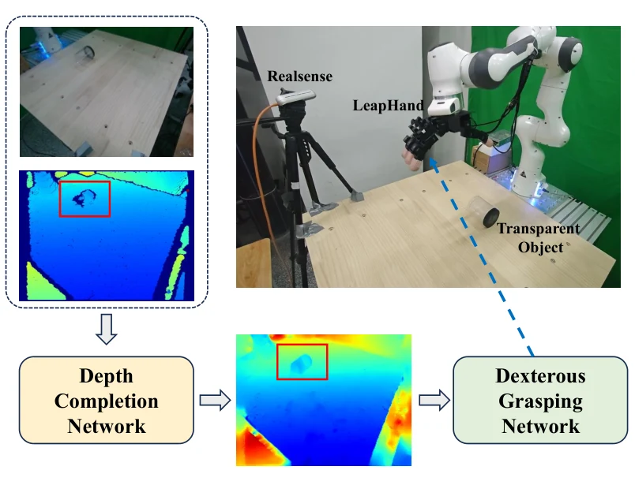

<!-- Generated by scripts/generate.py; edit data/works.json and data/media.json. -->

[← Back to the Awesome index](../../../README.md) · [Interactive website](https://chang-xinhai.github.io/Awesome-RGBDT-Manipulation/?collection=policy&item=dcirnet#library)

# DCIRNet

DCIRNet: Depth Completion with Iterative Refinement for Dexterous Grasping of Transparent and Reflective Objects

**2025-06-11 · Neurocomputing 703 (2026) · Harbin Institute of Technology**

**[Paper](https://arxiv.org/abs/2506.09491)** · [Code](https://github.com/hitxraz/DCIRNet) · [Benchmark Data Source](https://mirrors.pku.edu.cn/dl-release/DREDS_ECCV2022/) · [Published Version](https://doi.org/10.1016/j.neucom.2026.134792)

Restores incomplete RGB-D observations of transparent or reflective objects through iterative depth refinement, then evaluates dexterous grasping downstream.

*Guanghu Xie and coauthors · [Figure source](https://arxiv.org/html/2506.09491v1) · Original rights retained.*

| Field | Reported value and source scope |
| :-- | :-- |
| Record type | model |
| Model role and downstream interface | Depth completion and restoration [1](https://arxiv.org/html/2506.09491v1)  |
| Model family | DCIRNet [1](https://arxiv.org/html/2506.09491v1)  |
| Model architecture | RGB-depth multi-scale feature fusion and iterative propagation refinement network. [1](https://arxiv.org/html/2506.09491v1)  |
| Model size and component | Not reported [1](https://arxiv.org/html/2506.09491v1)  |
| Model inputs | Aligned RGB and incomplete measured/rendered depth; evaluated sensor failure and overlaid object geometry belong to different stages. [1](https://arxiv.org/html/2506.09491v1)  |
| Model outputs | Refined dense depth maps, which a separate grasping pipeline can use. [1](https://arxiv.org/html/2506.09491v1)  |
| Training method | Multi-stage supervision around depth refinement and boundary-aware scene geometry. [1](https://arxiv.org/html/2506.09491v1)  |
| Training data and scale | DREDS and STD data, separately listed by the original project. [1](https://arxiv.org/html/2506.09491v1) [2](https://github.com/hitxraz/DCIRNet#readme)  |
| Training duration | Not reported [1](https://arxiv.org/html/2506.09491v1)  |
| Training hardware | Not reported [1](https://arxiv.org/html/2506.09491v1)  |
| Inference setting and runtime | Not reported [1](https://arxiv.org/html/2506.09491v1)  |
| Downstream evaluation and scope | Depth restoration comparisons, including transparent and reflective objects, plus downstream physical dexterous grasping. [1](https://arxiv.org/html/2506.09491v1)  |
| Observations / modalities | RGB · Depth |
| Evaluation domain | Simulation · Real world |
| Embodiment | Dexterous hand |
| Release: code | Available — author training and inference source [2](https://github.com/hitxraz/DCIRNet#readme)  |
| Release: weights | Not verified — repository mentions model downloads without a validated standalone payload |
| Release: data | DREDS and STD through their separate project [2](https://github.com/hitxraz/DCIRNet#readme)  |
| Release: license | Author source and upstream data independent |
| Release: notes | Paper or official project reviewed. Code, weights and data are tracked independently. |

**Scope and qualifications**

- 3D grasp selection and manipulation controllers are downstream of depth completion. The publication volume date is separate from the first arXiv submission.

**Primary evidence**

1. [Original paper and evaluation settings](https://arxiv.org/html/2506.09491v1)
2. [Training, testing and upstream DREDS/STD datasets](https://github.com/hitxraz/DCIRNet#readme)
3. [Journal publication and volume](https://doi.org/10.1016/j.neucom.2026.134792)
