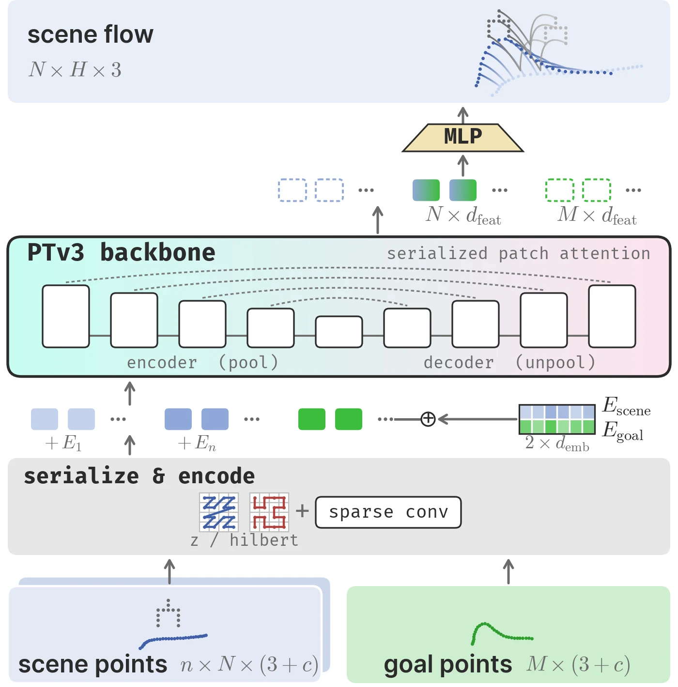

<!-- Generated by scripts/generate.py; edit data/works.json and data/media.json. -->

[← Back to the Awesome index](../../../README.md) · [Interactive website](https://chang-xinhai.github.io/Awesome-RGBDT-Manipulation/?collection=policy&item=defflow#library)

# DefFlow

DefFlow: Goal-Conditioned Deformable Object Manipulation using 3D Point Flows

**2026-10-16 · arXiv preprint · Brown University**

**[Paper](https://arxiv.org/abs/2610.22827)** · [Project](https://def-flow.github.io/)

Jointly predicts robot and deformable-object point flows for goal-conditioned manipulation.

*Defflow authors; original rights retained. · [Figure source](https://arxiv.org/html/2610.22827v1) · Original rights retained.*

| Field | Reported value and source scope |
| :-- | :-- |
| Record type | policy |
| Policy family | Transformer [2](https://arxiv.org/html/2610.22827v1)  |
| Base model and architecture | Point Transformer V3 point-cloud UNet with learned type embeddings and an MLP flow head; inverse-kinematics action extraction. [2](https://arxiv.org/html/2610.22827v1)  |
| Model size and component | Not reported [2](https://arxiv.org/html/2610.22827v1)  |
| Deployment inputs | Robot/scene point-cloud observation history and a target 3D deformable configuration; real observations from RealSense D455. [2](https://arxiv.org/html/2610.22827v1)  |
| Action outputs and horizon | Joint robot/object point flows converted into end-effector and gripper actions. [2](https://arxiv.org/html/2610.22827v1)  |
| Training method | Imitation learning with joint robot/scene-flow supervision. [2](https://arxiv.org/html/2610.22827v1)  |
| Training data | Unstructured play demonstrations relabeled with goal configurations for rope, granular media and cloth; training amounts differ by environment. [2](https://arxiv.org/html/2610.22827v1)  |
| Training duration | Not reported [2](https://arxiv.org/html/2610.22827v1)  |
| Training hardware | Not reported [2](https://arxiv.org/html/2610.22827v1)  |
| Inference and control rates | Not reported [2](https://arxiv.org/html/2610.22827v1)  |
| Evaluation scope | Simulated rope, granular-media and cloth manipulation; physical Franka Panda deployment on unseen goal configurations. [2](https://arxiv.org/html/2610.22827v1)  |
| Observations / modalities | Depth · Point cloud · Proprioception |
| Evaluation domain | Simulation · Real world |
| Embodiment | Parallel-jaw gripper |
| Release: code | Not verified [3](https://def-flow.github.io/)  |
| Release: weights | Not verified [3](https://def-flow.github.io/)  |
| Release: data | Not verified [3](https://def-flow.github.io/)  |
| Release: license | Not verified [3](https://def-flow.github.io/)  |
| Release: notes | Paper and public presentation verified; no implementation, weight or data release is inferred from a publication or demonstration. [3](https://def-flow.github.io/)  |

**Scope and qualifications**

- Real deployment uses observed 3D point clouds; no tactile observation is claimed.

**Primary evidence**

1. [Canonical author manuscript and arXiv submission history](https://arxiv.org/abs/2610.22827) — Date retains the initial v1 submission, independently of revisions or current artifact releases.
2. [Full author paper: method, observations and evaluation scope](https://arxiv.org/html/2610.22827v1) — Physical sensors, predicted signals, training labels and policy inputs are recorded separately; undisclosed quantities remain unknown.
3. [Official paper-linked project page; release review on 19 October 2026](https://def-flow.github.io/) — Current artifacts are checked separately from paper experiments. A project-only link is not proof of an implementation release.
