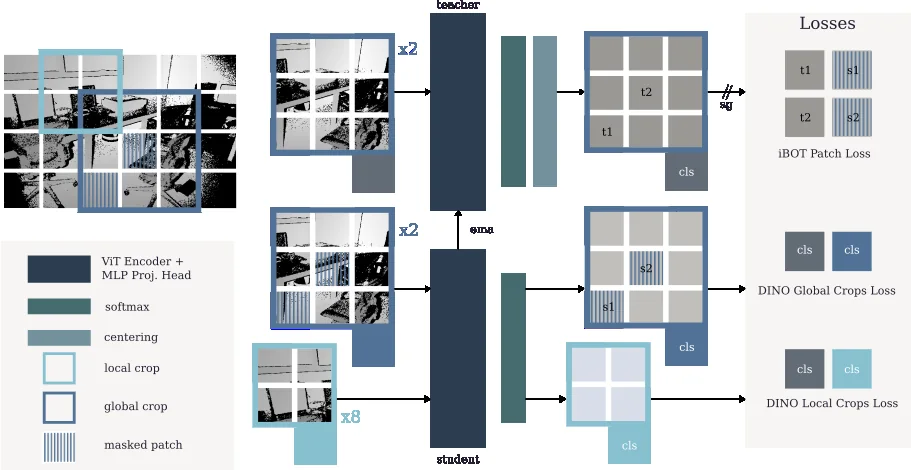

<!-- Generated by scripts/generate.py; edit data/works.json and data/media.json. -->

[← Back to the Awesome index](../../../README.md) · [Interactive website](https://chang-xinhai.github.io/Awesome-RGBDT-Manipulation/?collection=policy&item=defm#library)

# DeFM

DeFM: Learning Foundation Representations from Depth for Robotics

**2026-01-26 · IEEE T-RO · ETH Zurich**

**[Paper](https://arxiv.org/abs/2601.18923)** · [Project](https://de-fm.github.io/) · [Code](https://github.com/leggedrobotics/defm) · [Weights](https://huggingface.co/leggedrobotics/defm)

Self-supervised depth-image representations transfer to manipulation, navigation and locomotion.

*DeFM authors · [Figure source](https://de-fm.github.io/) · Original rights retained.*

| Field | Reported value and source scope |
| :-- | :-- |
| Record type | model |
| Model role and downstream interface | Depth and geometry perception reference [1](https://arxiv.org/html/2601.18923v1)  |
| Model family | Depth representation [1](https://arxiv.org/html/2601.18923v1)  |
| Model architecture | See original paper [1](https://arxiv.org/html/2601.18923v1)  |
| Model size and component | Not reported [1](https://arxiv.org/html/2601.18923v1)  |
| Model inputs | Depth images normalized to preserve metric awareness. [1](https://arxiv.org/html/2601.18923v1)  |
| Model outputs | Dense geometric and semantic feature representations. [1](https://arxiv.org/html/2601.18923v1)  |
| Training method | DINO-style self-distillation and compact model distillation; 60.4M mixed real, synthetic and monocular-predicted depth images. [1](https://arxiv.org/html/2601.18923v1)  |
| Training data and scale | See original paper for dataset scope [1](https://arxiv.org/html/2601.18923v1)  |
| Training duration | Not reported [1](https://arxiv.org/html/2601.18923v1)  |
| Training hardware | Not reported [1](https://arxiv.org/html/2601.18923v1)  |
| Inference setting and runtime | See original paper and official implementation [1](https://arxiv.org/html/2601.18923v1)  |
| Downstream evaluation and scope | Simulated dexterous grasping, depth understanding, navigation and locomotion; real-world deployment demonstrated for navigation. [1](https://arxiv.org/html/2601.18923v1)  |
| Observations / modalities | Depth |
| Evaluation domain |  |
| Embodiment |  |
| Release: code | Available — source linked [2](https://github.com/leggedrobotics/defm)  |
| Release: weights | Available — see official model page; terms vary by checkpoint [2](https://github.com/leggedrobotics/defm)  |
| Release: data | Not verified [2](https://github.com/leggedrobotics/defm)  |
| Release: license | Apache-2.0 for official code and published DeFM model card; external data have separate terms. [2](https://github.com/leggedrobotics/defm)  |
| Release: notes | Consumes depth images; it does not infer depth from RGB or directly output robot actions. [2](https://github.com/leggedrobotics/defm)  |

**Scope and qualifications**

- Consumes depth images; it does not infer depth from RGB or directly output robot actions.

**Primary evidence**

1. [Author paper and first submission](https://arxiv.org/html/2601.18923v1)
2. [Official code and license](https://github.com/leggedrobotics/defm)
