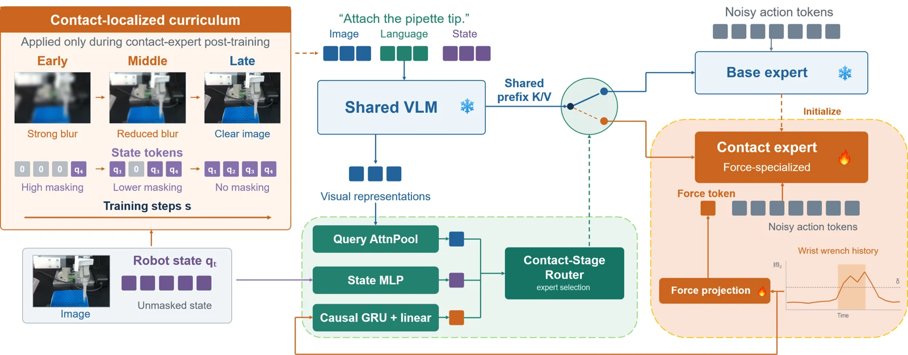

<!-- Generated by scripts/generate.py; edit data/works.json and data/media.json. -->

[← Back to the Awesome index](../../../README.md) · [Interactive website](https://chang-xinhai.github.io/Awesome-RGBDT-Manipulation/?collection=policy&item=deft-vla#library)

# DEFT-VLA

DEFT-VLA: Stage-Localized Force Specialization for Contact-Rich Robotic Manipulation

**2026-10-10 · arXiv preprint · University of Science and Technology of China**

**[Paper](https://arxiv.org/abs/2610.14854)**

Specializes a contact expert while preserving a separate vision-dominated non-contact expert.

*Deft Vla authors; original rights retained. · [Figure source](https://arxiv.org/html/2610.14854v1) · Original rights retained.*

| Field | Reported value and source scope |
| :-- | :-- |
| Record type | policy |
| Policy family | VLA [2](https://arxiv.org/html/2610.14854v1)  |
| Base model and architecture | pi0.5 shared vision-language prefix with independent base/contact action experts and stage routing. [2](https://arxiv.org/html/2610.14854v1)  |
| Model size and component | Not reported [2](https://arxiv.org/html/2610.14854v1)  |
| Deployment inputs | Three camera RGB views, instruction and robot state; bilateral wrist six-axis F/T for contact specialization. [2](https://arxiv.org/html/2610.14854v1)  |
| Action outputs and horizon | Stage-routed manipulation action chunks. [2](https://arxiv.org/html/2610.14854v1)  |
| Training method | Task adaptation, contact-localized expert training and force-attending curriculum with visual suppression/state masking. [2](https://arxiv.org/html/2610.14854v1)  |
| Training data | Task demonstrations segmented into contact and non-contact stages for pipette attachment, bimanual aspiration and whiteboard wiping. [2](https://arxiv.org/html/2610.14854v1)  |
| Training duration | Contact experts / applicable stage estimators: 30,000 steps, batch size 8; wall-clock Not reported. [2](https://arxiv.org/html/2610.14854v1)  |
| Training hardware | Not reported [2](https://arxiv.org/html/2610.14854v1)  |
| Inference and control rates | Mercury B2 robot operates at 15 Hz. [2](https://arxiv.org/html/2610.14854v1)  |
| Evaluation scope | Three real-robot contact-rich tasks and held-out grasp heights. [2](https://arxiv.org/html/2610.14854v1)  |
| Observations / modalities | RGB · Force/Torque · Proprioception · Language |
| Evaluation domain | Real world |
| Embodiment | Parallel-jaw gripper · Bimanual |
| Release: code | Not verified |
| Release: weights | Not verified |
| Release: data | Not verified |
| Release: license | Not verified |
| Release: notes | Paper and public presentation verified; no implementation, weight or data release is inferred from a publication or demonstration. |

**Scope and qualifications**

- Force is measured by wrist F/T sensors, not tactile skin.
- RGB-D camera hardware does not establish depth as a policy observation.

**Primary evidence**

1. [Canonical author manuscript and arXiv submission history](https://arxiv.org/abs/2610.14854) — Date retains the initial v1 submission, independently of revisions or current artifact releases.
2. [Full author paper: method, observations and evaluation scope](https://arxiv.org/html/2610.14854v1) — Physical sensors, predicted signals, training labels and policy inputs are recorded separately; undisclosed quantities remain unknown.
