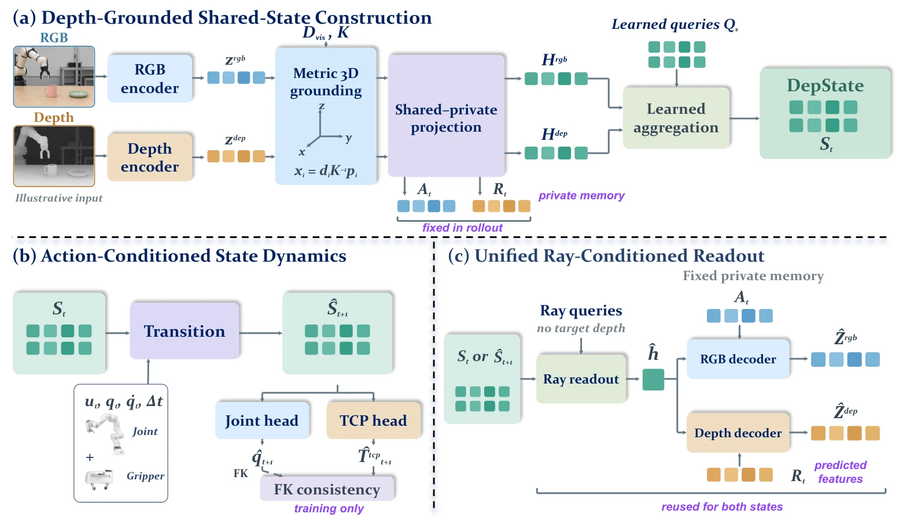

<!-- Generated by scripts/generate.py; edit data/works.json and data/media.json. -->

[← Back to the Awesome index](../../../README.md) · [Interactive website](https://chang-xinhai.github.io/Awesome-RGBDT-Manipulation/?collection=policy&item=depstate-jepa#library)

# DepState-JEPA

DepState-JEPA: Learning Depth-Grounded State Representation for Visual Perception and Manipulation

**2026-10-21 · Preprint · Fudan University**

**[Paper](https://arxiv.org/abs/2610.29246)** · [Project](https://shawnleung-sii.github.io/depstate-jepa/)

A metric RGB-D latent state supports spatial readout and action-conditioned forecasting, evaluated through separate policy-learning and MPC wrappers.

*DepState-JEPA authors · [Figure source](https://arxiv.org/abs/2610.29246) · Original rights retained.*

| Field | Reported value and source scope |
| :-- | :-- |
| Record type | model |
| Model role and downstream interface | A metric RGB-D latent state supports spatial readout and action-conditioned forecasting, evaluated through separate policy-learning and MPC wrappers. [1](https://arxiv.org/abs/2610.29246)  |
| Model family | Predictive representation [1](https://arxiv.org/abs/2610.29246)  |
| Model architecture | Independent RGB/depth V-JEPA2.1 ViT-g/16 encoders with metric positional grounding. [1](https://arxiv.org/abs/2610.29246)  |
| Model size and component | Not reported [1](https://arxiv.org/abs/2610.29246)  |
| Model inputs | Registered RGB, measured metric depth and camera intrinsics; current frame initializes robot prediction, future observations supervise training only. [1](https://arxiv.org/abs/2610.29246)  |
| Model outputs | Shared/private latent state, predicted RGB/depth features, proprioception and object-motion readouts. [1](https://arxiv.org/abs/2610.29246)  |
| Training method | Dense JEPA representation learning plus action-conditioned transitions and soft forward-kinematics regularization. [1](https://arxiv.org/abs/2610.29246)  |
| Training data and scale | Not reported [1](https://arxiv.org/abs/2610.29246)  |
| Training duration | Not reported [1](https://arxiv.org/abs/2610.29246)  |
| Training hardware | Not reported [1](https://arxiv.org/abs/2610.29246)  |
| Inference setting and runtime | Not reported [1](https://arxiv.org/abs/2610.29246)  |
| Downstream evaluation and scope | Spatial transfer, feature prediction, DMC/MetaWorld policy learning and latent MPC; matched real drawer/cup MPC across 3 seeds×30 trials, robot-execution budget 60 s excludes search/inference. [1](https://arxiv.org/abs/2610.29246)  |
| Observations / modalities | RGB · Depth · Proprioception |
| Evaluation domain | Simulation · Real world |
| Embodiment | Parallel-jaw gripper |
| Release: code | Not released [2](https://shawnleung-sii.github.io/depstate-jepa/)  |
| Release: weights | Not verified [2](https://shawnleung-sii.github.io/depstate-jepa/)  |
| Release: data | Not verified [2](https://shawnleung-sii.github.io/depstate-jepa/)  |
| Release: license | Not verified [2](https://shawnleung-sii.github.io/depstate-jepa/)  |
| Release: notes | Official linked GitHub repository is a website with app.js, media and paper; explicitly code coming soon. It is not model implementation or a checkpoint release. [2](https://shawnleung-sii.github.io/depstate-jepa/)  |

**Scope and qualifications**

- Learned predictor requires an external controller/planner; predicting geometry is not direct action generation.
- Reported-proprioception forecasting and predicted-proprioception planning are distinct protocols.
- Fixed calibrated camera, embodiment-specific training and matched workspaces limit demonstrated transfer.

**Primary evidence**

1. [Primary manuscript and first-submission history](https://arxiv.org/abs/2610.29246) — Current primary manuscript reviewed; first-public date uses arXiv v1. Observations, training privileges and deployed interfaces retain their separate scopes.
2. [Official project source and actual artifact inventory](https://shawnleung-sii.github.io/depstate-jepa/) — Reviewed 26 October 2026. Availability and licensing apply only to the described released component, independently of paper results.
3. [PDF title page, numbered affiliation1](https://arxiv.org/pdf/2610.29246) — PDF first page lists1Fudan,2SII,3SJTU; grouped HTML author markup alone was not used.
