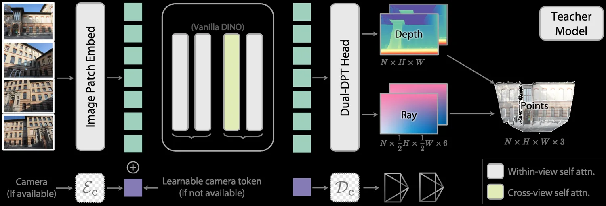

<!-- Generated by scripts/generate.py; edit data/works.json and data/media.json. -->

[← Back to the Awesome index](../../../README.md) · [Interactive website](https://chang-xinhai.github.io/Awesome-RGBDT-Manipulation/?collection=policy&item=depth-anything-3#library)

# Depth Anything 3

Depth Anything 3: Recovering the Visual Space from Any Views

**2025-11-13 · Preprint · ByteDance Seed**

**[Paper](https://arxiv.org/abs/2511.10647)** · [Project](https://depth-anything-3.github.io/) · [Code](https://github.com/ByteDance-Seed/Depth-Anything-3) · [Weights](https://huggingface.co/depth-anything/DA3-BASE)

A multi-view geometry model predicts spatial structure from one or more images.

*Depth Anything 3 authors · [Figure source](https://depth-anything-3.github.io/) · Original rights retained.*

| Field | Reported value and source scope |
| :-- | :-- |
| Record type | model |
| Model role and downstream interface | Depth and geometry perception reference [1](https://arxiv.org/html/2511.10647v1)  |
| Model family | Depth estimation [1](https://arxiv.org/html/2511.10647v1)  |
| Model architecture | See original paper [1](https://arxiv.org/html/2511.10647v1)  |
| Model size and component | Not reported [1](https://arxiv.org/html/2511.10647v1)  |
| Model inputs | One or more RGB views with optional camera poses. [1](https://arxiv.org/html/2511.10647v1)  |
| Model outputs | Depth, ray or camera information and point geometry; scale depends on model variant. [1](https://arxiv.org/html/2511.10647v1)  |
| Training method | Feed-forward visual geometry pretraining and distillation. [1](https://arxiv.org/html/2511.10647v1)  |
| Training data and scale | See original paper for dataset scope [1](https://arxiv.org/html/2511.10647v1)  |
| Training duration | Not reported [1](https://arxiv.org/html/2511.10647v1)  |
| Training hardware | Not reported [1](https://arxiv.org/html/2511.10647v1)  |
| Inference setting and runtime | See original paper and official implementation [1](https://arxiv.org/html/2511.10647v1)  |
| Downstream evaluation and scope | Multi-view pose, depth and reconstruction evaluations; potential robot geometry frontend. [1](https://arxiv.org/html/2511.10647v1)  |
| Observations / modalities | RGB |
| Evaluation domain |  |
| Embodiment |  |
| Release: code | Available — source linked [2](https://github.com/ByteDance-Seed/Depth-Anything-3)  |
| Release: weights | Available — multiple checkpoints; model-specific terms differ [2](https://github.com/ByteDance-Seed/Depth-Anything-3)  |
| Release: data | Not verified [2](https://github.com/ByteDance-Seed/Depth-Anything-3)  |
| Release: license | Apache-2.0 source; model variants have distinct Apache-2.0 or CC BY-NC 4.0 terms. [2](https://github.com/ByteDance-Seed/Depth-Anything-3)  |
| Release: notes | Metric behavior is variant specific; DA3Metric requires focal-length rescaling, while relative outputs are not sensor depth. [2](https://github.com/ByteDance-Seed/Depth-Anything-3)  |

**Scope and qualifications**

- Metric behavior is variant specific; DA3Metric requires focal-length rescaling, while relative outputs are not sensor depth.

**Primary evidence**

1. [Author paper and first submission](https://arxiv.org/html/2511.10647v1)
2. [Official code and license](https://github.com/ByteDance-Seed/Depth-Anything-3)
