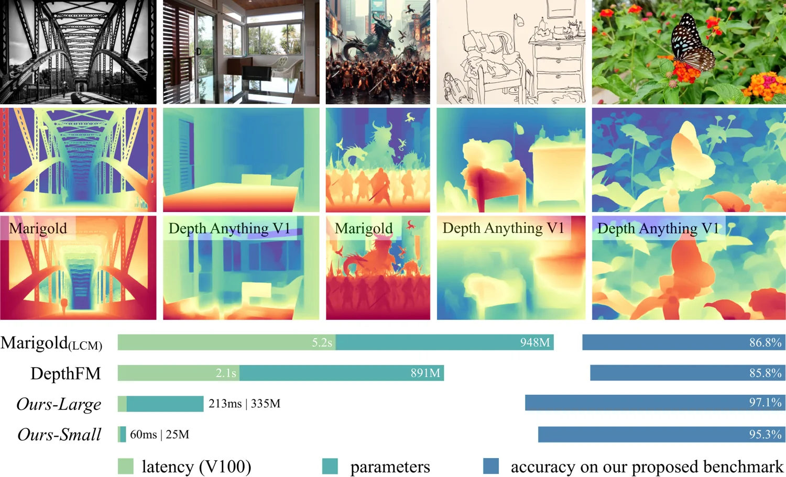

<!-- Generated by scripts/generate.py; edit data/works.json and data/media.json. -->

[← Back to the Awesome index](../../../README.md) · [Interactive website](https://chang-xinhai.github.io/Awesome-RGBDT-Manipulation/?collection=policy&item=depth-anything-v2#library)

# Depth Anything V2

Depth Anything V2

**2024-06-13 · NeurIPS 2024 · The University of Hong Kong**

**[Paper](https://arxiv.org/abs/2406.09414)** · [Project](https://depth-anything-v2.github.io/) · [Code](https://github.com/DepthAnything/Depth-Anything-V2) · [Weights](https://huggingface.co/depth-anything/Depth-Anything-V2-Small)

A monocular depth foundation model predicts detailed relative scene geometry.

*Depth Anything V2 authors · [Figure source](https://depth-anything-v2.github.io/) · Original rights retained.*

| Field | Reported value and source scope |
| :-- | :-- |
| Record type | model |
| Model role and downstream interface | Depth and geometry perception reference [1](https://arxiv.org/html/2406.09414v1)  |
| Model family | Depth estimation [1](https://arxiv.org/html/2406.09414v1)  |
| Model architecture | See original paper [1](https://arxiv.org/html/2406.09414v1)  |
| Model size and component | Not reported [1](https://arxiv.org/html/2406.09414v1)  |
| Model inputs | A single RGB image. [1](https://arxiv.org/html/2406.09414v1)  |
| Model outputs | Relative depth by default; separate metric-finetuned variants output metric predictions. [1](https://arxiv.org/html/2406.09414v1)  |
| Training method | Synthetic labels, large-scale pseudo-labelled images and teacher-student distillation. [1](https://arxiv.org/html/2406.09414v1)  |
| Training data and scale | See original paper for dataset scope [1](https://arxiv.org/html/2406.09414v1)  |
| Training duration | Not reported [1](https://arxiv.org/html/2406.09414v1)  |
| Training hardware | Not reported [1](https://arxiv.org/html/2406.09414v1)  |
| Inference setting and runtime | See original paper and official implementation [1](https://arxiv.org/html/2406.09414v1)  |
| Downstream evaluation and scope | Zero-shot monocular depth benchmarks; useful as a perception prior for robotics. [1](https://arxiv.org/html/2406.09414v1)  |
| Observations / modalities | RGB |
| Evaluation domain |  |
| Embodiment |  |
| Release: code | Available — source linked [2](https://github.com/DepthAnything/Depth-Anything-V2)  |
| Release: weights | Available — multiple checkpoints; size-specific license differs [2](https://github.com/DepthAnything/Depth-Anything-V2)  |
| Release: data | Not verified [2](https://github.com/DepthAnything/Depth-Anything-V2)  |
| Release: license | Apache-2.0 code and small model; base, large and giant weights use CC BY-NC 4.0. [2](https://github.com/DepthAnything/Depth-Anything-V2)  |
| Release: notes | Relative depth is not metric sensor data; downstream robot success is not implied by depth benchmarks. [2](https://github.com/DepthAnything/Depth-Anything-V2)  |

**Scope and qualifications**

- Relative depth is not metric sensor data; downstream robot success is not implied by depth benchmarks.

**Primary evidence**

1. [Author paper and first submission](https://arxiv.org/html/2406.09414v1)
2. [Official code and license](https://github.com/DepthAnything/Depth-Anything-V2)
