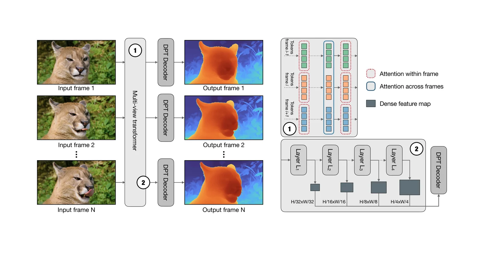

<!-- Generated by scripts/generate.py; edit data/works.json and data/media.json. -->

[← Back to the Awesome index](../../../README.md) · [Interactive website](https://chang-xinhai.github.io/Awesome-RGBDT-Manipulation/?collection=policy&item=depth-pro-2#library)

# Depth Pro 2

Depth Pro 2: Sharp and Temporally Consistent Metric Monocular Depth

**2026-11-19 · Preprint · Apple**

**[Paper](https://arxiv.org/abs/2611.26603)** · [Project](https://apple-aiml-research.github.io/ml-depth-pro-2/) · [Code](https://github.com/apple-aiml-research/ml-depth-pro-2) · [Weights](https://huggingface.co/apple/DepthPro2) · [Core Ml Exports](https://huggingface.co/apple/DepthPro2-coreml) · [Focal-Length Weights](https://huggingface.co/apple/DepthPro2-focal) · [Model License](https://github.com/apple-aiml-research/ml-depth-pro-2/blob/main/LICENSE_MODEL) · [Source License](https://github.com/apple-aiml-research/ml-depth-pro-2/blob/main/LICENSE)

A shared network predicts native-resolution metric depth from a single RGB image, a monocular video or a live stream. The model family trades speed for boundary detail and temporal stability.

*Peiyun Hu and coauthors, Apple · [Figure source](https://arxiv.org/html/2611.26603v1) · Original rights retained.*

| Field | Reported value and source scope |
| :-- | :-- |
| Record type | model |
| Model role and downstream interface | Geometry perception model [1](https://arxiv.org/html/2611.26603v1)  |
| Model family | Native-resolution metric monocular image and video depth [1](https://arxiv.org/html/2611.26603v1)  |
| Model architecture | DINOv3-initialized multi-view transformer with interleaved within/across-frame attention and a DPT decoder. [1](https://arxiv.org/html/2611.26603v1)  |
| Model size and component | S 24M; B 97M; L 334M; H+ 872M. Shared focal estimator: 23.5M, separate from depth model counts. [1](https://arxiv.org/html/2611.26603v1) [4](https://huggingface.co/apple/DepthPro2)  |
| Model inputs | One RGB image or a temporal RGB sequence; focal length or horizontal field of view can be provided or estimated. [1](https://arxiv.org/html/2611.26603v1)  |
| Model outputs | Dense metric camera-view depth in metres at source size. Decoder predicts focal-normalized inverse depth, then focal length restores metric depth. [1](https://arxiv.org/html/2611.26603v1)  |
| Training method | Joint image/video supervised native-resolution token-budget training, with un-interpolated depth targets and intrinsics-aware metric supervision. [1](https://arxiv.org/html/2611.26603v1)  |
| Training data and scale | 19 mixed synthetic and real datasets in Appendix A Table 7, including internal Apple captures/renderings and public sources such as Dynamic Replica, BEDLAM and TartanAir V2. [1](https://arxiv.org/html/2611.26603v1) [3](https://arxiv.org/html/2611.26603v1#A1.SS1)  |
| Training duration | Not reported [1](https://arxiv.org/html/2611.26603v1)  |
| Training hardware | Paper trains variants for 100K steps on 128 NVIDIA B200 GPUs. [1](https://arxiv.org/html/2611.26603v1) [3](https://arxiv.org/html/2611.26603v1#A1.SS1)  |
| Inference setting and runtime | Paper reports 1080p streaming S at 53 FPS and H+ at 8 FPS on one NVIDIA B200. Buffered streaming can use future frames; unbuffered uses past/current frames. Exports have separate hardware and window constraints. [1](https://arxiv.org/html/2611.26603v1) [5](https://github.com/apple-aiml-research/ml-depth-pro-2)  |
| Downstream evaluation and scope | Paper evaluates zero-shot metric depth, boundary F1 and temporal jitter under separately described image and video protocols. Examples include Sintel, Spring and DyDToF. [1](https://arxiv.org/html/2611.26603v1)  |
| Observations / modalities | RGB |
| Evaluation domain | Simulation · Real world |
| Embodiment |  |
| Release: code | Available — image, video and live-stream inference, plus Core ML export. [2](https://apple-aiml-research.github.io/ml-depth-pro-2/) [5](https://github.com/apple-aiml-research/ml-depth-pro-2)  |
| Release: weights | Available — S, B, L, H+, shared focal-length estimator and separately packaged Core ML exports. [2](https://apple-aiml-research.github.io/ml-depth-pro-2/) [4](https://huggingface.co/apple/DepthPro2)  |
| Release: data | Paper names and quantifies 19 components; Apple’s internal data and a merged training release were not verified. [2](https://apple-aiml-research.github.io/ml-depth-pro-2/)  |
| Release: license | Source under Apple Sample Code License. Model terms restrict use to non-commercial scientific research and academic development. [2](https://apple-aiml-research.github.io/ml-depth-pro-2/) [6](https://github.com/apple-aiml-research/ml-depth-pro-2/blob/main/LICENSE) [7](https://github.com/apple-aiml-research/ml-depth-pro-2/blob/main/LICENSE_MODEL)  |
| Release: notes | PyTorch source runs the released model family. The repository does not ship the authors’ training or benchmark-evaluation implementation. [2](https://apple-aiml-research.github.io/ml-depth-pro-2/) [5](https://github.com/apple-aiml-research/ml-depth-pro-2)  |

**Scope and qualifications**

- Inferred metres do not imply measured depth or calibrated out-of-domain operation.
- Check terms and deployment mode before using the model on a robot. The cited B200 throughput does not describe end-to-end robot latency.

**Primary evidence**

1. [Original author paper or dataset description](https://arxiv.org/html/2611.26603v1)
2. [Author source and artifact entry points](https://apple-aiml-research.github.io/ml-depth-pro-2/)
3. [Appendix A, training data mixture and hardware](https://arxiv.org/html/2611.26603v1#A1.SS1)
4. [Apple variant and focal model index](https://huggingface.co/apple/DepthPro2)
5. [Apple source, streaming modes and scope](https://github.com/apple-aiml-research/ml-depth-pro-2)
6. [Source license file](https://github.com/apple-aiml-research/ml-depth-pro-2/blob/main/LICENSE)
7. [Apple model terms](https://github.com/apple-aiml-research/ml-depth-pro-2/blob/main/LICENSE_MODEL)
