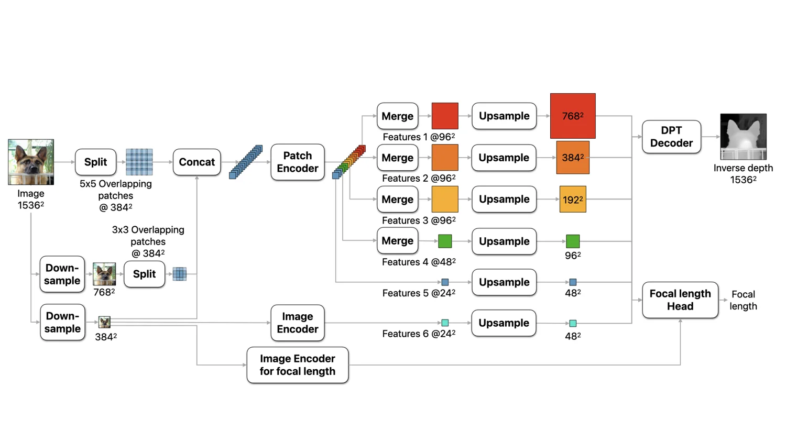

<!-- Generated by scripts/generate.py; edit data/works.json and data/media.json. -->

[← Back to the Awesome index](../../../README.md) · [Interactive website](https://chang-xinhai.github.io/Awesome-RGBDT-Manipulation/?collection=policy&item=depth-pro#library)

# Depth Pro

Depth Pro: Sharp Monocular Metric Depth in Less Than a Second

**2024-10-02 · ICLR 2025 · Apple**

**[Paper](https://arxiv.org/abs/2410.02073)** · [Project](https://machinelearning.apple.com/research/depth-pro) · [Code](https://github.com/apple/ml-depth-pro) · [Weights](https://ml-site.cdn-apple.com/models/depth-pro/depth_pro.pt)

A monocular foundation model predicts sharp metric depth and focal length.

*Depth Pro authors · [Figure source](https://machinelearning.apple.com/research/depth-pro) · Original rights retained.*

| Field | Reported value and source scope |
| :-- | :-- |
| Record type | model |
| Model role and downstream interface | Depth and geometry perception reference [1](https://arxiv.org/html/2410.02073v1)  |
| Model family | Depth estimation [1](https://arxiv.org/html/2410.02073v1)  |
| Model architecture | See original paper [1](https://arxiv.org/html/2410.02073v1)  |
| Model size and component | Not reported [1](https://arxiv.org/html/2410.02073v1)  |
| Model inputs | One RGB image; camera intrinsics are not required as external input. [1](https://arxiv.org/html/2410.02073v1)  |
| Model outputs | Predicted metric depth and camera focal estimate. [1](https://arxiv.org/html/2410.02073v1)  |
| Training method | Multi-scale vision transformer trained using real and synthetic data. [1](https://arxiv.org/html/2410.02073v1)  |
| Training data and scale | See original paper for dataset scope [1](https://arxiv.org/html/2410.02073v1)  |
| Training duration | Not reported [1](https://arxiv.org/html/2410.02073v1)  |
| Training hardware | Not reported [1](https://arxiv.org/html/2410.02073v1)  |
| Inference setting and runtime | See original paper and official implementation [1](https://arxiv.org/html/2410.02073v1)  |
| Downstream evaluation and scope | Zero-shot metric depth and high-resolution boundary evaluation. [1](https://arxiv.org/html/2410.02073v1)  |
| Observations / modalities | RGB |
| Evaluation domain |  |
| Embodiment |  |
| Release: code | Available — source linked [2](https://github.com/apple/ml-depth-pro)  |
| Release: weights | Available — official checkpoint under Apple Sample Code License [2](https://github.com/apple/ml-depth-pro) [3](https://github.com/apple/ml-depth-pro)  |
| Release: data | Not verified [2](https://github.com/apple/ml-depth-pro)  |
| Release: license | Apple Sample Code License covers released code and model weights; inspect dependencies separately. [2](https://github.com/apple/ml-depth-pro)  |
| Release: notes | Metric values are learned estimates, not measured depth; no manipulation policy is included. [2](https://github.com/apple/ml-depth-pro)  |

**Scope and qualifications**

- Metric values are learned estimates, not measured depth; no manipulation policy is included.

**Primary evidence**

1. [Author paper and first submission](https://arxiv.org/html/2410.02073v1)
2. [Official code and license](https://github.com/apple/ml-depth-pro)
3. [Official checkpoint download instructions](https://github.com/apple/ml-depth-pro)
