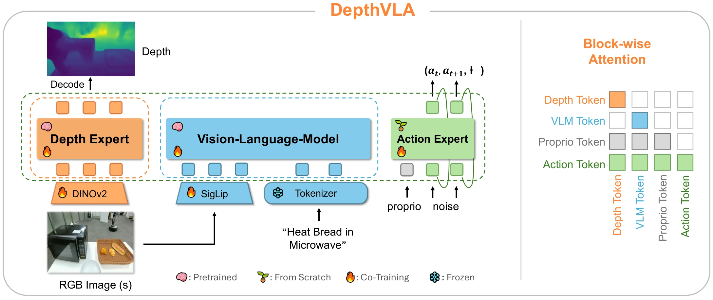

<!-- Generated by scripts/generate.py; edit data/works.json and data/media.json. -->

[← Back to the Awesome index](../../../README.md) · [Interactive website](https://chang-xinhai.github.io/Awesome-RGBDT-Manipulation/?collection=policy&item=depthvla#library)

# DepthVLA

DepthVLA: Enhancing Vision-Language-Action Models with Depth-Aware Spatial Reasoning

**2025-10-15 · arXiv preprint · Tsinghua University IIIS; Galaxea AI**

**[Paper](https://arxiv.org/abs/2510.13375)**

A depth expert shares attention with vision-language and action experts to improve RGB-derived spatial reasoning.

*DepthVLA authors · [Figure source](https://arxiv.org/html/2510.13375) · Original rights retained.*

| Field | Reported value and source scope |
| :-- | :-- |
| Record type | policy |
| Policy family | VLA [1](https://arxiv.org/abs/2510.13375)  |
| Base model and architecture | PaliGemma-3B, DINOv2-L / Depth-Anything-V2 initialization and mixture-of-transformers depth/action experts. [1](https://arxiv.org/abs/2510.13375)  |
| Model size and component | PaliGemma3B backbone; 600M added vs π₀ (300M image encoder + 300M depth decoder) [1](https://arxiv.org/abs/2510.13375)  |
| Deployment inputs | RGB, language and proprioception; depth expert infers geometry from images. [1](https://arxiv.org/abs/2510.13375)  |
| Action outputs and horizon | Flow-matching action chunks and auxiliary predicted depth. [1](https://arxiv.org/abs/2510.13375)  |
| Training method | Depth-expert geometric pretraining then end-to-end VLA learning with action/depth objectives. [1](https://arxiv.org/abs/2510.13375)  |
| Training data | WildRGB-D, ScanNet/ScanNet++ and HyperSim geometry data; Bridge/Galaxea and target task demonstrations. [1](https://arxiv.org/abs/2510.13375)  |
| Training duration | Depth pretraining 50K steps; Bridge 20K, LIBERO 30K steps; wall-clock not reported [1](https://arxiv.org/abs/2510.13375)  |
| Training hardware | 32 NVIDIA H100 GPUs [1](https://arxiv.org/abs/2510.13375)  |
| Inference and control rates | RTX 4090 BF16:210 ms/policy query; 16-action ~one-second chunk on a15 Hz platform. [1](https://arxiv.org/abs/2510.13375)  |
| Evaluation scope | LIBERO, Simpler WidowX and Galaxea R1 Lite physical manipulation. [1](https://arxiv.org/abs/2510.13375)  |
| Observations / modalities | RGB · Language · Proprioception |
| Evaluation domain | Simulation · Real world |
| Embodiment | Bimanual · Parallel-jaw gripper |
| Release: code | Not verified |
| Release: weights | Not verified |
| Release: data | Not verified |
| Release: license | Not verified |
| Release: notes | Code, data and weights are checked independently; an upstream pretrained model is not a released task policy. |

**Scope and qualifications**

- Predicted depth features are not a measured depth camera stream.
- Training/evaluation data and joint-all-suite LIBERO protocol differ from some published per-suite baselines.

**Primary evidence**

1. [Original manuscript and first submission history](https://arxiv.org/abs/2510.13375) — Full author HTML method/evaluation/appendix inspected; depth observations, pseudo-labels and generated outputs retain distinct roles.
