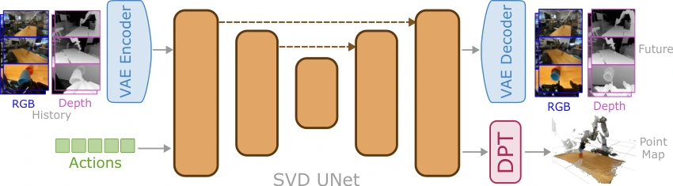

<!-- Generated by scripts/generate.py; edit data/works.json and data/media.json. -->

[← Back to the Awesome index](../../../README.md) · [Interactive website](https://chang-xinhai.github.io/Awesome-RGBDT-Manipulation/?collection=policy&item=depthworld#library)

# DepthWorld

DepthWorld: 3D World Model for Robot Manipulation

**2026-10-06 · arXiv preprint · Czech Technical University in Prague, CIIRC**

**[Paper](https://arxiv.org/abs/2610.08780)** · [Project](https://www.jaibardhan.com/depthworld)

An action-conditioned robot world model jointly predicts multi-view RGB and metric depth using recalibrated DROID-3D supervision.

*DepthWorld authors · [Figure source](https://arxiv.org/html/2610.08780) · Original rights retained.*

| Field | Reported value and source scope |
| :-- | :-- |
| Record type | model |
| Model role and downstream interface | Action-conditioned RGB-D neural simulator [1](https://arxiv.org/abs/2610.08780)  |
| Model family | Predictive world model [1](https://arxiv.org/abs/2610.08780)  |
| Model architecture | Ctrl-World / Stable Video Diffusion, spatial latent RGB-depth tiling and auxiliary point-map head. [1](https://arxiv.org/abs/2610.08780)  |
| Model size and component | Not reported in the inspected primary-source sections [1](https://arxiv.org/abs/2610.08780)  |
| Model inputs | Multi-view RGB-D initial observations and candidate 7-D end-effector/gripper action sequences. [1](https://arxiv.org/abs/2610.08780)  |
| Model outputs | Future RGB/depth videos and robot-frame geometric predictions. [1](https://arxiv.org/abs/2610.08780)  |
| Training method | Joint RGB-depth diffusion with geometric pointmap supervision. [1](https://arxiv.org/abs/2610.08780)  |
| Training data and scale | DROID-3D calibrates over 70K episodes; exact filtered training/validation subsets are reported separately. [1](https://arxiv.org/abs/2610.08780)  |
| Training duration | 90K steps, approximately two days [1](https://arxiv.org/abs/2610.08780)  |
| Training hardware | Two H200 nodes; GPUs per node not specified [1](https://arxiv.org/abs/2610.08780)  |
| Inference setting and runtime | Not reported in the inspected primary-source sections [1](https://arxiv.org/abs/2610.08780)  |
| Downstream evaluation and scope | Held-out world-model rollouts, depth/calibration and 3D consistency; no new closed-loop action policy evaluated. [1](https://arxiv.org/abs/2610.08780)  |
| Observations / modalities | RGB · Depth · Proprioception |
| Evaluation domain | Real-world recordings |
| Embodiment |  |
| Release: code | Not verified [2](https://www.jaibardhan.com/depthworld)  |
| Release: weights | Not verified [2](https://www.jaibardhan.com/depthworld)  |
| Release: data | Not verified [2](https://www.jaibardhan.com/depthworld)  |
| Release: license | Not verified [2](https://www.jaibardhan.com/depthworld)  |
| Release: notes | Code, data and weights are checked independently; an upstream pretrained model is not a released task policy. [2](https://www.jaibardhan.com/depthworld)  |

**Scope and qualifications**

- Generates the outcome of provided actions; it does not itself select a manipulation action.
- Depth labels are stereo-estimated/recalibrated metric geometry, not raw sensor ground truth.

**Primary evidence**

1. [Original manuscript and first submission history](https://arxiv.org/abs/2610.08780) — Full author HTML method/evaluation/appendix inspected; depth observations, pseudo-labels and generated outputs retain distinct roles.
2. [Official author project](https://www.jaibardhan.com/depthworld) — Public author-linked project; figure and downstream scope verified separately.
