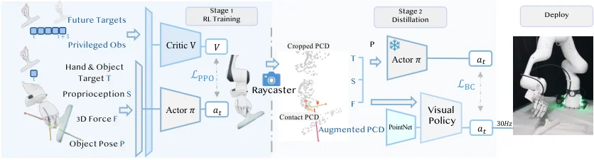

<!-- Generated by scripts/generate.py; edit data/works.json and data/media.json. -->

[← Back to the Awesome index](../../../README.md) · [Interactive website](https://chang-xinhai.github.io/Awesome-RGBDT-Manipulation/?collection=policy&item=dex-x#library)

# Dex-X

Dex-X: Learning Visual-Tactile Dexterous Manipulation From Human Videos with Simulated Interaction

**2026-09-07 · CoRL 2026 · Tsinghua University**

**[Paper](https://arxiv.org/abs/2609.07747)** · [Project](https://dexx-code.github.io/dexx-code/) · [Code](https://github.com/gcfy63821/dexx_lab)

Replays monocular human demonstrations in simulation to distill a visual-tactile dexterous policy for real robots.

*Dex-X authors · [Figure source](https://arxiv.org/html/2609.07747v1) · Original rights retained.*

| Field | Reported value and source scope |
| :-- | :-- |
| Record type | policy |
| Policy family | Privileged RL teacher and distilled policy [1](https://arxiv.org/html/2609.07747v1)  |
| Base model and architecture | PPO teacher with PointNet-based DAgger student [1](https://arxiv.org/html/2609.07747v1)  |
| Model size and component | Not reported [1](https://arxiv.org/html/2609.07747v1)  |
| Deployment inputs | Point cloud from depth, hand proprioception and measured tactile sensing; no privileged object pose at deployment. [1](https://arxiv.org/html/2609.07747v1)  |
| Action outputs and horizon | Arm and dexterous-hand actions. [1](https://arxiv.org/html/2609.07747v1)  |
| Training method | Human video retargeting, simulated contact teacher and DAgger distillation. [1](https://arxiv.org/html/2609.07747v1)  |
| Training data | Monocular human demonstrations retargeted into simulation; the tutorial release contains four sample demonstrations. [1](https://arxiv.org/html/2609.07747v1)  |
| Training duration | Not reported [1](https://arxiv.org/html/2609.07747v1)  |
| Training hardware | Not reported [1](https://arxiv.org/html/2609.07747v1)  |
| Inference and control rates | 30 Hz in tutorial deployment [1](https://arxiv.org/html/2609.07747v1)  |
| Evaluation scope | Six simulated task categories; separately reported real cube picking and table-cleaning experiments. [1](https://arxiv.org/html/2609.07747v1)  |
| Observations / modalities | Depth · Tactile · Proprioception |
| Evaluation domain | Simulation · Real world |
| Embodiment | Dexterous hand |
| Release: code | Partial — tutorial version [2](https://github.com/gcfy63821/dexx_lab) [3](https://github.com/gcfy63821/dexx_lab/blob/main/checkpoints/README.md)  |
| Release: weights | Partial — tutorial teacher and student checkpoints [2](https://github.com/gcfy63821/dexx_lab) [3](https://github.com/gcfy63821/dexx_lab/blob/main/checkpoints/README.md)  |
| Release: data | Partial — four demonstration examples [2](https://github.com/gcfy63821/dexx_lab) [3](https://github.com/gcfy63821/dexx_lab/blob/main/checkpoints/README.md)  |
| Release: license | MIT original code; bundled third-party assets retain separate terms [2](https://github.com/gcfy63821/dexx_lab) [3](https://github.com/gcfy63821/dexx_lab/blob/main/checkpoints/README.md)  |
| Release: notes | 374 repository files including actual teacher/student checkpoints. Authors note tutorial excludes additional paper augmentation and is not a complete paper reproduction. [2](https://github.com/gcfy63821/dexx_lab) [3](https://github.com/gcfy63821/dexx_lab/blob/main/checkpoints/README.md)  |

**Scope and qualifications**

- Tactile supervision is simulated during teacher training; real deployment uses measured tactile observations.
- Tutorial checkpoints and four demos do not establish release of all paper assets or full training data.

**Primary evidence**

1. [Original author manuscript](https://arxiv.org/html/2609.07747v1) — The student policy uses visual and tactile observations; human video supplies no direct touch.
2. [Official tutorial source and artifact inventory](https://github.com/gcfy63821/dexx_lab) — Source files, sample trajectories, checkpoint sizes, LICENSE and release limitations checked.
3. [Tutorial checkpoint scope](https://github.com/gcfy63821/dexx_lab/blob/main/checkpoints/README.md) — The tutorial setup and its reference scores are not a full paper reproduction.
