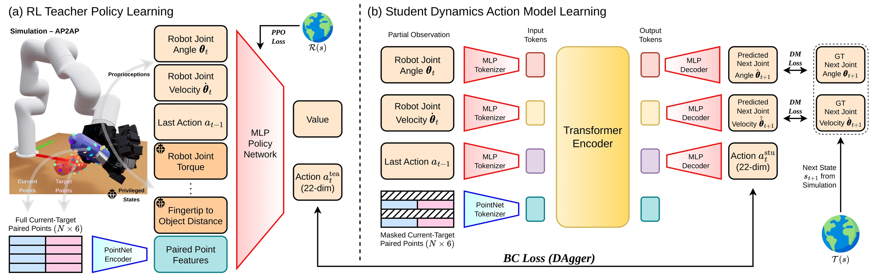

<!-- Generated by scripts/generate.py; edit data/works.json and data/media.json. -->

[← Back to the Awesome index](../../../README.md) · [Interactive website](https://chang-xinhai.github.io/Awesome-RGBDT-Manipulation/?collection=policy&item=dex4d#library)

# Dex4D

Dex4D: Task-Agnostic Point Track Policy for Zero-Shot Dexterous Manipulation

**2026-02-17 · arXiv preprint · Carnegie Mellon University**

**[Paper](https://arxiv.org/abs/2602.15828)** · [Project](https://dex4d.github.io/) · [Code](https://github.com/Dex4D/Dex4D-Simulation)

A task-agnostic 3D point-track controller transfers simulated dexterous skills to real manipulation.

*Dex4D authors · [Figure source](https://arxiv.org/html/2602.15828) · Original rights retained.*

| Field | Reported value and source scope |
| :-- | :-- |
| Record type | policy |
| Policy family | RL / sim-to-real [1](https://arxiv.org/abs/2602.15828)  |
| Base model and architecture | AP2AP point-track policy; PPO teacher and DAgger student, with modular video/depth/tracking goal extraction. [1](https://arxiv.org/abs/2602.15828)  |
| Model size and component | Not reported in the inspected primary-source sections [1](https://arxiv.org/abs/2602.15828)  |
| Deployment inputs | Current RGB-D point cloud, desired 3D point tracks and proprioception. [1](https://arxiv.org/abs/2602.15828)  |
| Action outputs and horizon | 22-D commands: xArm6 delta joint angles and 16 LEAP hand absolute joint angles. [1](https://arxiv.org/abs/2602.15828)  |
| Training method | Three-stage PPO teacher followed by DAgger student; sim-to-real with domain randomization. [1](https://arxiv.org/abs/2602.15828)  |
| Training data | 3,200 simulated objects; no real robot training data. [1](https://arxiv.org/abs/2602.15828)  |
| Training duration | Teacher 2–3 days; student approximately 20 hours [1](https://arxiv.org/abs/2602.15828)  |
| Training hardware | Single NVIDIA RTX A6000 [1](https://arxiv.org/abs/2602.15828)  |
| Inference and control rates | Not reported in the inspected primary-source sections [1](https://arxiv.org/abs/2602.15828)  |
| Evaluation scope | Real and simulation dexterous tasks driven by generated videos, human demonstrations or 3D forecasts. [1](https://arxiv.org/abs/2602.15828)  |
| Observations / modalities | RGB · Depth · Point cloud · Proprioception |
| Evaluation domain | Simulation · Real world |
| Embodiment | Dexterous hand |
| Release: code | Available [2](https://dex4d.github.io/) [3](https://github.com/Dex4D/Dex4D-Simulation) [5](https://github.com/Dex4D/Dex4D-Simulation/tree/master)  |
| Release: weights | Not verified [2](https://dex4d.github.io/) [3](https://github.com/Dex4D/Dex4D-Simulation)  |
| Release: data | Not verified [2](https://dex4d.github.io/) [3](https://github.com/Dex4D/Dex4D-Simulation)  |
| Release: license | Apache-2.0 for repository code; pretrained models, data and figure rights remain separate [2](https://dex4d.github.io/) [3](https://github.com/Dex4D/Dex4D-Simulation) [4](https://github.com/Dex4D/Dex4D-Simulation/blob/master/LICENSE)  |
| Release: notes | Code, data and weights are checked independently; an upstream pretrained model is not a released task policy. [2](https://dex4d.github.io/) [3](https://github.com/Dex4D/Dex4D-Simulation)  |

**Scope and qualifications**

- Current RGB-D observations and desired tracks inferred from generated video have different provenance.
- Track following is task-agnostic; language-to-track generation still depends on external modules.

**Primary evidence**

1. [Original manuscript and first submission history](https://arxiv.org/abs/2602.15828) — Full author HTML method/evaluation/appendix inspected; depth observations, pseudo-labels and generated outputs retain distinct roles.
2. [Official author project](https://dex4d.github.io/) — Public author-linked project; figure and downstream scope verified separately.
3. [Official implementation and release scope](https://github.com/Dex4D/Dex4D-Simulation) — Availability of research implementation does not establish public task-policy checkpoints.
4. [Actual license file in released source](https://github.com/Dex4D/Dex4D-Simulation/blob/master/LICENSE) — Only source code covered by this file; not a blanket license for paper figures or upstream weights.
5. [Actual repository content inventory](https://github.com/Dex4D/Dex4D-Simulation/tree/master) — 447 tracked paths inspected; code release is distinguished from a README/project/figure-only repository.
