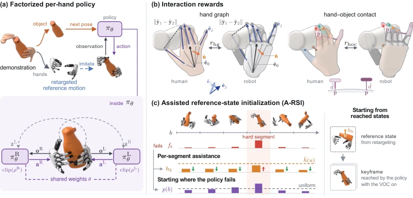

<!-- Generated by scripts/generate.py; edit data/works.json and data/media.json. -->

[← Back to the Awesome index](../../../README.md) · [Interactive website](https://chang-xinhai.github.io/Awesome-RGBDT-Manipulation/?collection=policy&item=dexduet#library)

# DexDuet

DexDuet: Learning Contact-Preserving Bimanual Dexterity from Human Demonstrations

**2026-11-23 · Preprint · MBZUAI; MotPhys**

**[Paper](https://arxiv.org/abs/2611.30495)** · [Project](https://rcl-robotics.github.io/Dexduet.io/) · [Code](https://github.com/HaoranZhangumich/DexDuet) · [Weights](https://huggingface.co/oldTOM/dexduet-checkpoints)

Transfers human bimanual contact patterns using weight-sharing per-hand policies and an assistance curriculum.

*Haoran Zhang and coauthors · [Figure source](https://arxiv.org/html/2611.30495v1) · Original rights retained.*

| Field | Reported value and source scope |
| :-- | :-- |
| Record type | policy |
| Policy family | Contact-preserving bimanual residual control [1](https://arxiv.org/html/2611.30495v1)  |
| Base model and architecture | Not reported [1](https://arxiv.org/html/2611.30495v1)  |
| Model size and component | Not reported [1](https://arxiv.org/html/2611.30495v1)  |
| Deployment inputs | Per-hand robot state, own and partner targets and current reference object pose in the synchronized simulator. Physical demos replay recorded simulated trajectories. [1](https://arxiv.org/html/2611.30495v1)  |
| Action outputs and horizon | Per-hand joint targets for coordinated bimanual execution. [1](https://arxiv.org/html/2611.30495v1)  |
| Training method | Per-hand policy factorization, hand-graph/contact rewards and assisted reference-state initialization from single successful human demonstrations. [1](https://arxiv.org/html/2611.30495v1)  |
| Training data | DexMachina, SPIDER, ManipTrans and humanoid V2D challenge human demonstrations; evaluation ensembles differ by simulator. [1](https://arxiv.org/html/2611.30495v1)  |
| Training duration | Not reported [1](https://arxiv.org/html/2611.30495v1)  |
| Training hardware | Not reported [1](https://arxiv.org/html/2611.30495v1)  |
| Inference and control rates | Not reported [1](https://arxiv.org/html/2611.30495v1)  |
| Evaluation scope | Four benchmarks across three simulators and five robot embodiments. Two physical robotic systems demonstrate replay without a new closed-loop camera/touch policy evaluation. [1](https://arxiv.org/html/2611.30495v1)  |
| Observations / modalities | Proprioception · Object state |
| Evaluation domain | Simulation · Real world |
| Embodiment | Dexterous hand · Bimanual |
| Release: code | Available — simulation training and replay [3](https://github.com/HaoranZhangumich/DexDuet#readme)  |
| Release: weights | Available — released checkpoint files and reproduction entry points [3](https://github.com/HaoranZhangumich/DexDuet#readme) [4](https://huggingface.co/oldTOM/dexduet-checkpoints/tree/main)  |
| Release: data | Benchmark inputs are reused; no new common demonstration bundle verified [3](https://github.com/HaoranZhangumich/DexDuet#readme)  |
| Release: license | MIT author source; upstream asset terms vary [3](https://github.com/HaoranZhangumich/DexDuet#readme)  |
| Release: notes | Paper or official project reviewed. Code, weights and data are tracked independently. [3](https://github.com/HaoranZhangumich/DexDuet#readme)  |

**Scope and qualifications**

- Contact terms are simulation learning rewards. The published robot replay does not establish a live tactile or depth observation stream.

**Primary evidence**

1. [Original paper and evaluation settings](https://arxiv.org/html/2611.30495v1)
2. [Official project with task and method examples](https://rcl-robotics.github.io/Dexduet.io/)
3. [Canonical code, replay and independent weight collection](https://github.com/HaoranZhangumich/DexDuet#readme)
4. [Files for released checkpoints](https://huggingface.co/oldTOM/dexduet-checkpoints/tree/main)
