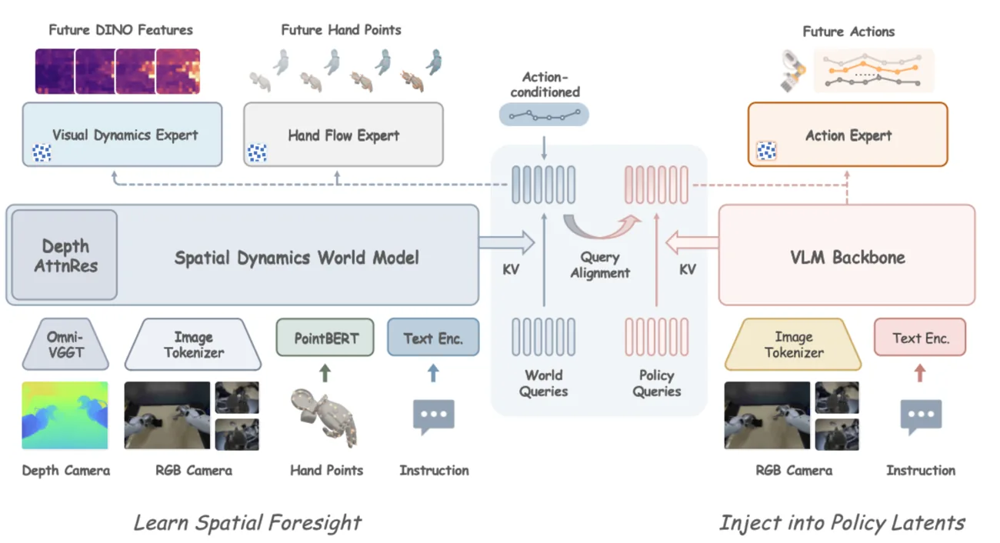

<!-- Generated by scripts/generate.py; edit data/works.json and data/media.json. -->

[← Back to the Awesome index](../../../README.md) · [Interactive website](https://chang-xinhai.github.io/Awesome-RGBDT-Manipulation/?collection=policy&item=dexforesight#library)

# DexForesight

DexForesight: Grounding Dexterous Policies with Implicit Spatial Foresight

**2026-11-08 · Preprint · Not reported**

**[Paper](https://arxiv.org/abs/2611.11166)** · [Project](https://dexforesight.github.io/)

Transfers action-conditioned hand and scene dynamics into dexterous policy latents for RGB-only deployment.

*DexForesight authors · [Figure source](https://dexforesight.github.io/) · Original rights retained.*

| Field | Reported value and source scope |
| :-- | :-- |
| Record type | policy |
| Policy family | Spatially grounded dexterous policy [1](https://arxiv.org/html/2611.11166v1)  |
| Base model and architecture | Not reported [1](https://arxiv.org/html/2611.11166v1)  |
| Model size and component | Not reported [1](https://arxiv.org/html/2611.11166v1)  |
| Deployment inputs | Deployment: RGB, language and robot state. Training teacher additionally uses offline estimated scene depth and hand kinematics. [1](https://arxiv.org/html/2611.11166v1)  |
| Action outputs and horizon | Dexterous robot action chunks. [1](https://arxiv.org/html/2611.11166v1)  |
| Training method | Frozen world-model query alignment; about 370 hours of demonstrations across 60 tasks. Real depth is estimated offline from stereo video; simulation depth is rendered. [1](https://arxiv.org/html/2611.11166v1)  |
| Training data | Frozen world-model query alignment; about 370 hours of demonstrations across 60 tasks. Real depth is estimated offline from stereo video; simulation depth is rendered. [1](https://arxiv.org/html/2611.11166v1)  |
| Training duration | Not reported [1](https://arxiv.org/html/2611.11166v1)  |
| Training hardware | Not reported [1](https://arxiv.org/html/2611.11166v1)  |
| Inference and control rates | Not reported [1](https://arxiv.org/html/2611.11166v1)  |
| Evaluation scope | 11 DexJoCo simulated tasks and three physical robot tasks: Close Box, Insert Battery and Screw On Lid. [1](https://arxiv.org/html/2611.11166v1)  |
| Observations / modalities | RGB · Proprioception · Language |
| Evaluation domain | Simulation · Real world |
| Embodiment |  |
| Release: code | Not verified |
| Release: weights | Not verified |
| Release: data | Not verified |
| Release: license | Not verified |
| Release: notes | Paper and project links are not evidence of code or model availability. |

**Scope and qualifications**

- No depth input, online geometry reconstruction or explicit world-model execution at deployment. Offline predicted depth is not a measured RGB-D stream.

**Primary evidence**

1. [Primary paper and first submission](https://arxiv.org/html/2611.11166v1)
