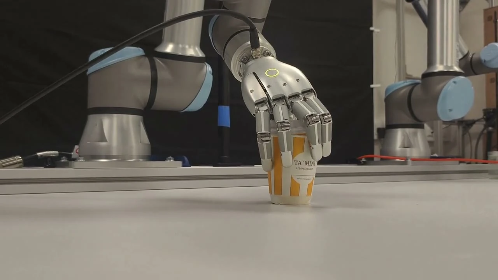

<!-- Generated by scripts/generate.py; edit data/works.json and data/media.json. -->

[← Back to the Awesome index](../../../README.md) · [Interactive website](https://chang-xinhai.github.io/Awesome-RGBDT-Manipulation/?collection=policy&item=dexlatentworld#library)

# DexLatentWorld

DexLatentWorld: 3D Cross-Embodiment Latent Action World Models for Zero-Shot Robotic Manipulation

**2026-11-23 · Preprint · Imperial College London, Embodied Dexterity Lab**

**[Paper](https://arxiv.org/abs/2611.30907)** · [Project](https://vinaymohan0409.github.io/DexLatentWorld/) · [Code](https://github.com/VinayMohan0409/DexLatentWorld)

Learns transferable latent actions over tracked 3D particles, then solves for actuator commands with point-cloud model predictive control.

*Vinay Udit Mohan and coauthors · [Figure source](https://vinaymohan0409.github.io/DexLatentWorld/) · Original rights retained.*

| Field | Reported value and source scope |
| :-- | :-- |
| Record type | policy |
| Policy family | 3D latent-action world model + MPC [1](https://arxiv.org/html/2611.30907v1)  |
| Base model and architecture | Not reported [1](https://arxiv.org/html/2611.30907v1)  |
| Model size and component | Not reported [1](https://arxiv.org/html/2611.30907v1)  |
| Deployment inputs | Two calibrated Intel RealSense D435 RGB-D views on the real setup, back-projected scene points, measured robot joint state and hand geometry from forward kinematics. [1](https://arxiv.org/html/2611.30907v1)  |
| Action outputs and horizon | Predicts future 3D particle locations from latent actions. MPC chooses latent actions and reconstructs executable pose and hand commands from predicted motion. [1](https://arxiv.org/html/2611.30907v1)  |
| Training method | H2O human action-unlabeled clips retargeted to several hands, contrastive latent consistency and world-model forward training. RoboCasa fine-tuning is separate. [1](https://arxiv.org/html/2611.30907v1)  |
| Training data | H2O bimanual manipulation clips with MANO, object meshes and tracked poses; RoboCasa provides task-agnostic simulated adaptation data. [1](https://arxiv.org/html/2611.30907v1)  |
| Training duration | Not reported [1](https://arxiv.org/html/2611.30907v1)  |
| Training hardware | Physical inference on one RTX 4090 24 GB in Appendix S5. [1](https://arxiv.org/html/2611.30907v1)  |
| Inference and control rates | Not reported [1](https://arxiv.org/html/2611.30907v1)  |
| Evaluation scope | Closed-loop RoboCasa using two RGB-D views; physical UR7e with previously unseen Sharpa Wave hand uses the H2O-pretrained model without additional adaptation. [1](https://arxiv.org/html/2611.30907v1)  |
| Observations / modalities | RGB · Depth · Point cloud · Proprioception |
| Evaluation domain | Simulation · Real world |
| Embodiment | Dexterous hand |
| Release: code | Available — training, simulation and evaluation scripts [3](https://github.com/VinayMohan0409/DexLatentWorld#checkpoints)  |
| Release: weights | Announced — prepared trained checkpoints not available in author README [3](https://github.com/VinayMohan0409/DexLatentWorld#checkpoints)  |
| Release: data | Upstream H2O / simulated corpora separately licensed |
| Release: license | Review original component notices |
| Release: notes | Public code documents training checkpoints and separately states a later weight release. |

**Scope and qualifications**

- Robot observations use measured scene depth. Human training uses fitted and tracked geometry. No tactile or force observation is reported.
- Physical zero-shot embodiment transfer and simulated cross-task fine-tuning are separate.

**Primary evidence**

1. [Original paper and evaluation settings](https://arxiv.org/html/2611.30907v1)
2. [Official project with task and method examples](https://vinaymohan0409.github.io/DexLatentWorld/)
3. [Source and separately stated checkpoint availability](https://github.com/VinayMohan0409/DexLatentWorld#checkpoints)
