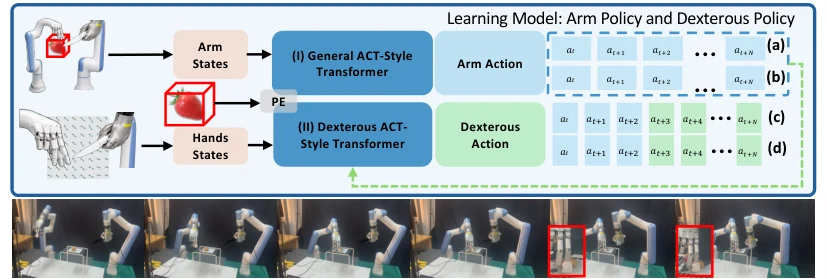

<!-- Generated by scripts/generate.py; edit data/works.json and data/media.json. -->

[← Back to the Awesome index](../../../README.md) · [Interactive website](https://chang-xinhai.github.io/Awesome-RGBDT-Manipulation/?collection=policy&item=dexninja#library)

# DexNinja

DexNinja: Learning Robust Dexterous Cutting Policy with a Real-to-Sim-to-Real Data Engine

**2026-10-12 · CoRL 2026 · Tsinghua University**

**[Paper](https://arxiv.org/abs/2610.17208)** · [Project](https://dex-ninja.github.io/) · [Data](https://huggingface.co/datasets/DexNinja/DexNinja_Simulated_Assets)

Builds real-to-sim-to-real dexterous cutting data with deformable simulation and tactile contact.

*Dexninja authors; original rights retained. · [Figure source](https://arxiv.org/html/2610.17208v1) · Original rights retained.*

| Field | Reported value and source scope |
| :-- | :-- |
| Record type | policy |
| Policy family | ACT [2](https://arxiv.org/html/2610.17208v1)  |
| Base model and architecture | Stage-conditioned ACT-style arm/hand action-chunking imitation policy trained with real demonstrations and augmented simulated episodes. [2](https://arxiv.org/html/2610.17208v1)  |
| Model size and component | Not reported [2](https://arxiv.org/html/2610.17208v1)  |
| Deployment inputs | RGB-D visual observations, proprioception and effector-specific tactile tokens. [2](https://arxiv.org/html/2610.17208v1)  |
| Action outputs and horizon | Stage-conditioned chunks for arm/hand motion and local grasp/contact regulation. [2](https://arxiv.org/html/2610.17208v1)  |
| Training method | Object reconstruction, constrained material/shape randomization, differentiable cutting simulation and behavior cloning. [2](https://arxiv.org/html/2610.17208v1)  |
| Training data | Tens of real cutting demonstrations augmented into hundreds of simulated episodes; exact splits remain setting-specific. [2](https://arxiv.org/html/2610.17208v1)  |
| Training duration | Not reported [2](https://arxiv.org/html/2610.17208v1)  |
| Training hardware | Not reported [2](https://arxiv.org/html/2610.17208v1)  |
| Inference and control rates | Not reported [2](https://arxiv.org/html/2610.17208v1)  |
| Evaluation scope | Food slicing with DR3/DR5 arms and LinkerHand L10; embodiment-shift study with dual Franka arms and LinkerBot L20. [2](https://arxiv.org/html/2610.17208v1)  |
| Observations / modalities | RGB · Depth · Tactile · Proprioception |
| Evaluation domain | Simulation · Real world |
| Embodiment | Dexterous hand · Bimanual |
| Release: code | Not released [3](https://dex-ninja.github.io/) [5](https://dex-ninja.github.io/)  |
| Release: weights | Not verified [3](https://dex-ninja.github.io/)  |
| Release: data | Access by request — simulated assets [3](https://dex-ninja.github.io/) [4](https://huggingface.co/datasets/DexNinja/DexNinja_Simulated_Assets)  |
| Release: license | Not verified [3](https://dex-ninja.github.io/)  |
| Release: notes | Official project marks code Coming soon. Hugging Face lists simulated mesh/voxel/SDF/point-cloud assets with manual access approval; this does not verify downloadable demonstration trajectories. [3](https://dex-ninja.github.io/)  |

**Scope and qualifications**

- Simulation-generated contact and topology changes should not be conflated with released real measurements.
- Simulated assets are a separate gated resource; access to meshes does not establish released policy code or demonstration data.

**Primary evidence**

1. [Canonical author manuscript and arXiv submission history](https://arxiv.org/abs/2610.17208) — Date retains the initial v1 submission, independently of revisions or current artifact releases.
2. [Full author paper: method, observations and evaluation scope](https://arxiv.org/html/2610.17208v1) — Physical sensors, predicted signals, training labels and policy inputs are recorded separately; undisclosed quantities remain unknown.
3. [Official paper-linked project page; release review on 19 October 2026](https://dex-ninja.github.io/) — Current artifacts are checked separately from paper experiments. A project-only link is not proof of an implementation release.
4. [Official simulated-asset inventory and gated access state](https://huggingface.co/datasets/DexNinja/DexNinja_Simulated_Assets) — Hugging Face API exposes mesh, point-cloud, Gaussian, voxel and SDF paths with gated=manual; file listing is not anonymous download access.
5. [Author project venue and current code-release notice](https://dex-ninja.github.io/) — Author BibTeX/footer specifies CoRL 2026; Code is explicitly marked Coming soon.
