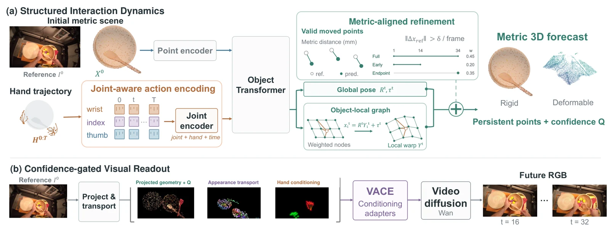

<!-- Generated by scripts/generate.py; edit data/works.json and data/media.json. -->

[← Back to the Awesome index](../../../README.md) · [Interactive website](https://chang-xinhai.github.io/Awesome-RGBDT-Manipulation/?collection=policy&item=dexplicit#library)

# DeXplicit

DeXplicit: Making Physical State Explicit in Dexterous Manipulation World Models

**2026-10-22 · Preprint · Nanyang Technological University**

**[Paper](https://arxiv.org/abs/2610.30781)** · [Project](https://dexplicit.github.io/) · [Code](https://github.com/Abecid/DeXplicit) · [Weights](https://huggingface.co/Abecid/DeXplicit)

Explicit metric object dynamics conditioned on supplied hand motion are rendered into future RGB for dexterous interaction prediction.

*DeXplicit authors · [Figure source](https://arxiv.org/abs/2610.30781) · Original rights retained.*

| Field | Reported value and source scope |
| :-- | :-- |
| Record type | model |
| Model role and downstream interface | Explicit metric object dynamics conditioned on supplied hand motion are rendered into future RGB for dexterous interaction prediction. [1](https://arxiv.org/abs/2610.30781)  |
| Model family | Predictive representation [1](https://arxiv.org/abs/2610.30781)  |
| Model architecture | 425M 3D dynamics model; Wan-based14B renderer with separate compact option. [1](https://arxiv.org/abs/2610.30781)  |
| Model size and component | 425M learned 3D model; 14B default video backbone; compact variant separate. [1](https://arxiv.org/abs/2610.30781)  |
| Model inputs | Initial RGB/metric scene features, calibrated cameras and externally supplied future hand trajectories. [1](https://arxiv.org/abs/2610.30781)  |
| Model outputs | Forecast metric object point motion and rendered future video; no robot action selection. [1](https://arxiv.org/abs/2610.30781)  |
| Training method | Train explicit 3D dynamics then rendering with predicted geometry; recorded future frames supervise training without future-object observation leakage. [1](https://arxiv.org/abs/2610.30781)  |
| Training data and scale | Not reported [1](https://arxiv.org/abs/2610.30781)  |
| Training duration | Not reported [1](https://arxiv.org/abs/2610.30781)  |
| Training hardware | Not reported [1](https://arxiv.org/abs/2610.30781)  |
| Inference setting and runtime | Not reported [1](https://arxiv.org/abs/2610.30781)  |
| Downstream evaluation and scope | HOT3D, OakInk2 and PhysTwin physical-interaction prediction; causal rollout and geometry/video fidelity, not closed-loop policy success. [1](https://arxiv.org/abs/2610.30781)  |
| Observations / modalities | RGB · Point cloud |
| Evaluation domain | Simulation · Real world |
| Embodiment | Dexterous hand · Bimanual |
| Release: code | Available [2](https://dexplicit.github.io/) [3](https://github.com/Abecid/DeXplicit) [4](https://huggingface.co/Abecid/DeXplicit)  |
| Release: weights | Available [2](https://dexplicit.github.io/) [3](https://github.com/Abecid/DeXplicit) [4](https://huggingface.co/Abecid/DeXplicit)  |
| Release: data | Not verified [2](https://dexplicit.github.io/) [3](https://github.com/Abecid/DeXplicit) [4](https://huggingface.co/Abecid/DeXplicit)  |
| Release: license | Apache-2.0 original code and four released method tensor files, verified LICENSE/ LICENSE-WEIGHTS; upstream Wan, MANO, DINOv3 and datasets retain separate terms. [2](https://dexplicit.github.io/) [3](https://github.com/Abecid/DeXplicit) [4](https://huggingface.co/Abecid/DeXplicit)  |
| Release: notes | Actual training/inference code and four safetensors (3D, high-noise renderer, low-noise renderer, compact renderer) released; 3D tensor Range 206 verified. Raw corpora and upstream assets are not redistributed. [2](https://dexplicit.github.io/) [3](https://github.com/Abecid/DeXplicit) [4](https://huggingface.co/Abecid/DeXplicit)  |

**Scope and qualifications**

- Future hand actions are inputs, not a generated policy or proof of autonomous robot execution.
- Initial metric geometry is required; do not call the deployed model monocular-only.
- Metric initial scene points are supplied inputs; this does not establish a measured camera-depth observation stream.

**Primary evidence**

1. [Primary manuscript and first-submission history](https://arxiv.org/abs/2610.30781) — Current primary manuscript reviewed; first-public date uses arXiv v1. Observations, training privileges and deployed interfaces retain their separate scopes.
2. [Official project source and actual artifact inventory](https://dexplicit.github.io/) — Reviewed 26 October 2026. Availability and licensing apply only to the described released component, independently of paper results.
3. [Official code source and actual artifact inventory](https://github.com/Abecid/DeXplicit) — Reviewed 26 October 2026. Availability and licensing apply only to the described released component, independently of paper results.
4. [Official weights source and actual artifact inventory](https://huggingface.co/Abecid/DeXplicit) — Reviewed 26 October 2026. Availability and licensing apply only to the described released component, independently of paper results.
