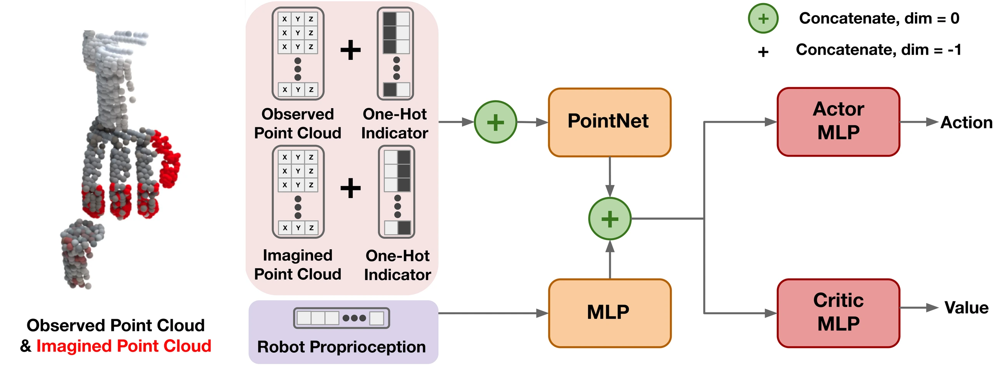

<!-- Generated by scripts/generate.py; edit data/works.json and data/media.json. -->

[← Back to the Awesome index](../../../README.md) · [Interactive website](https://chang-xinhai.github.io/Awesome-RGBDT-Manipulation/?collection=policy&item=dexpoint#library)

# DexPoint

DexPoint: Generalizable Point Cloud Reinforcement Learning for Sim-to-Real Dexterous Manipulation

**2022-11-17 · CoRL 2022 · University of California San Diego; Hong Kong University of Science and Technology**

**[Paper](https://arxiv.org/abs/2211.09423)** · [Project](https://yzqin.github.io/dexpoint/) · [Code](https://github.com/yzqin/dexpoint_sim)

Point-cloud reinforcement learning and imagined hand geometry enable generalizable sim-to-real dexterous grasping.

*DexPoint authors · [Figure source](https://arxiv.org/html/2211.09423) · Original rights retained.*

| Field | Reported value and source scope |
| :-- | :-- |
| Record type | policy |
| Policy family | RL / sim-to-real [1](https://arxiv.org/abs/2211.09423)  |
| Base model and architecture | Point-cloud feature extraction with sensed scene, imagined hand cloud and proprioception; actor-critic control. [1](https://arxiv.org/abs/2211.09423)  |
| Model size and component | Not reported in the inspected primary-source sections [1](https://arxiv.org/abs/2211.09423)  |
| Deployment inputs | Observed depth-derived point cloud, robot hand geometry and proprioception. [1](https://arxiv.org/abs/2211.09423)  |
| Action outputs and horizon | Arm/Allegro hand motor actions. [1](https://arxiv.org/abs/2211.09423)  |
| Training method | Multi-object RL with contact-based reward and imagined hand points; sim-to-real transfer. [1](https://arxiv.org/abs/2211.09423)  |
| Training data | Simulation object categories and randomized physical properties; no physical policy finetuning. [1](https://arxiv.org/abs/2211.09423)  |
| Training duration | Not reported in the inspected primary-source sections [1](https://arxiv.org/abs/2211.09423)  |
| Training hardware | Not reported in the inspected primary-source sections [1](https://arxiv.org/abs/2211.09423)  |
| Inference and control rates | Not reported in the inspected primary-source sections [1](https://arxiv.org/abs/2211.09423)  |
| Evaluation scope | Simulated and physical xArm6/Allegro grasping of novel category instances. [1](https://arxiv.org/abs/2211.09423)  |
| Observations / modalities | Depth · Point cloud · Proprioception |
| Evaluation domain | Simulation · Real world |
| Embodiment | Dexterous hand |
| Release: code | Available [2](https://yzqin.github.io/dexpoint/) [3](https://github.com/yzqin/dexpoint_sim) [5](https://github.com/yzqin/dexpoint_sim/tree/main)  |
| Release: weights | Not verified [2](https://yzqin.github.io/dexpoint/) [3](https://github.com/yzqin/dexpoint_sim)  |
| Release: data | Not verified [2](https://yzqin.github.io/dexpoint/) [3](https://github.com/yzqin/dexpoint_sim)  |
| Release: license | MIT for repository code; pretrained models, data and figure rights remain separate [2](https://yzqin.github.io/dexpoint/) [3](https://github.com/yzqin/dexpoint_sim) [4](https://github.com/yzqin/dexpoint_sim/blob/main/LICENSE)  |
| Release: notes | Code, data and weights are checked independently; an upstream pretrained model is not a released task policy. [2](https://yzqin.github.io/dexpoint/) [3](https://github.com/yzqin/dexpoint_sim)  |

**Scope and qualifications**

- Contact-based reward is simulated training supervision, not measured tactile input at deployment.

**Primary evidence**

1. [Original manuscript and first submission history](https://arxiv.org/abs/2211.09423) — Full author HTML method/evaluation/appendix inspected; depth observations, pseudo-labels and generated outputs retain distinct roles.
2. [Official author project](https://yzqin.github.io/dexpoint/) — Public author-linked project; figure and downstream scope verified separately.
3. [Official current implementation linked by author project](https://github.com/yzqin/dexpoint_sim) — Actual runnable release and model artifacts checked independently.
4. [Actual license file in released source](https://github.com/yzqin/dexpoint_sim/blob/main/LICENSE) — Only source code covered by this file; not a blanket license for paper figures or upstream weights.
5. [Actual repository content inventory](https://github.com/yzqin/dexpoint_sim/tree/main) — 237 tracked paths inspected; code release is distinguished from a README/project/figure-only repository.
