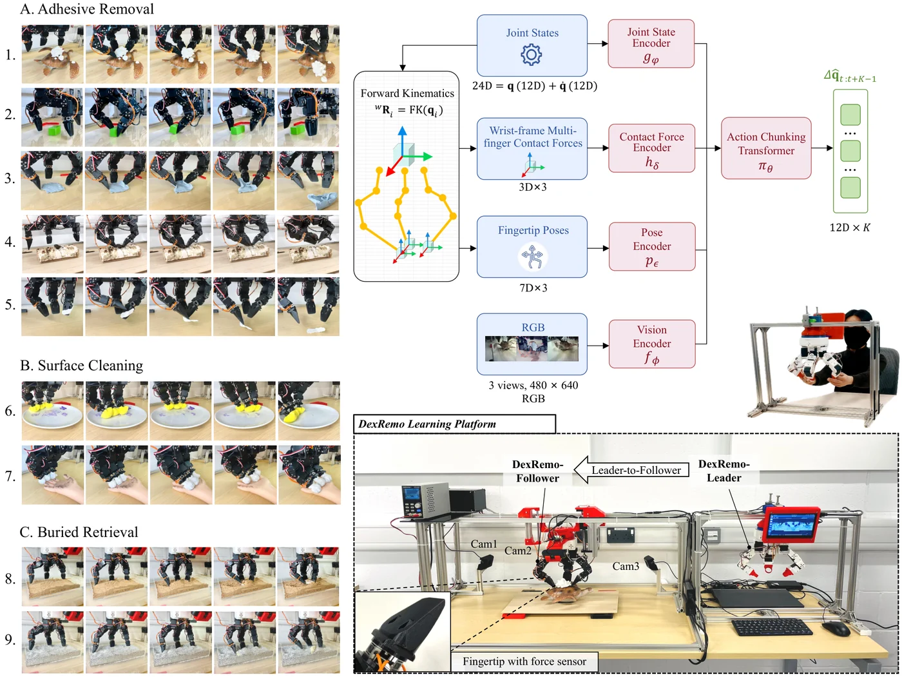

<!-- Generated by scripts/generate.py; edit data/works.json and data/media.json. -->

[← Back to the Awesome index](../../../README.md) · [Interactive website](https://chang-xinhai.github.io/Awesome-RGBDT-Manipulation/?collection=policy&item=dexremo#library)

# DexRemo

DexRemo: A Force-Sensing Hand Platform and Task Suite for Contact-Rich Removal Manipulation

**2026-11-11 · Preprint · University of York and collaborators**

**[Paper](https://arxiv.org/abs/2611.15981)** · [Project](https://dexremo.github.io/)

Pairs a three-finger force-sensing hand with a nine-scenario real-robot benchmark and an ACT baseline for removal.

*DexRemo authors · [Figure source](https://arxiv.org/html/2611.15981v1) · Original rights retained.*

| Field | Reported value and source scope |
| :-- | :-- |
| Record type | policy |
| Policy family | Force-aware action chunking [1](https://arxiv.org/html/2611.15981)  |
| Base model and architecture | Action Chunking Transformer [1](https://arxiv.org/html/2611.15981)  |
| Model size and component | Not reported [1](https://arxiv.org/html/2611.15981)  |
| Deployment inputs | Multi-view RGB, joint position/velocity, fingertip pose and wrist-frame fingertip force. [1](https://arxiv.org/html/2611.15981)  |
| Action outputs and horizon | Closed-loop joint action chunks. [1](https://arxiv.org/html/2611.15981)  |
| Training method | Imitation learning from teleoperation; wrist-frame alignment applied before fusion. [1](https://arxiv.org/html/2611.15981)  |
| Training data | Separate human demonstrations per removal task. [1](https://arxiv.org/html/2611.15981)  |
| Training duration | Not reported [1](https://arxiv.org/html/2611.15981)  |
| Training hardware | Not reported [1](https://arxiv.org/html/2611.15981)  |
| Inference and control rates | 15 Hz synchronized sensing/execution. [1](https://arxiv.org/html/2611.15981)  |
| Evaluation scope | Physical comparisons on six core tasks and three additional scenarios. [1](https://arxiv.org/html/2611.15981)  |
| Observations / modalities | RGB · Tactile · Force · Proprioception |
| Evaluation domain | Real world |
| Embodiment | DexRemo three-finger follower hand |
| Release: code | Not verified [2](https://dexremo.github.io/)  |
| Release: weights | Not verified [2](https://dexremo.github.io/)  |
| Release: data | Not verified [2](https://dexremo.github.io/)  |
| Release: license | Not verified [2](https://dexremo.github.io/)  |
| Release: notes | Paper provides the task and hardware procedure. Author site gives a staged hardware-first roadmap; separate downloadable datasets, weights and repository were not verified. [2](https://dexremo.github.io/)  |

**Scope and qualifications**

- Six core tasks have controlled force-frame ablations. Three extension scenarios report additional held-out evaluations.
- Force is measured at the fingertips in three axes and transformed to a common wrist frame; it does not denote a wrist force/torque sensor.

**Primary evidence**

1. [Primary paper and evaluated setting](https://arxiv.org/html/2611.15981)
2. [Author project and artifact status](https://dexremo.github.io/)
