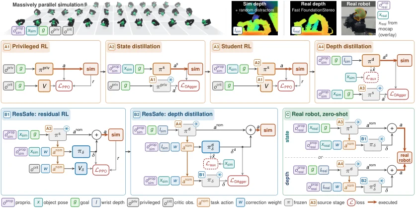

<!-- Generated by scripts/generate.py; edit data/works.json and data/media.json. -->

[← Back to the Awesome index](../../../README.md) · [Interactive website](https://chang-xinhai.github.io/Awesome-RGBDT-Manipulation/?collection=policy&item=dexsafe#library)

# DexSafe

Pushing Dexterity and Safety for In-Hand Object Pose Reaching That Works Remarkably Well

**2026-10-27 · Preprint · University of California, Berkeley**

**[Paper](https://arxiv.org/abs/2610.37652)** · [Project](https://ian-chuang.github.io/dexsafe/)

A simulated RL policy and learned residual safety filter perform in-hand object pose reaching with a motion-capture state or wrist-depth perception.

*DexSafe authors · [Figure source](https://arxiv.org/html/2610.37652v1/combined13_color_aux_v8.png) · Original rights retained.*

| Field | Reported value and source scope |
| :-- | :-- |
| Record type | policy |
| Policy family | Reinforcement learning [1](https://arxiv.org/html/2610.37652v1)  |
| Base model and architecture | State policy and depth-distilled policy with optional learned residual safety filter. [1](https://arxiv.org/html/2610.37652v1)  |
| Model size and component | Not reported [1](https://arxiv.org/html/2610.37652v1)  |
| Deployment inputs | Joint proprioception and goal; either motion-capture object pose or wrist-mounted depth images in separate real-world conditions. [1](https://arxiv.org/html/2610.37652v1)  |
| Action outputs and horizon | LEAP hand joint commands, optionally corrected by the residual safety filter. [1](https://arxiv.org/html/2610.37652v1)  |
| Training method | PPO in simulation with staged state and depth distillation, adaptive friction curriculum and a separately learned residual safety filter. [1](https://arxiv.org/html/2610.37652v1)  |
| Training data | Generated grasp dataset and simulation; no human demonstrations. [1](https://arxiv.org/html/2610.37652v1)  |
| Training duration | Not reported [1](https://arxiv.org/html/2610.37652v1)  |
| Training hardware | Not reported [1](https://arxiv.org/html/2610.37652v1)  |
| Inference and control rates | Not reported [1](https://arxiv.org/html/2610.37652v1)  |
| Evaluation scope | Real state-based motion-capture condition: 4,800 goals across four objects, 95.2% reaching success; with filter 91.5% success and 75% fewer drops. Wrist-depth evaluations are separate. [1](https://arxiv.org/html/2610.37652v1)  |
| Observations / modalities | Depth · Proprioception |
| Evaluation domain | Simulation · Real world |
| Embodiment | Dexterous hand |
| Release: code | Forthcoming [2](https://ian-chuang.github.io/dexsafe/)  |
| Release: weights | Not verified [2](https://ian-chuang.github.io/dexsafe/)  |
| Release: data | Not verified [2](https://ian-chuang.github.io/dexsafe/)  |
| Release: license | Not verified [2](https://ian-chuang.github.io/dexsafe/)  |
| Release: notes | Official project says code coming soon; public paper and videos do not establish released training source or weights. [2](https://ian-chuang.github.io/dexsafe/)  |

**Scope and qualifications**

- The reported 95.2% and 75% fewer drops are state-based motion-capture measurements, not a claim for wrist-depth inference.
- Object pose reaching and object-drop avoidance are distinct metrics.

**Primary evidence**

1. [Original paper, methods and evaluation](https://arxiv.org/html/2610.37652v1) — Depth vs motion-capture conditions and filter results are reported separately in Sections IV–VI.
2. [Official project and release status](https://ian-chuang.github.io/dexsafe/) — Project labels code coming soon.
