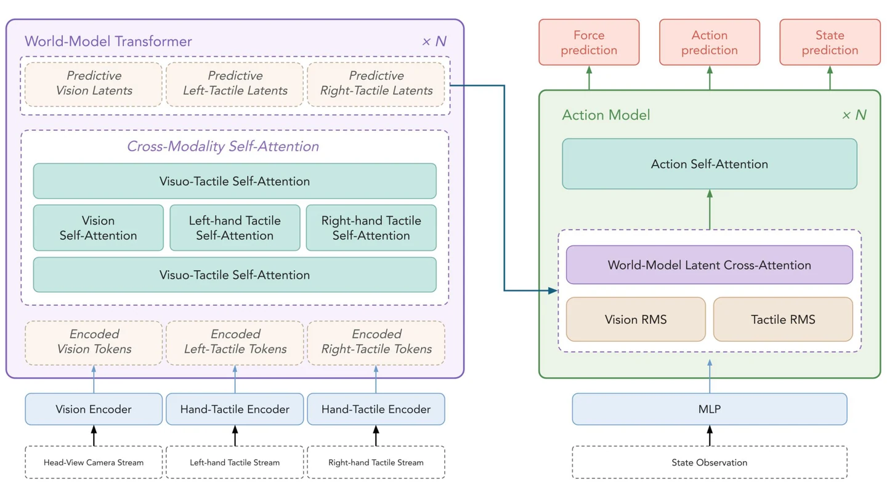

<!-- Generated by scripts/generate.py; edit data/works.json and data/media.json. -->

[← Back to the Awesome index](../../../README.md) · [Interactive website](https://chang-xinhai.github.io/Awesome-RGBDT-Manipulation/?collection=policy&item=dextacwam#library)

# DexTacWAM

DexTacWAM: A Visuo-Tactile World-Action Model for Dexterous Manipulation

**2026-09-21 · Preprint · University of Illinois Urbana-Champaign; UC Berkeley; Northwestern University**

**[Paper](https://arxiv.org/abs/2609.24976)** · [Project](https://dextacwam.github.io/) · [Code](https://github.com/dextacwam/DexTacWAM) · [Data](https://huggingface.co/datasets/JensenYuan/DexTacWAM_OXT) · [Weights](https://huggingface.co/collections/JensenYuan/dextacwam-6aba3aa25d3362d882cdefbc)

Uses multi-finger touch and robot vision to train a world-action policy for dexterous bimanual manipulation.

*Haoran Yuan and coauthors · [Figure source](https://dextacwam.github.io/) · Original rights retained.*

| Field | Reported value and source scope |
| :-- | :-- |
| Record type | policy |
| Policy family | DexTacWAM [1](https://arxiv.org/html/2609.24976v1)  |
| Base model and architecture | Not reported [1](https://arxiv.org/html/2609.24976v1)  |
| Model size and component | Not reported [1](https://arxiv.org/html/2609.24976v1)  |
| Deployment inputs | Head/wrist views, hand state and multi-finger tactile images from both hands. The tactile encoder compresses each hand into a shared latent representation. [1](https://arxiv.org/html/2609.24976v1)  |
| Action outputs and horizon | Arm and dexterous-hand action chunks, plus future visual, tactile, force and state predictions for supervised learning. [1](https://arxiv.org/html/2609.24976v1)  |
| Training method | Train multi-finger encoder then world-model dynamics; integrate action head in the final stage. Inference dependency is stage/task-specific. [1](https://arxiv.org/html/2609.24976v1)  |
| Training data | DexTacWAM-OXT six-task data and additional task-specific traces. The author release includes a 488-episode pretraining subset. [1](https://arxiv.org/html/2609.24976v1)  |
| Training duration | Not reported [1](https://arxiv.org/html/2609.24976v1)  |
| Training hardware | Not reported [1](https://arxiv.org/html/2609.24976v1)  |
| Inference and control rates | Not reported [1](https://arxiv.org/html/2609.24976v1)  |
| Evaluation scope | Physical bimanual manipulation across six tasks with real tactile input, including bowl unstacking, tool handling and controlled wiping. [1](https://arxiv.org/html/2609.24976v1)  |
| Observations / modalities | RGB · Tactile · Proprioception · Language |
| Evaluation domain | Real world |
| Embodiment | Bimanual · Dexterous hand |
| Release: code | Available — offline inference and training; robot deployment is hardware-specific [3](https://github.com/dextacwam/DexTacWAM#readme)  |
| Release: weights | Available in scoped stages — multi-finger encoder, examples of released world-action task weights [3](https://github.com/dextacwam/DexTacWAM#readme) [5](https://huggingface.co/JensenYuan/DexTacWAM_multi_finger_tactile_encoder/tree/main)  |
| Release: data | Available in scoped subsets — six public OXT zarr recordings and pretraining collection [3](https://github.com/dextacwam/DexTacWAM#readme) [4](https://huggingface.co/datasets/JensenYuan/DexTacWAM_OXT/tree/main)  |
| Release: license | Mixed Apache-2.0 and CC BY-NC-SA 4.0 by component; OXT dataset card indicates CC BY 4.0. [3](https://github.com/dextacwam/DexTacWAM#readme)  |
| Release: notes | Public paper verified. Code, task weights and data are tracked separately. [3](https://github.com/dextacwam/DexTacWAM#readme)  |

**Scope and qualifications**

- Offline checkpoint verification does not establish out-of-box deployment on other robots.
- Multi-finger tactile RGB measures the tactile sensors rather than an external scene-depth stream.

**Primary evidence**

1. [Original author paper with methods, evaluation and scope](https://arxiv.org/html/2609.24976v1)
2. [Public author project with method and evaluation examples](https://dextacwam.github.io/)
3. [Source, model examples, and file-level licensing](https://github.com/dextacwam/DexTacWAM#readme)
4. [Six public Zarr archives](https://huggingface.co/datasets/JensenYuan/DexTacWAM_OXT/tree/main)
5. [Public multi-finger encoder checkpoint](https://huggingface.co/JensenYuan/DexTacWAM_multi_finger_tactile_encoder/tree/main)
