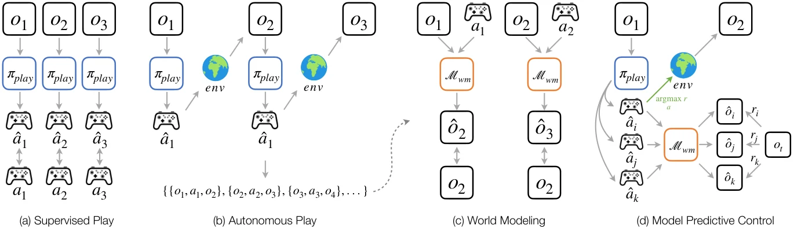

<!-- Generated by scripts/generate.py; edit data/works.json and data/media.json. -->

[← Back to the Awesome index](../../../README.md) · [Interactive website](https://chang-xinhai.github.io/Awesome-RGBDT-Manipulation/?collection=policy&item=dexterity-supervised-play#library)

# DSP: Dexterity from Supervised Play

Dexterity from Supervised Play

**2026-10-15 · arXiv preprint · Amazon FAR**

**[Paper](https://arxiv.org/abs/2610.22340)** · [Project](https://play-policy.github.io/) · [Code](https://github.com/FAR-hands/play_policy)

Learns a play policy from human interaction, then collects autonomous data for world-model planning.

*Dexterity Supervised Play authors; original rights retained. · [Figure source](https://arxiv.org/html/2610.22340v1) · Original rights retained.*

| Field | Reported value and source scope |
| :-- | :-- |
| Record type | policy |
| Policy family | Model-based planning [2](https://arxiv.org/html/2610.22340v1)  |
| Base model and architecture | Behavior-cloned play policy, action-conditioned world model and play-proposal MPC; exploratory goal-policy distillation. [2](https://arxiv.org/html/2610.22340v1)  |
| Model size and component | Not reported [2](https://arxiv.org/html/2610.22340v1)  |
| Deployment inputs | Robot state, tracked object pose and desired goal; visual-reorientation variant uses images. Real cube pose is tracked from camera-visible tags. [2](https://arxiv.org/html/2610.22340v1)  |
| Action outputs and horizon | Hand action sequences proposed by the play policy and selected/refined with MPC. [2](https://arxiv.org/html/2610.22340v1)  |
| Training method | Behavior cloning, autonomous play, dynamics prediction and MPC; self-play distillation is a separate acceleration study. [2](https://arxiv.org/html/2610.22340v1)  |
| Training data | Minutes of human play seed autonomous interaction; real-world world-model scaling study spans 0.5–5 hours. [2](https://arxiv.org/html/2610.22340v1)  |
| Training duration | Not reported [2](https://arxiv.org/html/2610.22340v1)  |
| Training hardware | Not reported [2](https://arxiv.org/html/2610.22340v1)  |
| Inference and control rates | Real closed-loop system 15–18 Hz; reported replan latency 134 ms on one RTX 5090. [2](https://arxiv.org/html/2610.22340v1)  |
| Evaluation scope | Push-T and in-hand reorientation; physical 22-commanded-joint Sharpa hand with ZED 2i cube tracking. [2](https://arxiv.org/html/2610.22340v1)  |
| Observations / modalities | RGB · Proprioception |
| Evaluation domain | Simulation · Real world |
| Embodiment | Dexterous hand |
| Release: code | Available [3](https://play-policy.github.io/) [4](https://github.com/FAR-hands/play_policy)  |
| Release: weights | Not verified [3](https://play-policy.github.io/) [4](https://github.com/FAR-hands/play_policy)  |
| Release: data | Not verified [3](https://play-policy.github.io/) [4](https://github.com/FAR-hands/play_policy)  |
| Release: license | Not reported — no repository license found [3](https://play-policy.github.io/) [4](https://github.com/FAR-hands/play_policy)  |
| Release: notes | Official linked repository includes play_policy, scripts, Isaac/Manus interfaces and quickstart material. Weights and data remain separate unverified artifacts. [3](https://play-policy.github.io/) [4](https://github.com/FAR-hands/play_policy)  |

**Scope and qualifications**

- Real and simulated tasks are separate settings; tag-based object pose is not a tactile signal.
- A public implementation repository is available, but a source-code license was not found in its root inventory.

**Primary evidence**

1. [Canonical author manuscript and arXiv submission history](https://arxiv.org/abs/2610.22340) — Date retains the initial v1 submission, independently of revisions or current artifact releases.
2. [Full author paper: method, observations and evaluation scope](https://arxiv.org/html/2610.22340v1) — Physical sensors, predicted signals, training labels and policy inputs are recorded separately; undisclosed quantities remain unknown.
3. [Official paper-linked project page; release review on 19 October 2026](https://play-policy.github.io/) — Current artifacts are checked separately from paper experiments. A project-only link is not proof of an implementation release.
4. [Official linked implementation and current file inventory](https://github.com/FAR-hands/play_policy) — Official linked repository includes play_policy, scripts, Isaac/Manus interfaces and quickstart material. Weights and data remain separate unverified artifacts.
