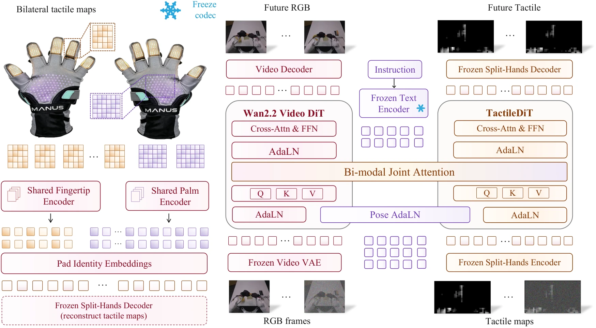

<!-- Generated by scripts/generate.py; edit data/works.json and data/media.json. -->

[← Back to the Awesome index](../../../README.md) · [Interactive website](https://chang-xinhai.github.io/Awesome-RGBDT-Manipulation/?collection=policy&item=dextouch-wm#library)

# DexTouch-WM

DexTouch-WM: Learning Action-Conditioned Tactile World Models from Human Touch for Dexterous Robot Manipulation

**2026-09-17 · Preprint · Xspark AI / HKUST (Guangzhou) / Tsinghua University / University of Hong Kong / Peking University**

**[Paper](https://arxiv.org/abs/2609.20649)**

An action-conditioned visual/tactile world model learns shared human/robot contact dynamics for policy evaluation and synthetic demonstration generation.

*DexTouch-WM: Learning Action-Conditioned Tactile World Models from Human Touch for Dexterous Robot Manipulation authors · [Figure source](https://arxiv.org/abs/2609.20649) · Original rights retained.*

| Field | Reported value and source scope |
| :-- | :-- |
| Record type | model |
| Model role and downstream interface | Action-conditioned visual/tactile predictive model; surrogate evaluator and synthetic-data generator, not standalone action policy. [1](https://arxiv.org/abs/2609.20649)  |
| Model family | World model [1](https://arxiv.org/abs/2609.20649)  |
| Model architecture | Pretrained video expert plus anatomy-aware tactile expert with aligned 67D pose conditioning. [1](https://arxiv.org/abs/2609.20649)  |
| Model size and component | Not reported [1](https://arxiv.org/abs/2609.20649)  |
| Model inputs | Initial RGB, bilateral tactile maps, language and a proposed future 67D retargeted wrist/hand/head pose sequence. [1](https://arxiv.org/abs/2609.20649)  |
| Model outputs | Future RGB and bilateral tactile predictions; downstream policies supply actions, so this is not itself an executable policy. [1](https://arxiv.org/abs/2609.20649)  |
| Training method | Human-to-robot dynamics pretraining; task-specific world-model adaptation; closed-loop imagined evaluation and synthetic-demonstration generation. [1](https://arxiv.org/abs/2609.20649)  |
| Training data and scale | 100 h human interaction over 50 tasks +5 h robot world-model pretraining over 6 tasks. Four disjoint downstream tasks have separately partitioned robot/human adaptation sets. [1](https://arxiv.org/abs/2609.20649)  |
| Training duration | Not reported [1](https://arxiv.org/abs/2609.20649)  |
| Training hardware | Not reported [1](https://arxiv.org/abs/2609.20649)  |
| Inference setting and runtime | Human glove recording 60 Hz; model/policy-evaluation throughput Not reported. [1](https://arxiv.org/abs/2609.20649)  |
| Downstream evaluation and scope | Held-out real-robot prediction; FTP-1/π0.5/X-VLA evaluated in model/real worlds and trained with generated demos on Place Shoes, Stack Bowls, Place Phone, Stand Bottle. [1](https://arxiv.org/abs/2609.20649)  |
| Observations / modalities | RGB · Tactile · Proprioception |
| Evaluation domain | Real world |
| Embodiment | Dexterous hand · Bimanual |
| Release: code | Not verified |
| Release: weights | Not verified |
| Release: data | Not verified |
| Release: license | Not verified |
| Release: notes | Original paper reviewed; claimed future releases are not treated as currently available. |

**Scope and qualifications**

- 67D action sequence is an input to the world model. Predicted observations condition separate policies.
- Human/robot adaptation and downstream policy-training splits are distinct; synthetic-data utility varies by policy and does not equal all-real training.

**Primary evidence**

1. [Original paper and supplementary implementation details](https://arxiv.org/abs/2609.20649) — Primary full text reviewed; dataset, deployment modalities and training-only privileges are scoped separately.
