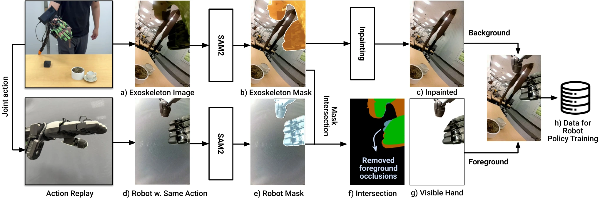

<!-- Generated by scripts/generate.py; edit data/works.json and data/media.json. -->

[← Back to the Awesome index](../../../README.md) · [Interactive website](https://chang-xinhai.github.io/Awesome-RGBDT-Manipulation/?collection=policy&item=dexumi#library)

# DexUMI

DexUMI: Using Human Hand as the Universal Manipulation Interface for Dexterous Manipulation

**2025-05-28 · Preprint · Not reported**

**[Paper](https://arxiv.org/abs/2505.21864)** · [Project](https://dex-umi.github.io/) · [Code](https://github.com/real-stanford/DexUMI)

Human-hand exoskeleton demonstrations and visual robot-hand replacement train dexterous manipulation policies.

*DexUMI: Using Human Hand as the Universal Manipulation Interface for Dexterous Manipulation authors · [Figure source](https://arxiv.org/abs/2505.21864) · Original rights retained.*

| Field | Reported value and source scope |
| :-- | :-- |
| Record type | policy |
| Policy family | Diffusion [1](https://arxiv.org/abs/2505.21864)  |
| Base model and architecture | Fine-tuned DINO-V2 image encoder and diffusion action policy. [1](https://arxiv.org/abs/2505.21864)  |
| Model size and component | Not reported [1](https://arxiv.org/abs/2505.21864)  |
| Deployment inputs | Wrist RGB and tactile readings. [1](https://arxiv.org/abs/2505.21864)  |
| Action outputs and horizon | 16-step end-effector relative pose/hand action chunks;6 D Inspire or 12 DX Hand hand commands. [1](https://arxiv.org/abs/2505.21864)  |
| Training method | Robot-hand image inpainting/embodiment alignment and 400 epoch diffusion imitation. [1](https://arxiv.org/abs/2505.21864)  |
| Training data | Human exoskeleton interaction demonstrations across two hand platforms; exact retained counts Not reported here. [1](https://arxiv.org/abs/2505.21864)  |
| Training duration | 400 epochs; wall-clock Not reported. [1](https://arxiv.org/abs/2505.21864)  |
| Training hardware | Not reported [1](https://arxiv.org/abs/2505.21864)  |
| Inference and control rates | Not reported [1](https://arxiv.org/abs/2505.21864)  |
| Evaluation scope | Real Inspire Hand and XHand dexterous tasks. [1](https://arxiv.org/abs/2505.21864)  |
| Observations / modalities | RGB · Tactile |
| Evaluation domain | Real world |
| Embodiment | Dexterous hand |
| Release: code | Available [2](https://dex-umi.github.io/) [3](https://github.com/real-stanford/DexUMI)  |
| Release: weights | Not verified [2](https://dex-umi.github.io/) [3](https://github.com/real-stanford/DexUMI)  |
| Release: data | Not verified [2](https://dex-umi.github.io/) [3](https://github.com/real-stanford/DexUMI)  |
| Release: license | MIT [2](https://dex-umi.github.io/) [3](https://github.com/real-stanford/DexUMI)  |
| Release: notes | Author-linked repository and actual LICENSE inspected; code, checkpoints anddatasets have independent availability. [2](https://dex-umi.github.io/) [3](https://github.com/real-stanford/DexUMI)  |

**Scope and qualifications**

- Collection hardware fits robot kinematics; cross-hand results do not mean one undifferentiated policy transfers without adaptation.

**Primary evidence**

1. [Original paper and supplementary implementation details](https://arxiv.org/abs/2505.21864) — Primary full text reviewed; dataset, deployment modalities and training-only privileges are scoped separately.
2. [Official author project](https://dex-umi.github.io/) — Live project artifact links inspected on2026-10-17.
3. [Official released implementation and LICENSE](https://github.com/real-stanford/DexUMI) — Repository metadata,README and actualLICENSE inspected; availability scoped to the listed component.
