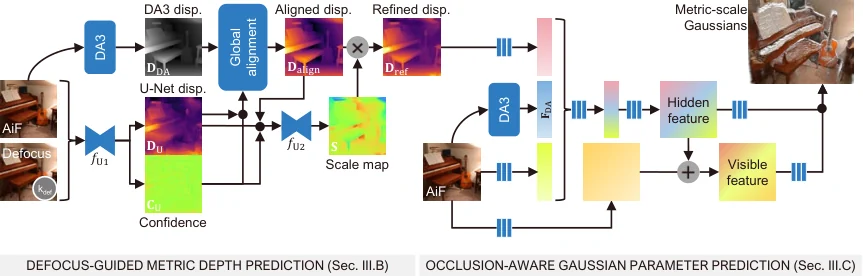

<!-- Generated by scripts/generate.py; edit data/works.json and data/media.json. -->

[← Back to the Awesome index](../../../README.md) · [Interactive website](https://chang-xinhai.github.io/Awesome-RGBDT-Manipulation/?collection=policy&item=dfd-gs#library)

# DfD-GS

DfD-GS: Defocus Image Prior for Metric-Scale Single-View Depth Estimation and View Synthesis

**2026-11-19 · Preprint · Keio University and University of Stuttgart**

**[Paper](https://arxiv.org/abs/2611.26072)**

Uses optical defocus as a metric cue for depth and Gaussian geometry from two images of the same viewpoint.

*Shiori Ueda and coauthors · [Figure source](https://arxiv.org/html/2611.26072v1) · Original rights retained.*

| Field | Reported value and source scope |
| :-- | :-- |
| Record type | model |
| Model role and downstream interface | Geometry perception model [1](https://arxiv.org/html/2611.26072v1)  |
| Model family | Single-view depth-from-defocus and Gaussian reconstruction [1](https://arxiv.org/html/2611.26072v1)  |
| Model architecture | Defocus-conditioned U-Net plus Gaussian reconstruction pipeline. [1](https://arxiv.org/html/2611.26072v1)  |
| Model size and component | Not reported [1](https://arxiv.org/html/2611.26072v1)  |
| Model inputs | All-in-focus and defocused images from the same view, plus known defocus strength. [1](https://arxiv.org/html/2611.26072v1)  |
| Model outputs | A metric-scale depth estimate and 3D Gaussians suitable for novel views. [1](https://arxiv.org/html/2611.26072v1)  |
| Training method | Predict defocus-aware disparity offsets, then use depth for metric Gaussian reconstruction. [1](https://arxiv.org/html/2611.26072v1)  |
| Training data and scale | Paper describes synthetic defocus generation and the experimental protocol. [1](https://arxiv.org/html/2611.26072v1)  |
| Training duration | Not reported [1](https://arxiv.org/html/2611.26072v1)  |
| Training hardware | Not reported [1](https://arxiv.org/html/2611.26072v1)  |
| Inference setting and runtime | Requires a defocus pair and defocus strength. Single viewpoint does not imply single-image RGB. [1](https://arxiv.org/html/2611.26072v1)  |
| Downstream evaluation and scope | Booster, Middlebury and WildRGB-D depth and novel-view experiments; input-generation conditions are described per dataset. [1](https://arxiv.org/html/2611.26072v1)  |
| Observations / modalities | RGB |
| Evaluation domain | Simulation · Real world |
| Embodiment |  |
| Release: code | Not verified |
| Release: weights | Not verified |
| Release: data | Not verified |
| Release: license | Not verified |
| Release: notes | Paper and examples available; executable release was not verified. |

**Scope and qualifications**

- Paired focus settings differ from stereo, time-of-flight and ordinary monocular depth models.

**Primary evidence**

1. [Original author paper or dataset description](https://arxiv.org/html/2611.26072v1)
