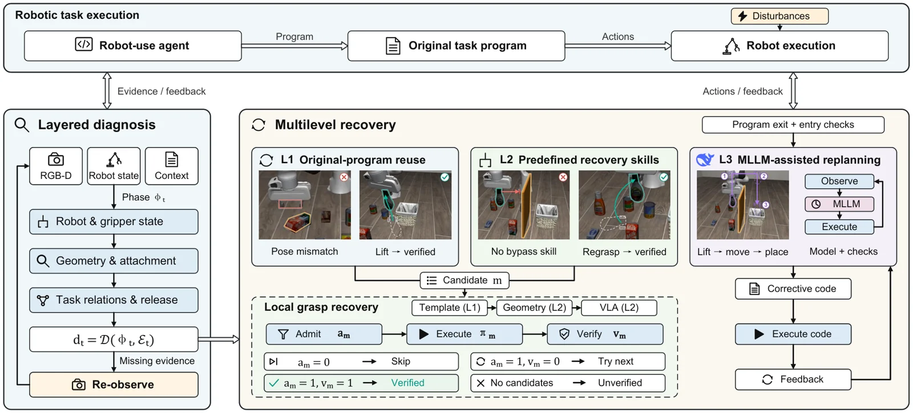

<!-- Generated by scripts/generate.py; edit data/works.json and data/media.json. -->

[← Back to the Awesome index](../../../README.md) · [Interactive website](https://chang-xinhai.github.io/Awesome-RGBDT-Manipulation/?collection=policy&item=dimure#library)

# DiMuRe / LIBERO-Disturb

DiMuRe: Diagnosis-Guided Multilevel Recovery for Robotic Task Execution

**2026-11-03 · Preprint · Beijing Institute of Technology**

**[Paper](https://arxiv.org/abs/2611.04226)**

An agent selects program reuse, local recovery skills, or corrective replanning under mid-execution disturbances.

*DiMuRe / LIBERO-Disturb authors · [Figure source](https://arxiv.org/abs/2611.04226) · Original rights retained.*

| Field | Reported value and source scope |
| :-- | :-- |
| Record type | policy |
| Policy family | Robot agent [1](https://arxiv.org/abs/2611.04226)  |
| Base model and architecture | Program reuse, bounded VLA and multimodal LLM replanning [1](https://arxiv.org/abs/2611.04226)  |
| Model size and component | Not reported [1](https://arxiv.org/abs/2611.04226)  |
| Deployment inputs | RGB-D, robot state, phase and execution feedback. [1](https://arxiv.org/abs/2611.04226)  |
| Action outputs and horizon | Reused program, recovery skills or corrected program. [1](https://arxiv.org/abs/2611.04226)  |
| Training method | Diagnosis-guided routing with bounded attempts; terminal corrective code generation. [1](https://arxiv.org/abs/2611.04226)  |
| Training data | No policy-weight training claimed for the recovery selector. [1](https://arxiv.org/abs/2611.04226)  |
| Training duration | Not reported [1](https://arxiv.org/abs/2611.04226)  |
| Training hardware | Not reported [1](https://arxiv.org/abs/2611.04226)  |
| Inference and control rates | Not reported [1](https://arxiv.org/abs/2611.04226)  |
| Evaluation scope | 801 Encore development cases: local 77.65% and full 81.90% complete-task success under differing budgets. [1](https://arxiv.org/abs/2611.04226)  |
| Observations / modalities | RGB · Depth · Proprioception · Language |
| Evaluation domain | Simulation |
| Embodiment | Not reported |
| Release: code | Not verified |
| Release: weights | Not verified |
| Release: data | Not verified |
| Release: license | Not verified |
| Release: notes | No official public code link verified in the original paper. |

**Scope and qualifications**

- The benchmark is simulated; full DiMuRe and local-only DiMuRe use different step allowances and handoff protocols.

**Primary evidence**

1. [Author paper or official project: methods and evaluation scope](https://arxiv.org/abs/2611.04226)
