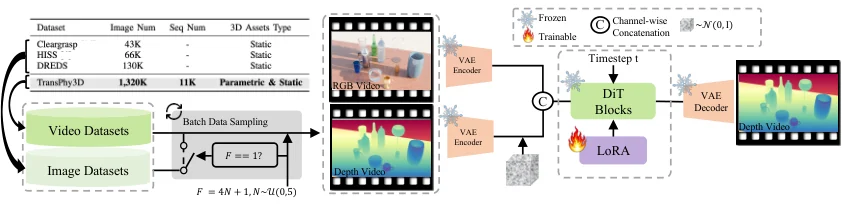

<!-- Generated by scripts/generate.py; edit data/works.json and data/media.json. -->

[← Back to the Awesome index](../../../README.md) · [Interactive website](https://chang-xinhai.github.io/Awesome-RGBDT-Manipulation/?collection=policy&item=dkt#library)

# DKT

Diffusion Knows Transparency: Repurposing Video Diffusion for Transparent Object Depth and Normal Estimation

**2025-12-29 · ICRA 2026 · Beijing Academy of Artificial Intelligence and collaborators**

**[Paper](https://arxiv.org/abs/2512.23705)** · [Project](https://daniellli.github.io/projects/DKT/) · [Code](https://github.com/Daniellli/DKT) · [Data](https://huggingface.co/datasets/Daniellesry/TransPhy3D) · [Weights](https://huggingface.co/Daniellesry/DKT-Depth-1-3B-v1.1)

Adapts a video diffusion model to predict temporally coherent relative depth and surface normals for transparent and reflective objects.

*DKT authors · [Figure source](https://arxiv.org/html/2512.23705v1) · Original rights retained.*

| Field | Reported value and source scope |
| :-- | :-- |
| Record type | model |
| Model role and downstream interface | Video depth and normals for transparent-object perception [1](https://arxiv.org/html/2512.23705)  |
| Model family | Video diffusion [1](https://arxiv.org/html/2512.23705)  |
| Model architecture | Pretrained video diffusion with LoRA [1](https://arxiv.org/html/2512.23705)  |
| Model size and component | Not reported [1](https://arxiv.org/html/2512.23705)  |
| Model inputs | RGB images or a video sequence. [1](https://arxiv.org/html/2512.23705)  |
| Model outputs | Relative depth or surface normals, depending on checkpoint. [1](https://arxiv.org/html/2512.23705)  |
| Training method | Adapts video diffusion with depth/normal supervision and synthetic material-aware video. [1](https://arxiv.org/html/2512.23705)  |
| Training data and scale | TransPhy3D clips plus synthetic images from HISS, DREDS and ClearGrasp. [1](https://arxiv.org/html/2512.23705)  |
| Training duration | Not reported [1](https://arxiv.org/html/2512.23705)  |
| Training hardware | Not reported [1](https://arxiv.org/html/2512.23705)  |
| Inference setting and runtime | Denoising in shared video latent space; calibrate depth separately where a metric point cloud is required. [1](https://arxiv.org/html/2512.23705)  |
| Downstream evaluation and scope | Image and video depth/normal comparisons plus physical transparent-object grasping. [1](https://arxiv.org/html/2512.23705)  |
| Observations / modalities | RGB |
| Evaluation domain | Simulation · Real world |
| Embodiment | Dual PiPER arms (grasping evaluation) |
| Release: code | Available — model loading, inference utilities and demos [2](https://daniellli.github.io/projects/DKT/) [3](https://github.com/Daniellli/DKT) [4](https://huggingface.co/Daniellesry/DKT-Depth-1-3B-v1.1)  |
| Release: weights | Available — verified 1.3B depth LoRA checkpoint; see model collection for other variants [2](https://daniellli.github.io/projects/DKT/) [3](https://github.com/Daniellli/DKT) [4](https://huggingface.co/Daniellesry/DKT-Depth-1-3B-v1.1)  |
| Release: data | Available — TransPhy3D synthetic RGB/depth/normal dataset [2](https://daniellli.github.io/projects/DKT/) [3](https://github.com/Daniellli/DKT) [4](https://huggingface.co/Daniellesry/DKT-Depth-1-3B-v1.1)  |
| Release: license | Apache-2.0 repository and published 1.3B LoRA/TransPhy3D cards; upstream model terms remain separate [2](https://daniellli.github.io/projects/DKT/) [3](https://github.com/Daniellli/DKT) [4](https://huggingface.co/Daniellesry/DKT-Depth-1-3B-v1.1)  |
| Release: notes | Verified actual inference source, model safetensors and dataset archives. [2](https://daniellli.github.io/projects/DKT/) [3](https://github.com/Daniellli/DKT) [4](https://huggingface.co/Daniellesry/DKT-Depth-1-3B-v1.1)  |

**Scope and qualifications**

- Video diffusion produces inferred relative geometry. Real-robot grasping calibrates the output to metric scale with AprilTags before point-cloud grasp generation.
- The paper’s longer-video inference claim is separate from online causal streaming performance.

**Primary evidence**

1. [Primary paper and evaluated setting](https://arxiv.org/html/2512.23705)
2. [Author project and artifact status](https://daniellli.github.io/projects/DKT/)
3. [Official repository and public artifact inventory](https://github.com/Daniellli/DKT) — Apache-2.0 LICENSE and inference/demo files.
4. [Official repository and public artifact inventory](https://huggingface.co/Daniellesry/DKT-Depth-1-3B-v1.1) — Public depth LoRA safetensors file.
5. [Official repository and public artifact inventory](https://huggingface.co/datasets/Daniellesry/TransPhy3D) — Public synthetic dataset tar archives and loader.
