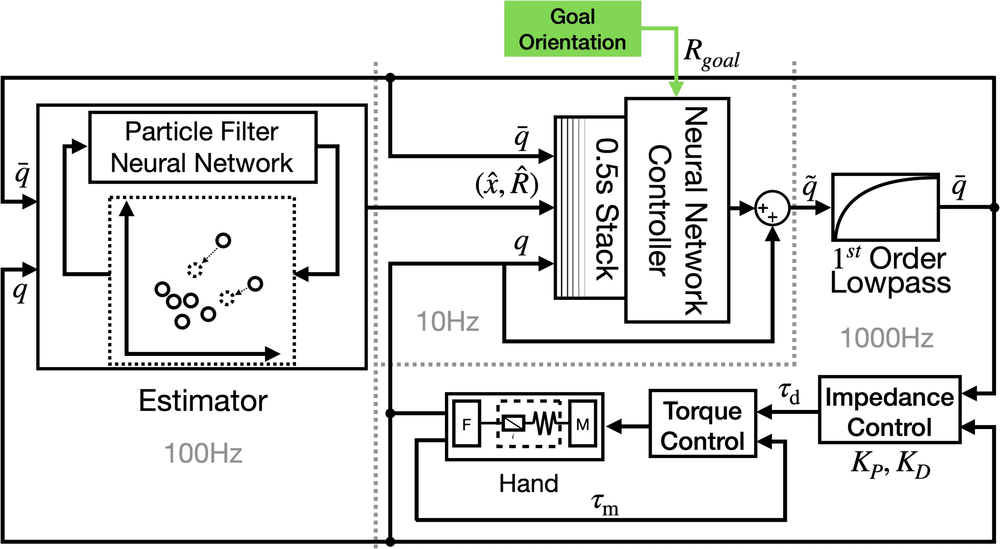

<!-- Generated by scripts/generate.py; edit data/works.json and data/media.json. -->

[← Back to the Awesome index](../../../README.md) · [Interactive website](https://chang-xinhai.github.io/Awesome-RGBDT-Manipulation/?collection=policy&item=dlr-modular-reorientation#library)

# DLR Modular Reorientation

Dextrous Tactile In-Hand Manipulation Using a Modular Reinforcement Learning Architecture

**2023-03-08 · Preprint · German Aerospace Center (DLR)**

**[Paper](https://arxiv.org/abs/2303.04705)** · [Project](https://dlr-alr.github.io/dlr-tactile-manipulation)

A modular policy and differentiable particle filter enable tactile goal-conditioned cube reorientation.

*Dextrous Tactile In-Hand Manipulation Using a Modular Reinforcement Learning Architecture authors · [Figure source](https://arxiv.org/abs/2303.04705) · Original rights retained.*

| Field | Reported value and source scope |
| :-- | :-- |
| Record type | policy |
| Policy family | RL [1](https://arxiv.org/abs/2303.04705)  |
| Base model and architecture | Small RL control policy plus D2P2 F differentiable particle filter. [1](https://arxiv.org/abs/2303.04705)  |
| Model size and component | Not reported [1](https://arxiv.org/abs/2303.04705)  |
| Deployment inputs | Joint measurements and estimated object state/goal orientation. [1](https://arxiv.org/abs/2303.04705)  |
| Action outputs and horizon | DLR Hand II target joint commands. [1](https://arxiv.org/abs/2303.04705)  |
| Training method | Staged policy/estimator learning and iterative estimator-in-the-loop fine-tuning. [1](https://arxiv.org/abs/2303.04705)  |
| Training data | Simulation rollouts for policy/state estimator training; exact budget Not reported. [1](https://arxiv.org/abs/2303.04705)  |
| Training duration | Not reported [1](https://arxiv.org/abs/2303.04705)  |
| Training hardware | Not reported [1](https://arxiv.org/abs/2303.04705)  |
| Inference and control rates | Not reported [1](https://arxiv.org/abs/2303.04705)  |
| Evaluation scope | Palm-down cube reorientation to 24 quarter-turn goals without cameras. [1](https://arxiv.org/abs/2303.04705)  |
| Observations / modalities | Force/Torque · Proprioception |
| Evaluation domain | Simulation · Real world |
| Embodiment | Dexterous hand |
| Release: code | Not verified [2](https://dlr-alr.github.io/dlr-tactile-manipulation)  |
| Release: weights | Not verified [2](https://dlr-alr.github.io/dlr-tactile-manipulation)  |
| Release: data | Not verified [2](https://dlr-alr.github.io/dlr-tactile-manipulation)  |
| Release: license | Not verified [2](https://dlr-alr.github.io/dlr-tactile-manipulation)  |
| Release: notes | Original paper reviewed; claimed future releases are not treated as currently available. [2](https://dlr-alr.github.io/dlr-tactile-manipulation)  |

**Scope and qualifications**

- Object state is estimated from joint/contact feedback; ground truth state used in train simulation is not runtime observation.

**Primary evidence**

1. [Original paper and supplementary implementation details](https://arxiv.org/abs/2303.04705) — Primary full text reviewed; dataset, deployment modalities and training-only privileges are scoped separately.
2. [Official author project](https://dlr-alr.github.io/dlr-tactile-manipulation) — Live project artifact links inspected on2026-10-17.
