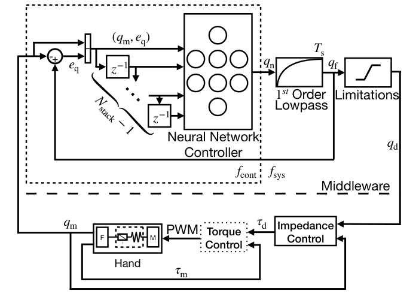

<!-- Generated by scripts/generate.py; edit data/works.json and data/media.json. -->

[← Back to the Awesome index](../../../README.md) · [Interactive website](https://chang-xinhai.github.io/Awesome-RGBDT-Manipulation/?collection=policy&item=dlr-pure-torque-rotation#library)

# DLR Torque-Only Rotation

Learning Purely Tactile In-Hand Manipulation with a Torque-Controlled Hand

**2022-04-07 · Preprint · German Aerospace Center (DLR) / Deggendorf Institute of Technology**

**[Paper](https://arxiv.org/abs/2204.03698)** · [Project](https://dlr-alr.github.io/dlr-tactile-manipulation)

Torque/proprioceptive feedback supports palm-down continuous in-hand rotation without cameras.

*Learning Purely Tactile In-Hand Manipulation with a Torque-Controlled Hand authors · [Figure source](https://arxiv.org/abs/2204.03698) · Original rights retained.*

| Field | Reported value and source scope |
| :-- | :-- |
| Record type | policy |
| Policy family | RL [1](https://arxiv.org/abs/2204.03698)  |
| Base model and architecture | SAC policy trained in identified rigid-body simulation with gravity/filter curriculum. [1](https://arxiv.org/abs/2204.03698)  |
| Model size and component | Not reported [1](https://arxiv.org/abs/2204.03698)  |
| Deployment inputs | Hand joint position/torque measurements; no vision or skin array. [1](https://arxiv.org/abs/2204.03698)  |
| Action outputs and horizon | Target hand joint angles through impedance control. [1](https://arxiv.org/abs/2204.03698)  |
| Training method | Off-policy SAC with domain adapted curriculum andsim-to-real transfer. [1](https://arxiv.org/abs/2204.03698)  |
| Training data | Simulated RL interactions; not reported as a demonstration dataset. [1](https://arxiv.org/abs/2204.03698)  |
| Training duration | Not reported [1](https://arxiv.org/abs/2204.03698)  |
| Training hardware | Not reported [1](https://arxiv.org/abs/2204.03698)  |
| Inference and control rates | 10 Hz policy,1000 Hz real impedance/filtered control;500 Hz simulator loop. [1](https://arxiv.org/abs/2204.03698)  |
| Evaluation scope | DLR Hand II palm-down cube rotation with permanent force closure. [1](https://arxiv.org/abs/2204.03698)  |
| Observations / modalities | Force/Torque · Proprioception |
| Evaluation domain | Simulation · Real world |
| Embodiment | Dexterous hand |
| Release: code | Not verified [2](https://dlr-alr.github.io/dlr-tactile-manipulation)  |
| Release: weights | Not verified [2](https://dlr-alr.github.io/dlr-tactile-manipulation)  |
| Release: data | Not verified [2](https://dlr-alr.github.io/dlr-tactile-manipulation)  |
| Release: license | Not verified [2](https://dlr-alr.github.io/dlr-tactile-manipulation)  |
| Release: notes | Original paper reviewed; claimed future releases are not treated as currently available. [2](https://dlr-alr.github.io/dlr-tactile-manipulation)  |

**Scope and qualifications**

- Paper calls this purely tactile, but observations are joint torque/position, not cutaneous skin measurements.

**Primary evidence**

1. [Original paper and supplementary implementation details](https://arxiv.org/abs/2204.03698) — Primary full text reviewed; dataset, deployment modalities and training-only privileges are scoped separately.
2. [Official author project](https://dlr-alr.github.io/dlr-tactile-manipulation) — Live project artifact links inspected on2026-10-17.
