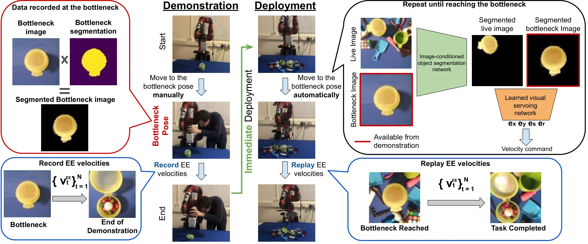

<!-- Generated by scripts/generate.py; edit data/works.json and data/media.json. -->

[← Back to the Awesome index](../../../README.md) · [Interactive website](https://chang-xinhai.github.io/Awesome-RGBDT-Manipulation/?collection=policy&item=dome#library)

# DOME

Demonstrate Once, Imitate Immediately (DOME): Learning Visual Servoing for One-Shot Imitation Learning

**2022-04-06 · IROS 2022 · Imperial College London**

**[Paper](https://arxiv.org/abs/2204.02863)** · [Project](https://www.robot-learning.uk/dome)

A learned segmentation and image-servoing system reaches the demonstrated bottleneck pose, then replays end-effector velocities.

*DOME authors · [Figure source](https://arxiv.org/html/2204.02863) · Original rights retained.*

| Field | Reported value and source scope |
| :-- | :-- |
| Record type | policy |
| Policy family | Geometric transfer [1](https://arxiv.org/abs/2204.02863)  |
| Base model and architecture | Learned visual alignment and trajectory replay. Image-conditioned segmentation network and learned relative-pose visual-servo network. [1](https://arxiv.org/abs/2204.02863)  |
| Model size and component | Not reported [1](https://arxiv.org/abs/2204.02863)  |
| Deployment inputs | Wrist RGB image and bottleneck reference from one demonstration; recorded end-effector velocities. [1](https://arxiv.org/abs/2204.02863)  |
| Action outputs and horizon | Servo corrections to the bottleneck, then open-loop velocity replay. [1](https://arxiv.org/abs/2204.02863)  |
| Training method | Supervised synthetic segmentation and pose-regression pretraining; frozen deployment on unseen objects. [1](https://arxiv.org/abs/2204.02863)  |
| Training data | Task-independent synthetic Blender/BlenderProc scenes with ShapeNet/ModelNet40 objects and randomized lighting, distractors and appearance. [1](https://arxiv.org/abs/2204.02863)  |
| Training duration | No additional training after the target demonstration; offline pretraining duration not reported. [1](https://arxiv.org/abs/2204.02863)  |
| Training hardware | Not reported [1](https://arxiv.org/abs/2204.02863)  |
| Inference and control rates | Not reported [1](https://arxiv.org/abs/2204.02863)  |
| Evaluation scope | Seven everyday physical tasks, 30 predetermined object poses per task, half with distractors. [1](https://arxiv.org/abs/2204.02863)  |
| Observations / modalities | RGB · Proprioception |
| Evaluation domain | Real world |
| Embodiment | Parallel-jaw gripper |
| Release: code | Not verified [2](https://www.robot-learning.uk/dome)  |
| Release: weights | Not verified [2](https://www.robot-learning.uk/dome)  |
| Release: data | Not verified [2](https://www.robot-learning.uk/dome)  |
| Release: license | Not verified [2](https://www.robot-learning.uk/dome)  |
| Release: notes | No author-linked implementation was verified in the inspected primary manuscript/project. This is an evidence gap, not proof that no implementation exists. [2](https://www.robot-learning.uk/dome)  |

**Scope and qualifications**

- No post-demonstration training does not mean the perception/servoing modules were never pretrained.
- Interaction after alignment is open-loop replay and does not provide contact-feedback correction.

**Primary evidence**

1. [Original manuscript and first submission history](https://arxiv.org/abs/2204.02863) — Original method, evaluation and available implementation/appendix sections inspected. The survey is discovery evidence only.
2. [Official project](https://www.robot-learning.uk/dome) — Author-linked source. Component and artifact release terms may differ.
