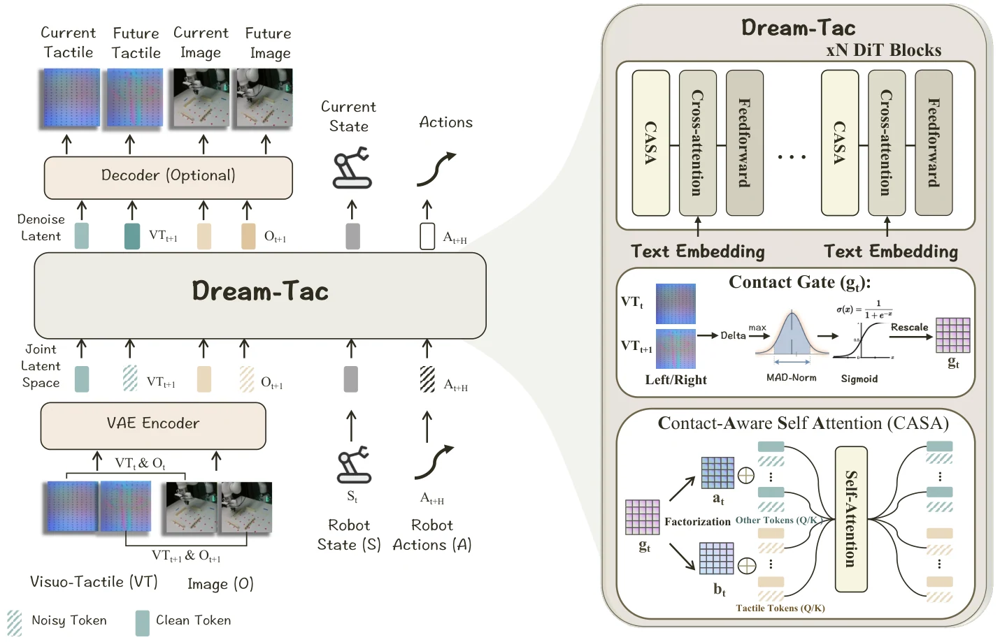

<!-- Generated by scripts/generate.py; edit data/works.json and data/media.json. -->

[← Back to the Awesome index](../../../README.md) · [Interactive website](https://chang-xinhai.github.io/Awesome-RGBDT-Manipulation/?collection=policy&item=dream-tac#library)

# Dream-Tac

Dream-Tac: A Unified Tactile World Action Model for Contact-Rich Robot Manipulation

**2026-06-07 · Preprint · Not reported**

**[Paper](https://arxiv.org/abs/2606.08737)** · [Code](https://github.com/LYFCLOUDFAN/Dream-Tac)

Joint video/contact/action modeling with contact-gated tactile attention and diffusion-step caching.

*Dream-Tac authors · [Figure source](https://arxiv.org/html/2606.08737) · Original rights retained.*

| Field | Reported value and source scope |
| :-- | :-- |
| Record type | policy |
| Policy family | World-action model [1](https://arxiv.org/abs/2606.08737)  |
| Base model and architecture | Cosmos-Predict2-2B Video2World [1](https://arxiv.org/abs/2606.08737) [3](https://arxiv.org/html/2606.08737)  |
| Model size and component | 2B video backbone component; total policy size not reported [1](https://arxiv.org/abs/2606.08737) [3](https://arxiv.org/html/2606.08737)  |
| Deployment inputs | First-/third-person RGB, tactile images, proprioception and language [1](https://arxiv.org/abs/2606.08737) [3](https://arxiv.org/html/2606.08737)  |
| Action outputs and horizon | 20-step actions plus future visual/tactile predictions [1](https://arxiv.org/abs/2606.08737) [3](https://arxiv.org/html/2606.08737)  |
| Training method | Joint latent denoising with contact-aware logit bias and cached denoising [1](https://arxiv.org/abs/2606.08737) [3](https://arxiv.org/html/2606.08737)  |
| Training data | 100 demonstrations for each of six real tasks [1](https://arxiv.org/abs/2606.08737) [3](https://arxiv.org/html/2606.08737)  |
| Training duration | Warmup 2k updates; schedule beyond 20k; total wall-clock not reported [1](https://arxiv.org/abs/2606.08737) [3](https://arxiv.org/html/2606.08737)  |
| Training hardware | 8 NVIDIA H100 GPUs; attention microbenchmark additionally measured on H200 [1](https://arxiv.org/abs/2606.08737) [3](https://arxiv.org/html/2606.08737)  |
| Inference and control rates | Uncached 10-step inference ≈5 Hz on A800; cache reduces full evaluations to two; data 30 Hz [1](https://arxiv.org/abs/2606.08737) [3](https://arxiv.org/html/2606.08737)  |
| Evaluation scope | Peel Cucumber, Cut Banana, Insert USB, Play Mahjong, Pick and Place, Clean Whiteboard [1](https://arxiv.org/abs/2606.08737) [3](https://arxiv.org/html/2606.08737)  |
| Observations / modalities | RGB · Tactile · Proprioception · Language |
| Evaluation domain | Real world |
| Embodiment | Parallel-jaw gripper |
| Release: code | Available [2](https://github.com/LYFCLOUDFAN/Dream-Tac)  |
| Release: weights | Available [2](https://github.com/LYFCLOUDFAN/Dream-Tac)  |
| Release: data | Not verified [2](https://github.com/LYFCLOUDFAN/Dream-Tac)  |
| Release: license | Not verified [2](https://github.com/LYFCLOUDFAN/Dream-Tac)  |
| Release: notes | Official repository contains training/inference and model download instructions. [2](https://github.com/LYFCLOUDFAN/Dream-Tac)  |

**Scope and qualifications**

- Changing tactile-pixel magnitude controls the contact gate; cross-sensor calibration matters.
- 5 Hz is uncached model inference, not the low-level actuation rate.

**Primary evidence**

1. [Author manuscript and submission history](https://arxiv.org/abs/2606.08737) — Policy facts refer to the full manuscript available on the verification date; date is first arXiv submission.
2. [Official repository](https://github.com/LYFCLOUDFAN/Dream-Tac) — Release status is checked separately from paper claims; a project page alone does not imply released implementation or weights.
3. [Full paper: method and implementation details](https://arxiv.org/html/2606.08737) — Unreported specifications remain explicitly unknown; hardware/rates are scoped to training, inference or low-level control.
