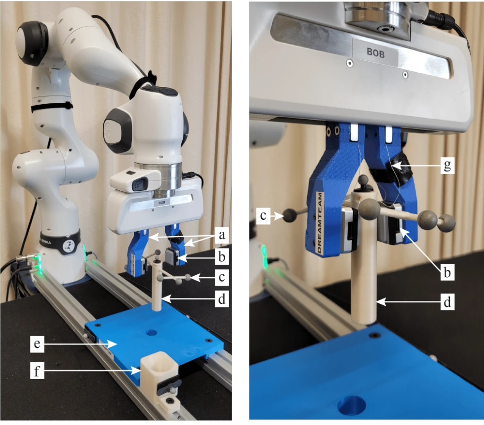

<!-- Generated by scripts/generate.py; edit data/works.json and data/media.json. -->

[← Back to the Awesome index](../../../README.md) · [Interactive website](https://chang-xinhai.github.io/Awesome-RGBDT-Manipulation/?collection=policy&item=dreamer-tactile-insertion#library)

# Dreamer Tactile Insertion

Learning Tactile Insertion in the Real World

**2024-05-01 · Preprint · Technical University of Darmstadt**

**[Paper](https://arxiv.org/abs/2405.00383)**

Dreamer-v 3 learns a tactile insertion controller from scratch directly on a physical robot.

*Daniel Palenicek et al., Learning Tactile Insertion in the Real World, Figure 1 (arXiv v2). Original rights retained. · [Figure source](https://arxiv.org/abs/2405.00383) · Original rights retained.*

| Field | Reported value and source scope |
| :-- | :-- |
| Record type | policy |
| Policy family | RL [1](https://arxiv.org/abs/2405.00383)  |
| Base model and architecture | Dreamer-v 3 latent world model and actor–critic. [1](https://arxiv.org/abs/2405.00383)  |
| Model size and component | Not reported [1](https://arxiv.org/abs/2405.00383)  |
| Deployment inputs | 64×64 Gel Sight Mini image and 3 Dend-effector position; no external vision required. [1](https://arxiv.org/abs/2405.00383)  |
| Action outputs and horizon | Relative end-effector position targets. [1](https://arxiv.org/abs/2405.00383)  |
| Training method | Model-based RL from scratch with restricted work space and autonomous resets. [1](https://arxiv.org/abs/2405.00383)  |
| Training data | Autonomous real/simulation interaction with reset procedure; exact step budget Not reported here. [1](https://arxiv.org/abs/2405.00383)  |
| Training duration | Not reported [1](https://arxiv.org/abs/2405.00383)  |
| Training hardware | Not reported [1](https://arxiv.org/abs/2405.00383)  |
| Inference and control rates | Tactile/state observations 25 Hz, policy position targets 20 Hz. [1](https://arxiv.org/abs/2405.00383)  |
| Evaluation scope | Franka Research 3 tactile peg-in-hole insertion under partial observability. [1](https://arxiv.org/abs/2405.00383)  |
| Observations / modalities | Tactile · Proprioception |
| Evaluation domain | Simulation · Real world |
| Embodiment | Parallel-jaw gripper |
| Release: code | Not verified |
| Release: weights | Not verified |
| Release: data | Not verified |
| Release: license | Not verified |
| Release: notes | Original paper reviewed; claimed future releases are not treated as currently available. |

**Scope and qualifications**

- Safety work space and reset infrastructure are essential experimental conditions, not a general unconstrained RL system.

**Primary evidence**

1. [Original paper and supplementary implementation details](https://arxiv.org/abs/2405.00383) — Primary full text reviewed; dataset, deployment modalities and training-only privileges are scoped separately.
