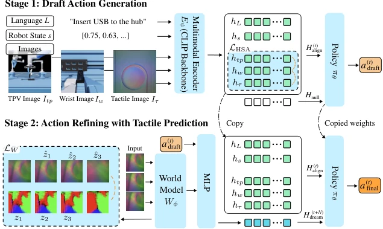

<!-- Generated by scripts/generate.py; edit data/works.json and data/media.json. -->

[← Back to the Awesome index](../../../README.md) · [Interactive website](https://chang-xinhai.github.io/Awesome-RGBDT-Manipulation/?collection=policy&item=dreamtacvla#library)

# DreamTacVLA

Learning to Feel the Future: DreamTacVLA for Contact-Rich Manipulation

**2025-12-29 · Preprint · Northwestern University**

**[Paper](https://arxiv.org/abs/2512.23864)** · [Project](https://michaelyeah7.github.io/learning-to-feel-the-future/) · [Code](https://github.com/michaelyeah7/learning-to-feel-the-future) · [Data](https://huggingface.co/datasets/michaelyeah7/dobot_xtrainer_tac_1107) · [Weights](https://huggingface.co/michaelyeah7/dreamtacvla)

Spatially aligned visual/tactile observations and predicted future touch refine a draft manipulation action.

*Learning to Feel the Future: DreamTacVLA for Contact-Rich Manipulation authors · [Figure source](https://arxiv.org/abs/2512.23864) · Original rights retained.*

| Field | Reported value and source scope |
| :-- | :-- |
| Record type | policy |
| Policy family | World-action model [1](https://arxiv.org/abs/2512.23864)  |
| Base model and architecture | Hierarchical spatial alignment; frozen V-JEPA2 tactile world model plus residual adapter; draft/final action policy. [1](https://arxiv.org/abs/2512.23864)  |
| Model size and component | ViT-L tactile encoder 300 M frozen; main text says 5.5 M trainable adapter, appendix ~1.5 M per tactile encoder; full policy size Not reported. [1](https://arxiv.org/abs/2512.23864)  |
| Deployment inputs | Third-person RGB, wrist RGB, tactile images and robot state; language described in the conceptual framework. [1](https://arxiv.org/abs/2512.23864)  |
| Action outputs and horizon | Draft action, predicted tactile contact latent and refined final action chunks. [1](https://arxiv.org/abs/2512.23864)  |
| Training method | Two-stage spatial alignment / policy learning followed by tactile-prediction-conditioned refinement; appendix describes CVAE action chunking. [1](https://arxiv.org/abs/2512.23864)  |
| Training data | Main text reports 1,000 simulation demonstrations/task and 100 real demonstrations/task for four tasks, while separately describing an 80/20 mixture; these statements are not arithmetically reconciled. [1](https://arxiv.org/abs/2512.23864)  |
| Training duration | Typical 20,000-step training run 8–12 h, depending on unspecified GPU/dataset. [1](https://arxiv.org/abs/2512.23864)  |
| Training hardware | Single NVIDIA GPU; GPU model Not reported. [1](https://arxiv.org/abs/2512.23864)  |
| Inference and control rates | Appendix simulation experts resampled at 30 Hz; separate inference paragraph says 50 Hz. Conditions are not conflated. [1](https://arxiv.org/abs/2512.23864)  |
| Evaluation scope | Dobot XTrainer with two GelSight sensors; Isaac Sim digital twin; peg-in-hole, USB insertion, gear assembly and tool stabilization. [1](https://arxiv.org/abs/2512.23864)  |
| Observations / modalities | RGB · Tactile · Proprioception |
| Evaluation domain | Simulation · Real world |
| Embodiment | Parallel-jaw gripper |
| Release: code | Available [2](https://michaelyeah7.github.io/learning-to-feel-the-future/) [3](https://github.com/michaelyeah7/learning-to-feel-the-future) [4](https://huggingface.co/michaelyeah7/dreamtacvla)  |
| Release: weights | Available [2](https://michaelyeah7.github.io/learning-to-feel-the-future/) [3](https://github.com/michaelyeah7/learning-to-feel-the-future) [4](https://huggingface.co/michaelyeah7/dreamtacvla)  |
| Release: data | Available [2](https://michaelyeah7.github.io/learning-to-feel-the-future/) [3](https://github.com/michaelyeah7/learning-to-feel-the-future) [4](https://huggingface.co/michaelyeah7/dreamtacvla)  |
| Release: license | MIT [2](https://michaelyeah7.github.io/learning-to-feel-the-future/) [3](https://github.com/michaelyeah7/learning-to-feel-the-future) [4](https://huggingface.co/michaelyeah7/dreamtacvla)  |
| Release: notes | Author-linked repository and actual LICENSE inspected; code, checkpoints anddatasets have independent availability. [2](https://michaelyeah7.github.io/learning-to-feel-the-future/) [3](https://github.com/michaelyeah7/learning-to-feel-the-future) [4](https://huggingface.co/michaelyeah7/dreamtacvla)  |

**Scope and qualifications**

- Initial public paper is December 2025, despite a later 2026 revision/citation in discovery lists.
- Manuscript contains conflicting dataset-ratio, adapter-size and control-frequency statements; these are recorded instead of selecting one silently.
- Conceptual VLA language conditioning and appendix CVAE/action-chunk implementation are not assumed to be an off-the-shelf pretrained LLM.

**Primary evidence**

1. [Original paper and supplementary implementation details](https://arxiv.org/abs/2512.23864) — Primary full text reviewed; dataset, deployment modalities and training-only privileges are scoped separately.
2. [Official author project](https://michaelyeah7.github.io/learning-to-feel-the-future/) — Live project artifact links inspected on2026-10-17.
3. [Official released implementation and LICENSE](https://github.com/michaelyeah7/learning-to-feel-the-future) — Repository metadata,README and actualLICENSE inspected; availability scoped to the listed component.
4. [Author-linked released model](https://huggingface.co/michaelyeah7/dreamtacvla) — Public repository file inventory inspected; component/data scope follows model/dataset card.
5. [Author-linked released dataset](https://huggingface.co/datasets/michaelyeah7/dobot_xtrainer_tac_1107) — Public repository file inventory inspected; component/data scope follows model/dataset card.
