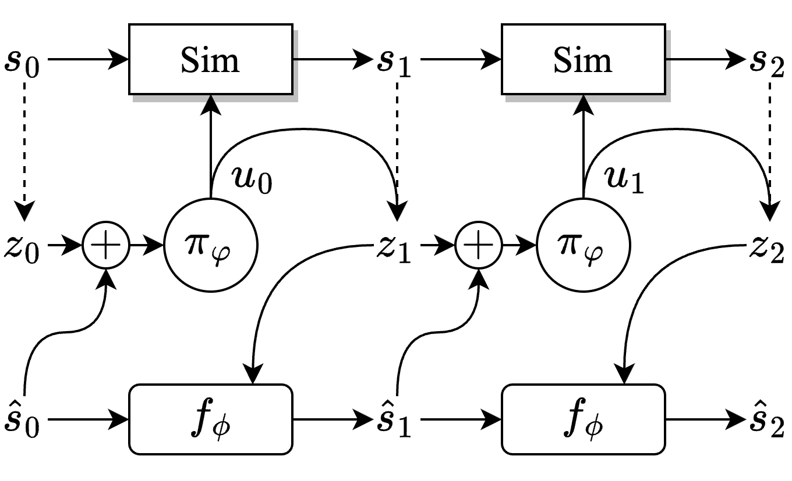

<!-- Generated by scripts/generate.py; edit data/works.json and data/media.json. -->

[← Back to the Awesome index](../../../README.md) · [Interactive website](https://chang-xinhai.github.io/Awesome-RGBDT-Manipulation/?collection=policy&item=ecrl#library)

# EcRL

Estimator-Coupled Reinforcement Learning for Robust Purely Tactile In-Hand Manipulation

**2023-11-07 · Preprint · DLR / Technical University of Munich / Deggendorf Institute of Technology**

**[Paper](https://arxiv.org/abs/2311.04060)** · [Project](https://dlr-alr.github.io/dlr-tactile-manipulation)

Estimator-coupled reinforcement learning co-trains tactile pose inference and control to reduce sim-to-real estimation failures.

*Estimator-Coupled Reinforcement Learning for Robust Purely Tactile In-Hand Manipulation authors · [Figure source](https://arxiv.org/abs/2311.04060) · Original rights retained.*

| Field | Reported value and source scope |
| :-- | :-- |
| Record type | policy |
| Policy family | RL [1](https://arxiv.org/abs/2311.04060)  |
| Base model and architecture | PPO actor and supervised recurrent state estimator trained together. [1](https://arxiv.org/abs/2311.04060)  |
| Model size and component | Not reported [1](https://arxiv.org/abs/2311.04060)  |
| Deployment inputs | Hand joint positions/control errors and estimated object pose/goal. [1](https://arxiv.org/abs/2311.04060)  |
| Action outputs and horizon | 12 DLR Hand II joint targets. [1](https://arxiv.org/abs/2311.04060)  |
| Training method | Alternating on-policy RL and supervised estimator updates with ground truth-state curriculum. [1](https://arxiv.org/abs/2311.04060)  |
| Training data | 4096 parallel Isaac simulation environments; new rollouts jointly update estimator and policy. [1](https://arxiv.org/abs/2311.04060)  |
| Training duration | Median 6.5 h convergence per object;~95%final performance after 5 h. [1](https://arxiv.org/abs/2311.04060)  |
| Training hardware | Single NVIDIA T4. [1](https://arxiv.org/abs/2311.04060)  |
| Inference and control rates | 10 Hz policy/estimator;60 Hz stacked measurements;1000 Hz impedance controller. [1](https://arxiv.org/abs/2311.04060)  |
| Evaluation scope | Palm-down goal-conditioned reorientation of several objects on DLR Hand II. [1](https://arxiv.org/abs/2311.04060)  |
| Observations / modalities | Force/Torque · Proprioception |
| Evaluation domain | Simulation · Real world |
| Embodiment | Dexterous hand |
| Release: code | Not verified [2](https://dlr-alr.github.io/dlr-tactile-manipulation)  |
| Release: weights | Not verified [2](https://dlr-alr.github.io/dlr-tactile-manipulation)  |
| Release: data | Not verified [2](https://dlr-alr.github.io/dlr-tactile-manipulation)  |
| Release: license | Not verified [2](https://dlr-alr.github.io/dlr-tactile-manipulation)  |
| Release: notes | Original paper reviewed; claimed future releases are not treated as currently available. [2](https://dlr-alr.github.io/dlr-tactile-manipulation)  |

**Scope and qualifications**

- Tactile inference comes from joint position/control error; no skin tactile array.

**Primary evidence**

1. [Original paper and supplementary implementation details](https://arxiv.org/abs/2311.04060) — Primary full text reviewed; dataset, deployment modalities and training-only privileges are scoped separately.
2. [Official author project](https://dlr-alr.github.io/dlr-tactile-manipulation) — Live project artifact links inspected on2026-10-17.
