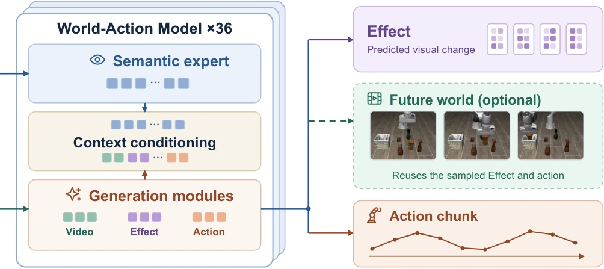

<!-- Generated by scripts/generate.py; edit data/works.json and data/media.json. -->

[← Back to the Awesome index](../../../README.md) · [Interactive website](https://chang-xinhai.github.io/Awesome-RGBDT-Manipulation/?collection=policy&item=effectwam#library)

# EffectWAM

EffectWAM: Learning Action-Grounded Effects for Robot Manipulation

**2026-11-24 · Preprint · iFLYTEK and collaborators**

**[Paper](https://arxiv.org/abs/2611.32053)** · [Weights](https://huggingface.co/haocui/xx-wam-mem-0.5-preview)

Predicts action-grounded visual change alongside executable robot controls and renders future video optionally after action generation.

*Yuan Zhang and coauthors · [Figure source](https://arxiv.org/html/2611.32053v2) · Original rights retained.*

| Field | Reported value and source scope |
| :-- | :-- |
| Record type | policy |
| Policy family | EffectWAM [1](https://arxiv.org/html/2611.32053v2)  |
| Base model and architecture | Semantic and shared generation mixture-of-transformers; preview bundle includes Wan2.1 and RynnBrain components. [1](https://arxiv.org/html/2611.32053v2)  |
| Model size and component | Small and large reported variants: 8B and 26B, respectively. [1](https://arxiv.org/html/2611.32053v2)  |
| Deployment inputs | Current camera RGB, task instruction and robot state. Relative camera pose can pose-condition endpoint pooling when calibration is available. [1](https://arxiv.org/html/2611.32053v2)  |
| Action outputs and horizon | Action chunks and latent differences from the observation anchor; video decoding can be skipped for control. [1](https://arxiv.org/html/2611.32053v2)  |
| Training method | Joint Effect and action flow matching with an EMA observation encoder and measured-action grounding targets. [1](https://arxiv.org/html/2611.32053v2)  |
| Training data | Paper reports more than 20,000 hours of heterogeneous embodied data, excluding unused chain-of-thought data. [1](https://arxiv.org/html/2611.32053v2)  |
| Training duration | Not reported [1](https://arxiv.org/html/2611.32053v2)  |
| Training hardware | Not reported [1](https://arxiv.org/html/2611.32053v2)  |
| Inference and control rates | Not reported [1](https://arxiv.org/html/2611.32053v2)  |
| Evaluation scope | Separate policy and predictive evaluations on RoboDojo and other simulation and physical experiments documented by the authors. [1](https://arxiv.org/html/2611.32053v2)  |
| Observations / modalities | RGB · Language · Proprioception |
| Evaluation domain | Simulation · Real world |
| Embodiment | Parallel-jaw gripper · Bimanual |
| Release: code | Announced — linked GitHub repo exists but had no usable source tree at review |
| Release: weights | Partial — one public RoboDojo preview with action-expert/grounding checkpoint files and supporting components [2](https://huggingface.co/haocui/xx-wam-mem-0.5-preview/tree/main)  |
| Release: data | Not verified — the full pretraining mix was not released as an identified bundle. |
| Release: license | Not verified |
| Release: notes | Public paper verified. Code, task weights and data are tracked separately. |

**Scope and qualifications**

- Calibrated endpoint pooling uses extrinsics rather than metric depth images.
- A preview checkpoint is not evidence of public source releases or support for both reported model scales.

**Primary evidence**

1. [Original author paper with methods, evaluation and scope](https://arxiv.org/html/2611.32053v2)
2. [Model preview files and action checkpoint bundle](https://huggingface.co/haocui/xx-wam-mem-0.5-preview/tree/main)
