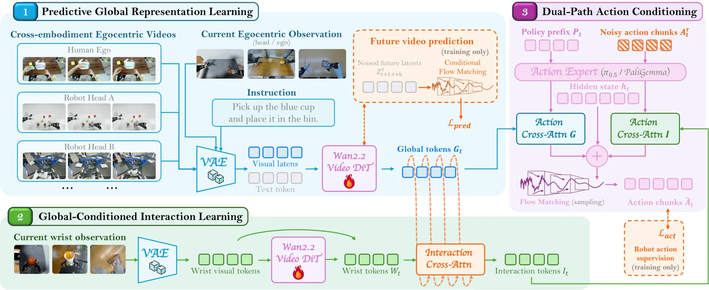

<!-- Generated by scripts/generate.py; edit data/works.json and data/media.json. -->

[← Back to the Awesome index](../../../README.md) · [Interactive website](https://chang-xinhai.github.io/Awesome-RGBDT-Manipulation/?collection=policy&item=ego-cevr#library)

# Ego-CEVR

Ego-CEVR: Learning Cross-Embodiment Visual Representations from Human Egocentric Videos

**2026-10-27 · arXiv preprint · Maniformer**

**[Paper](https://arxiv.org/abs/2610.37509)**

Aligns global egocentric video representations with wrist-level robot interaction for cross-embodiment policy learning.

*Ego-CEVR authors · [Figure source](https://arxiv.org/html/2610.37509v1) · Original rights retained.*

| Field | Reported value and source scope |
| :-- | :-- |
| Record type | policy |
| Policy family | Hierarchical visual representation and VLA [1](https://arxiv.org/html/2610.37509v1)  |
| Base model and architecture | π0.5 with separate global and local representations [1](https://arxiv.org/html/2610.37509v1)  |
| Model size and component | Not reported [1](https://arxiv.org/html/2610.37509v1)  |
| Deployment inputs | Global egocentric RGB and local wrist images with language. [1](https://arxiv.org/html/2610.37509v1)  |
| Action outputs and horizon | Robot action predictions through the downstream π0.5 policy. [1](https://arxiv.org/html/2610.37509v1)  |
| Training method | Global future-video representation pretraining, robot interaction mid-training and cross-embodiment post-training. [1](https://arxiv.org/html/2610.37509v1)  |
| Training data | Human/robot videos for global pretraining; robot demonstrations for action-aligned mid-training. [1](https://arxiv.org/html/2610.37509v1)  |
| Training duration | Not reported [1](https://arxiv.org/html/2610.37509v1)  |
| Training hardware | Not reported [1](https://arxiv.org/html/2610.37509v1)  |
| Inference and control rates | Not reported [1](https://arxiv.org/html/2610.37509v1)  |
| Evaluation scope | LIBERO, LIBERO-Plus, RoboTwin 2.0 and physical manipulation experiments. [1](https://arxiv.org/html/2610.37509v1)  |
| Observations / modalities | RGB · Language |
| Evaluation domain | Simulation · Real world |
| Embodiment | Bimanual · Parallel-jaw gripper |
| Release: code | Not verified |
| Release: weights | Not verified |
| Release: data | Not verified |
| Release: license | Not verified |
| Release: notes | The linked LIBERO-CF repository is a distinct benchmark and is not counted as released Ego-CEVR implementation. |

**Scope and qualifications**

- Human egocentric data and actual robot training/deployment observations are separate stages.

**Primary evidence**

1. [Author manuscript and initial submission](https://arxiv.org/html/2610.37509v1) — Original manuscript distinguishes human capture, training labels and deployment observations.
