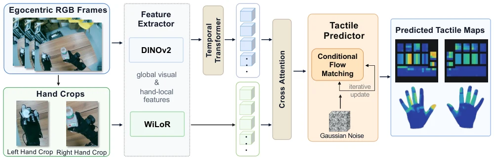

<!-- Generated by scripts/generate.py; edit data/works.json and data/media.json. -->

[← Back to the Awesome index](../../../README.md) · [Interactive website](https://chang-xinhai.github.io/Awesome-RGBDT-Manipulation/?collection=policy&item=ego2contact#library)

# Ego2Contact

Ego2Contact: Predicting Touch from Egocentric Human Video for Contact-Rich Robot Manipulation

**2026-10-16 · arXiv preprint · Carnegie Mellon University**

**[Paper](https://arxiv.org/abs/2610.22932)**

Transfers human visual-touch priors to robot tactile layouts for downstream control.

*Ego2Contact authors; original rights retained. · [Figure source](https://arxiv.org/html/2610.22932v1) · Original rights retained.*

| Field | Reported value and source scope |
| :-- | :-- |
| Record type | model |
| Model role and downstream interface | Visual tactile-field predictor; supplies derived touch to separately trained robot policies. [2](https://arxiv.org/html/2610.22932v1)  |
| Model family | Visual-to-tactile prediction [2](https://arxiv.org/html/2610.22932v1)  |
| Model architecture | Temporal scene context and hand-local visual features; anatomical mapping to a canonical tactile grid. [2](https://arxiv.org/html/2610.22932v1)  |
| Model size and component | Not reported [2](https://arxiv.org/html/2610.22932v1)  |
| Model inputs | Egocentric RGB sequences and local hand-image features; paired tactile measurements supervise adaptation. [2](https://arxiv.org/html/2610.22932v1)  |
| Model outputs | Bimanual pressure/contact fields mapped to robot tactile layouts. [2](https://arxiv.org/html/2610.22932v1)  |
| Training method | Human visual-tactile pretraining, robot-layout adaptation and downstream PPO / N0-VTLA post-training. [2](https://arxiv.org/html/2610.22932v1)  |
| Training data and scale | Paired human video/tactile data and robot video/tactile fine-tuning examples; policy comparisons use matched measured, predicted and zero-touch variants. [2](https://arxiv.org/html/2610.22932v1)  |
| Training duration | Not reported [2](https://arxiv.org/html/2610.22932v1)  |
| Training hardware | Not reported [2](https://arxiv.org/html/2610.22932v1)  |
| Inference setting and runtime | Predicted touch is supplied online to simulation PPO and used offline to annotate real demonstration videos. Real N0-VTLA rollouts consume measured signals from an 880-taxel glove, not online predicted touch. [2](https://arxiv.org/html/2610.22932v1)  |
| Downstream evaluation and scope | Four simulated contact-rich tasks and physical bottle-cap removal / test-tube transfer. [2](https://arxiv.org/html/2610.22932v1)  |
| Observations / modalities | RGB |
| Evaluation domain | Simulation · Real world |
| Embodiment | Dexterous hand · Bimanual |
| Release: code | Not verified |
| Release: weights | Not verified |
| Release: data | Not verified |
| Release: license | Not verified |
| Release: notes | Paper and public presentation verified; no implementation, weight or data release is inferred from a publication or demonstration. |

**Scope and qualifications**

- Predicted pressure is inferred from RGB, not a physical tactile sensor stream.
- In the real-robot study (§IV-E), predicted tactile annotations support policy post-training, but live rollouts receive measured glove tactile input. Hardware results do not establish sensor-free online predicted-touch control.

**Primary evidence**

1. [Canonical author manuscript and arXiv submission history](https://arxiv.org/abs/2610.22932) — Date retains the initial v1 submission, independently of revisions or current artifact releases.
2. [Full author paper: method, observations and evaluation scope](https://arxiv.org/html/2610.22932v1) — Physical sensors, predicted signals, training labels and policy inputs are recorded separately; undisclosed quantities remain unknown.
