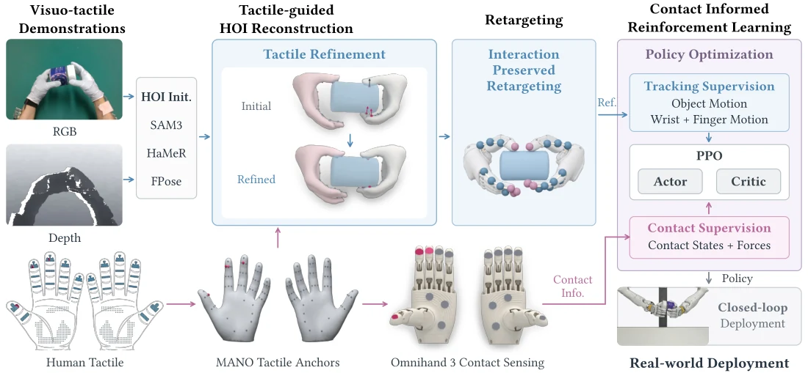

<!-- Generated by scripts/generate.py; edit data/works.json and data/media.json. -->

[← Back to the Awesome index](../../../README.md) · [Interactive website](https://chang-xinhai.github.io/Awesome-RGBDT-Manipulation/?collection=policy&item=ego2real#library)

# Ego2Real

Ego2Real: Learning Bimanual Dexterous Manipulation from Egocentric Visuo-Tactile Demonstrations

**2026-11-24 · Preprint · Zhejiang University; HKUST; AGILINK**

**[Paper](https://arxiv.org/abs/2611.32101)**

Uses human RGB-D and tactile feedback to refine bimanual training references and contact rewards, then runs an actor from tracked object and robot states.

*Ange Bao and coauthors · [Figure source](https://arxiv.org/html/2611.32101v1) · Original rights retained.*

| Field | Reported value and source scope |
| :-- | :-- |
| Record type | policy |
| Policy family | Ego2Real [1](https://arxiv.org/html/2611.32101v1)  |
| Base model and architecture | Not reported [1](https://arxiv.org/html/2611.32101v1)  |
| Model size and component | Not reported [1](https://arxiv.org/html/2611.32101v1)  |
| Deployment inputs | Tracked object pose, wrist pose and joint positions for both hands, reference phase and motion targets. Physical feedback uses camera-based object tracking and robot state. [1](https://arxiv.org/html/2611.32101v1)  |
| Action outputs and horizon | Residual wrist translation and rotation, plus hand joint targets for both hands. [1](https://arxiv.org/html/2611.32101v1)  |
| Training method | Metric RGB-D and contact-guided HOI reconstruction, morphology-aware retargeting and PPO with privileged contact feedback for the critic. [1](https://arxiv.org/html/2611.32101v1)  |
| Training data | Egocentric RGB-D and tactile-glove demonstrations converted to references; simulation contact sensors and adaptation used in training. [1](https://arxiv.org/html/2611.32101v1)  |
| Training duration | Not reported [1](https://arxiv.org/html/2611.32101v1)  |
| Training hardware | Not reported [1](https://arxiv.org/html/2611.32101v1)  |
| Inference and control rates | 30 Hz simulation training and 15 Hz physical inference/commands under the reported controller. [1](https://arxiv.org/html/2611.32101v1)  |
| Evaluation scope | Simulated skill-transfer comparisons and reported physical bimanual bottle handover and box rotation with Tianji Marvin Pro arms and OmniHand 3 hands. [1](https://arxiv.org/html/2611.32101v1)  |
| Observations / modalities | RGB · Proprioception |
| Evaluation domain | Simulation · Real world |
| Embodiment | Bimanual · Dexterous hand |
| Release: code | Not verified |
| Release: weights | Not verified |
| Release: data | Not verified |
| Release: license | Not verified |
| Release: notes | Public paper verified. Code, task weights and data are tracked separately. |

**Scope and qualifications**

- RGB-D and dense skin touch are used for demonstration reconstruction; the actor sees tracked state, not raw tactile measurements.
- Robot-side critic contact state and auxiliary rewards are training-only.

**Primary evidence**

1. [Original author paper with methods, evaluation and scope](https://arxiv.org/html/2611.32101v1)
