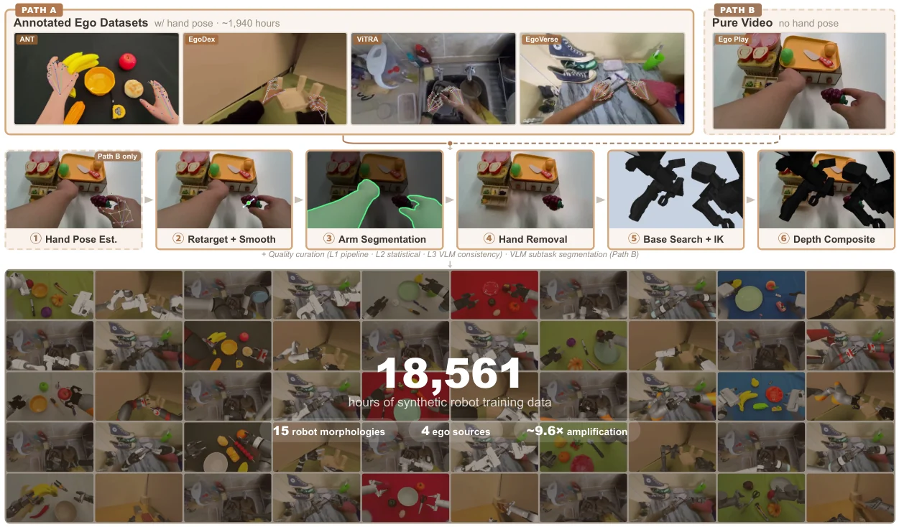

<!-- Generated by scripts/generate.py; edit data/works.json and data/media.json. -->

[← Back to the Awesome index](../../../README.md) · [Interactive website](https://chang-xinhai.github.io/Awesome-RGBDT-Manipulation/?collection=policy&item=ego2robot#library)

# Ego2Robot

Ego2Robot: Scalable Robot Data Synthesis from Egocentric Human Data

**2026-08-03 · arXiv preprint · Renmin University of China**

**[Paper](https://arxiv.org/abs/2608.02580)** · [Project](https://www-ye.github.io/ego2robot_blog/)

Synthesizes retargeted robot observations and actions from egocentric human data for downstream manipulation policy pretraining.

*Ego2Robot authors · [Figure source](https://arxiv.org/html/2608.02580v1) · Original rights retained.*

| Field | Reported value and source scope |
| :-- | :-- |
| Record type | policy |
| Policy family | Human-to-robot data synthesis and flow-matching policy [1](https://arxiv.org/html/2608.02580v1)  |
| Base model and architecture | Not reported [1](https://arxiv.org/html/2608.02580v1)  |
| Model size and component | Not reported [1](https://arxiv.org/html/2608.02580v1)  |
| Deployment inputs | Human egocentric video and hand trajectories for synthesis; robot visual observations and language for policy. [1](https://arxiv.org/html/2608.02580v1)  |
| Action outputs and horizon | Robotized image trajectories and executable end-effector actions. [1](https://arxiv.org/html/2608.02580v1)  |
| Training method | Retargeting and depth-aware rendering generate pretraining data, followed by task-specific robot fine-tuning. [1](https://arxiv.org/html/2608.02580v1)  |
| Training data | Reported 18,561 hours across 15 robot morphologies; generated corpus is distinct from real demonstrations. [1](https://arxiv.org/html/2608.02580v1)  |
| Training duration | Not reported [1](https://arxiv.org/html/2608.02580v1)  |
| Training hardware | Not reported [1](https://arxiv.org/html/2608.02580v1)  |
| Inference and control rates | Not reported [1](https://arxiv.org/html/2608.02580v1)  |
| Evaluation scope | EBench simulation perturbations and real robot evaluations. [1](https://arxiv.org/html/2608.02580v1)  |
| Observations / modalities | RGB · Language |
| Evaluation domain | Simulation · Real world |
| Embodiment | Bimanual |
| Release: code | Not verified [2](https://www-ye.github.io/ego2robot_blog/)  |
| Release: weights | Not verified [2](https://www-ye.github.io/ego2robot_blog/)  |
| Release: data | Not verified [2](https://www-ye.github.io/ego2robot_blog/)  |
| Release: license | Not verified [2](https://www-ye.github.io/ego2robot_blog/)  |
| Release: notes | Project and manuscript demonstrate the pipeline; a downloadable implementation or full corpus was not independently verified. [2](https://www-ye.github.io/ego2robot_blog/)  |

**Scope and qualifications**

- Human egocentric data and actual robot training/deployment observations are separate stages.
- Do not infer a measured depth policy input from camera hardware, reconstruction, or data generation alone.

**Primary evidence**

1. [Author manuscript and initial submission](https://arxiv.org/html/2608.02580v1) — Original manuscript distinguishes human capture, training labels and deployment observations.
2. [Official project and release evidence](https://www-ye.github.io/ego2robot_blog/) — Current repository contents and access are assessed independently of paper claims.
