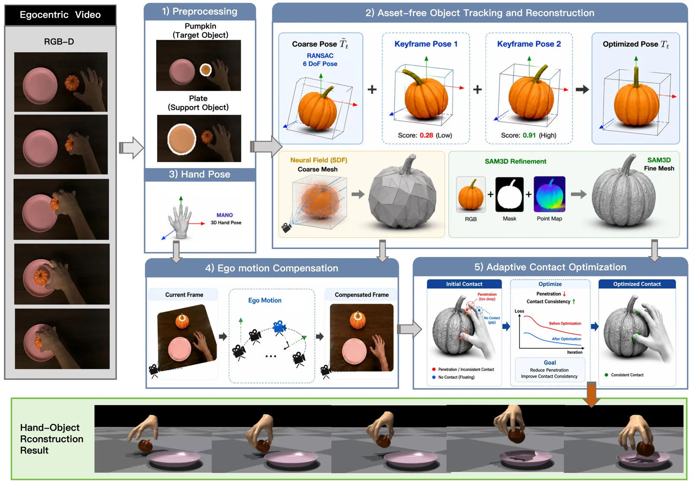

<!-- Generated by scripts/generate.py; edit data/works.json and data/media.json. -->

[← Back to the Awesome index](../../../README.md) · [Interactive website](https://chang-xinhai.github.io/Awesome-RGBDT-Manipulation/?collection=policy&item=egoaero#library)

# EgoAERO

EgoAERO: Learning Dexterous Manipulation from a Single Egocentric Video without Object Assets

**2026-06-06 · arXiv preprint · Harbin Institute of Technology**

**[Paper](https://arxiv.org/abs/2606.08057)**

Converts a single egocentric RGB-D human demonstration into dexterous manipulation through asset-free contact-aware reconstruction.

*EgoAERO authors · [Figure source](https://arxiv.org/html/2606.08057v1) · Original rights retained.*

| Field | Reported value and source scope |
| :-- | :-- |
| Record type | policy |
| Policy family | Contact-aware retargeting and residual learning [1](https://arxiv.org/html/2606.08057v1)  |
| Base model and architecture | Not reported [1](https://arxiv.org/html/2606.08057v1)  |
| Model size and component | Not reported [1](https://arxiv.org/html/2606.08057v1)  |
| Deployment inputs | Simulated hand/object state and reconstructed reference trajectories; real deployment-time observations are not specified. [1](https://arxiv.org/html/2606.08057v1)  |
| Action outputs and horizon | Reconstructed object/hand trajectories and closed-loop robot control. [1](https://arxiv.org/html/2606.08057v1)  |
| Training method | Asset-free tracking, adaptive contact optimization and two-stage residual policy learning. [1](https://arxiv.org/html/2606.08057v1)  |
| Training data | Single human RGB-D demonstrations; EgoDex-R described as a 4.3M-frame resource. [1](https://arxiv.org/html/2606.08057v1)  |
| Training duration | Not reported [1](https://arxiv.org/html/2606.08057v1)  |
| Training hardware | Not reported [1](https://arxiv.org/html/2606.08057v1)  |
| Inference and control rates | Not reported [1](https://arxiv.org/html/2606.08057v1)  |
| Evaluation scope | Simulation and physical hand experiments; measured training RGB-D should not be assumed as a deployed live depth input.  [1](https://arxiv.org/html/2606.08057v1)  |
| Observations / modalities |  |
| Evaluation domain | Simulation · Real world |
| Embodiment | Dexterous hand |
| Release: code | Not verified |
| Release: weights | Not verified |
| Release: data | Not verified |
| Release: license | Not verified |
| Release: notes | Manuscript establishes the 4.3M-frame dataset claim but not independent downloadable data or implementation. |

**Scope and qualifications**

- RGB-D is measured for the human demonstration and offline trajectory reconstruction; the manuscript does not establish a live depth input during robot execution.
- Physical hardware execution tracks a policy-generated trajectory; do not infer closed-loop deployment sensing or reported success counts.

**Primary evidence**

1. [Author manuscript and initial submission](https://arxiv.org/html/2606.08057v1) — Original manuscript distinguishes human capture, training labels and deployment observations.
