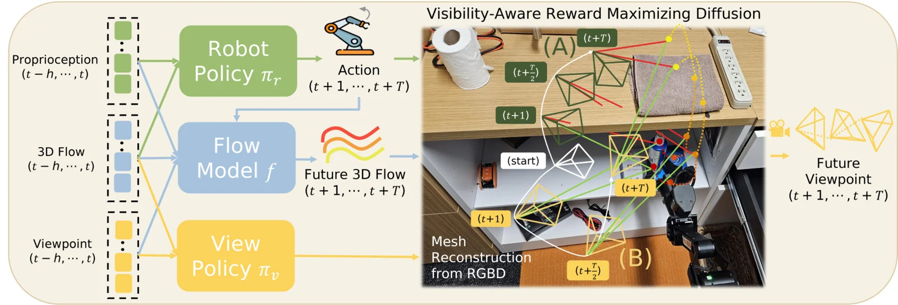

<!-- Generated by scripts/generate.py; edit data/works.json and data/media.json. -->

[← Back to the Awesome index](../../../README.md) · [Interactive website](https://chang-xinhai.github.io/Awesome-RGBDT-Manipulation/?collection=policy&item=egoavflow#library)

# EgoAVFlow

EgoAVFlow: Robot Policy Learning with Active Vision from Human Egocentric Videos via 3D Flow

**2026-02-25 · arXiv preprint · Georgia Institute of Technology**

**[Paper](https://arxiv.org/abs/2602.22461)** · [Project](https://dscho1234.github.io/egoavflow/) · [Code](https://github.com/dscho1234/Ego-AV-Flow)

Learns 3D-flow manipulation and active-viewpoint policies from human egocentric RGB-D demonstrations.

*EgoAVFlow authors · [Figure source](https://arxiv.org/html/2602.22461v1) · Original rights retained.*

| Field | Reported value and source scope |
| :-- | :-- |
| Record type | policy |
| Policy family | 3D flow diffusion policy [1](https://arxiv.org/html/2602.22461v1)  |
| Base model and architecture | Not reported [1](https://arxiv.org/html/2602.22461v1)  |
| Model size and component | Not reported [1](https://arxiv.org/html/2602.22461v1)  |
| Deployment inputs | Tracked 3D point flow from RGB-D, with visibility and scene geometry for view control. [1](https://arxiv.org/html/2602.22461v1)  |
| Action outputs and horizon | End-effector and camera viewpoint actions from separate manipulation and view policies. [1](https://arxiv.org/html/2602.22461v1)  |
| Training method | Human-demo imitation using flow representation; visibility-aware view policy. [1](https://arxiv.org/html/2602.22461v1)  |
| Training data | 150 head-mounted D435 human videos per task; no robot demonstrations in primary comparison. [1](https://arxiv.org/html/2602.22461v1)  |
| Training duration | Not reported [1](https://arxiv.org/html/2602.22461v1)  |
| Training hardware | Not reported [1](https://arxiv.org/html/2602.22461v1)  |
| Inference and control rates | Not reported [1](https://arxiv.org/html/2602.22461v1)  |
| Evaluation scope | Four real manipulation tasks, WidowX manipulation plus Unitree Z1 mounted D435 camera. [1](https://arxiv.org/html/2602.22461v1)  |
| Observations / modalities | RGB · Depth |
| Evaluation domain | Real world |
| Embodiment | Parallel-jaw gripper |
| Release: code | Available — code [2](https://dscho1234.github.io/egoavflow/) [3](https://github.com/dscho1234/Ego-AV-Flow)  |
| Release: weights | Not verified [2](https://dscho1234.github.io/egoavflow/) [3](https://github.com/dscho1234/Ego-AV-Flow)  |
| Release: data | Not verified [2](https://dscho1234.github.io/egoavflow/) [3](https://github.com/dscho1234/Ego-AV-Flow)  |
| Release: license | MIT code license [2](https://dscho1234.github.io/egoavflow/) [3](https://github.com/dscho1234/Ego-AV-Flow)  |
| Release: notes | Actual Python implementation and LICENSE inspected; no data or weight availability inferred. [2](https://dscho1234.github.io/egoavflow/) [3](https://github.com/dscho1234/Ego-AV-Flow)  |

**Scope and qualifications**

- Human egocentric data and actual robot training/deployment observations are separate stages.

**Primary evidence**

1. [Author manuscript and initial submission](https://arxiv.org/html/2602.22461v1) — Original manuscript distinguishes human capture, training labels and deployment observations.
2. [Official project and release evidence](https://dscho1234.github.io/egoavflow/) — Current repository contents and access are assessed independently of paper claims.
3. [Official code and release evidence](https://github.com/dscho1234/Ego-AV-Flow) — Current repository contents and access are assessed independently of paper claims.
