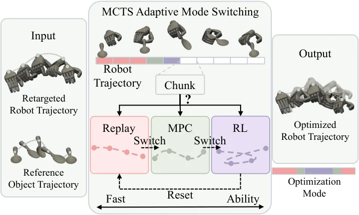

<!-- Generated by scripts/generate.py; edit data/works.json and data/media.json. -->

[← Back to the Awesome index](../../../README.md) · [Interactive website](https://chang-xinhai.github.io/Awesome-RGBDT-Manipulation/?collection=policy&item=egoengine#library)

# EgoEngine

EgoEngine: From Egocentric Human Videos to High-Fidelity Dexterous Robot Demonstrations

**2026-06-10 · arXiv preprint · Georgia Institute of Technology**

**[Paper](https://arxiv.org/abs/2606.12604)** · [Project](https://egoengine.github.io/) · [Code](https://github.com/GaTech-RL2/EgoEngine-CoRL2026)

Transforms human egocentric video into aligned robot observations and executable dexterous trajectories for policy learning.

*EgoEngine authors · [Figure source](https://arxiv.org/html/2606.12604v1) · Original rights retained.*

| Field | Reported value and source scope |
| :-- | :-- |
| Record type | policy |
| Policy family | Human-to-robot data synthesis and flow-matching policy [1](https://arxiv.org/html/2606.12604v1)  |
| Base model and architecture | Not reported [1](https://arxiv.org/html/2606.12604v1)  |
| Model size and component | Not reported [1](https://arxiv.org/html/2606.12604v1)  |
| Deployment inputs | Human egocentric RGB for conversion; robot observation images for downstream policy. [1](https://arxiv.org/html/2606.12604v1)  |
| Action outputs and horizon | Rendered robot observations and retargeted robot actions; distilled policy produces actions. [1](https://arxiv.org/html/2606.12604v1)  |
| Training method | Digital-twin action retargeting, visual translation and downstream imitation policy distillation. [1](https://arxiv.org/html/2606.12604v1)  |
| Training data | TACO and Aria human video; generated trajectories; robot teleoperation is a separate baseline. [1](https://arxiv.org/html/2606.12604v1)  |
| Training duration | Not reported [1](https://arxiv.org/html/2606.12604v1)  |
| Training hardware | Not reported [1](https://arxiv.org/html/2606.12604v1)  |
| Inference and control rates | Not reported [1](https://arxiv.org/html/2606.12604v1)  |
| Evaluation scope | Simulation action comparisons and zero-shot physical dexterous robot experiments. [1](https://arxiv.org/html/2606.12604v1)  |
| Observations / modalities | RGB |
| Evaluation domain | Simulation · Real world |
| Embodiment | Dexterous hand |
| Release: code | Available — action and visual source [2](https://egoengine.github.io/) [3](https://github.com/GaTech-RL2/EgoEngine-CoRL2026)  |
| Release: weights | Not verified [2](https://egoengine.github.io/) [3](https://github.com/GaTech-RL2/EgoEngine-CoRL2026)  |
| Release: data | Not verified [2](https://egoengine.github.io/) [3](https://github.com/GaTech-RL2/EgoEngine-CoRL2026)  |
| Release: license | Mixed: action/SPIDER CC BY-NC 4.0; visual/robosuite MIT; upstream assets retain their terms [2](https://egoengine.github.io/) [3](https://github.com/GaTech-RL2/EgoEngine-CoRL2026)  |
| Release: notes | 418 source files checked. The complete stack is not uniformly MIT; the action component remains noncommercial. [2](https://egoengine.github.io/) [3](https://github.com/GaTech-RL2/EgoEngine-CoRL2026)  |

**Scope and qualifications**

- Human egocentric data and actual robot training/deployment observations are separate stages.
- Do not infer a measured depth policy input from camera hardware, reconstruction, or data generation alone.

**Primary evidence**

1. [Author manuscript and initial submission](https://arxiv.org/html/2606.12604v1) — Original manuscript distinguishes human capture, training labels and deployment observations.
2. [Official project and release evidence](https://egoengine.github.io/) — Current repository contents and access are assessed independently of paper claims.
3. [Official code and release evidence](https://github.com/GaTech-RL2/EgoEngine-CoRL2026) — Current repository contents and access are assessed independently of paper claims.
