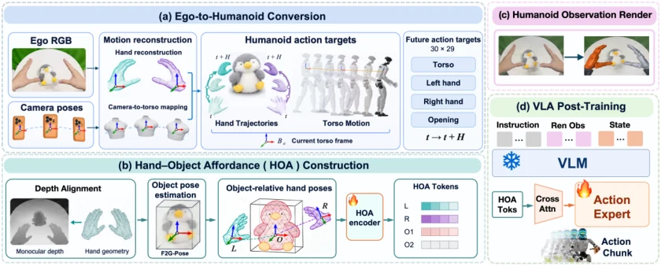

<!-- Generated by scripts/generate.py; edit data/works.json and data/media.json. -->

[← Back to the Awesome index](../../../README.md) · [Interactive website](https://chang-xinhai.github.io/Awesome-RGBDT-Manipulation/?collection=policy&item=egoloaf#library)

# EgoLoAF

EgoLoAF: Learning Humanoid Loco-Manipulation from Egocentric Demonstrations with Hand-Object Affordances

**2026-11-24 · Preprint · Xi’an Jiaotong University; HKUST (Guangzhou); Xbotics Research Team**

**[Paper](https://arxiv.org/abs/2611.32260)** · [Project](https://egoloaf.github.io/)

Trains a humanoid VLA from egocentric video-derived behavior and uses online RGB-D hand–object affordances to condition execution.

*Yiming Zeng and coauthors · [Figure source](https://arxiv.org/html/2611.32260v1) · Original rights retained.*

| Field | Reported value and source scope |
| :-- | :-- |
| Record type | policy |
| Policy family | EgoLoAF [1](https://arxiv.org/html/2611.32260v1)  |
| Base model and architecture | Not reported [1](https://arxiv.org/html/2611.32260v1)  |
| Model size and component | Not reported [1](https://arxiv.org/html/2611.32260v1)  |
| Deployment inputs | Head-camera RGB, proprioceptive torso/hand state, instructions and hand–object affordances. The physical G1 builds the affordances with calibrated head RGB-D and robot forward kinematics. [1](https://arxiv.org/html/2611.32260v1)  |
| Action outputs and horizon | Torso turning/locomotion commands and bimanual hand pose and open/close targets, executed by a lower-level whole-body controller. [1](https://arxiv.org/html/2611.32260v1)  |
| Training method | Derive torso and hand trajectories from human egocentric RGB, render robot views, then post-train the VLA with object-relative affordance tokens. [1](https://arxiv.org/html/2611.32260v1)  |
| Training data | Paper reports 128,400 egocentric demonstrations covering 1,284 tasks; physical four-task policy training uses subsets and separately collected examples. [1](https://arxiv.org/html/2611.32260v1)  |
| Training duration | Not reported [1](https://arxiv.org/html/2611.32260v1)  |
| Training hardware | Not reported [1](https://arxiv.org/html/2611.32260v1)  |
| Inference and control rates | Not reported [1](https://arxiv.org/html/2611.32260v1)  |
| Evaluation scope | Unitree G1 with LinkerHand O6 hands and RealSense D435. Four physical tasks with randomized initial poses, 20 trials per task and checkpoint in each batch. [1](https://arxiv.org/html/2611.32260v1)  |
| Observations / modalities | RGB · Depth · Proprioception · Language |
| Evaluation domain | Real world |
| Embodiment | Humanoid · Bimanual · Dexterous hand |
| Release: code | Announced — author project marks implementation coming soon |
| Release: weights | Not verified |
| Release: data | Announced — author reports 128,400 episodes; downloadable archives not independently verified |
| Release: license | Not verified |
| Release: notes | Public paper verified. Code, task weights and data are tracked separately. |

**Scope and qualifications**

- Human collection relies on RGB and camera tracking, with predicted depth aligned offline. Physical deployment also uses measured RGB-D via the online affordance estimator.
- No wearable motion trackers used for the human demo collection in this work.

**Primary evidence**

1. [Original author paper with methods, evaluation and scope](https://arxiv.org/html/2611.32260v1)
2. [Public author project with method and evaluation examples](https://egoloaf.github.io/)
