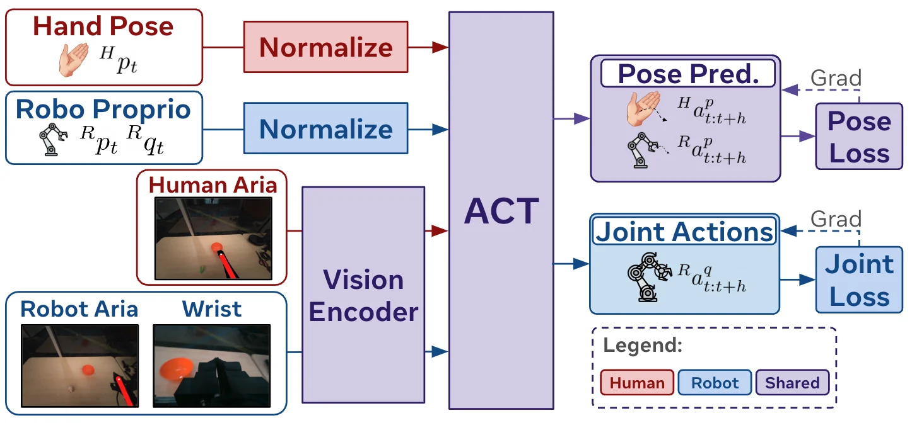

<!-- Generated by scripts/generate.py; edit data/works.json and data/media.json. -->

[← Back to the Awesome index](../../../README.md) · [Interactive website](https://chang-xinhai.github.io/Awesome-RGBDT-Manipulation/?collection=policy&item=egomimic#library)

# EgoMimic

EgoMimic: Scaling Imitation Learning via Egocentric Video

**2024-10-31 · arXiv preprint · Georgia Institute of Technology**

**[Paper](https://arxiv.org/abs/2410.24221)** · [Project](https://egomimic.github.io/) · [Code](https://github.com/SimarKareer/EgoMimic) · [Data](https://huggingface.co/datasets/gatech/EgoMimic)

Jointly trains a shared imitation policy on tracked egocentric human and teleoperated bimanual robot data.

*EgoMimic authors · [Figure source](https://arxiv.org/html/2410.24221v1) · Original rights retained.*

| Field | Reported value and source scope |
| :-- | :-- |
| Record type | policy |
| Policy family | Action chunking transformer [1](https://arxiv.org/html/2410.24221v1)  |
| Base model and architecture | Not reported [1](https://arxiv.org/html/2410.24221v1)  |
| Model size and component | Not reported [1](https://arxiv.org/html/2410.24221v1)  |
| Deployment inputs | Egocentric camera image; tracked 3D hand supervision for human demonstrations. [1](https://arxiv.org/html/2410.24221v1)  |
| Action outputs and horizon | Hand trajectory predictions and robot joint-action predictions through separate heads. [1](https://arxiv.org/html/2410.24221v1)  |
| Training method | Co-training shared visual encoder and ACT policy on human and robot data. [1](https://arxiv.org/html/2410.24221v1)  |
| Training data | Project Aria video and tracked hands paired with separately collected bimanual robot demonstrations. [1](https://arxiv.org/html/2410.24221v1)  |
| Training duration | Not reported [1](https://arxiv.org/html/2410.24221v1)  |
| Training hardware | Not reported [1](https://arxiv.org/html/2410.24221v1)  |
| Inference and control rates | Not reported [1](https://arxiv.org/html/2410.24221v1)  |
| Evaluation scope | Three physical tabletop manipulation tasks with scaling and ablation comparisons. [1](https://arxiv.org/html/2410.24221v1)  |
| Observations / modalities | RGB |
| Evaluation domain | Real world |
| Embodiment | Bimanual · Parallel-jaw gripper |
| Release: code | Available — training and hardware source [2](https://egomimic.github.io/) [3](https://github.com/SimarKareer/EgoMimic) [4](https://huggingface.co/datasets/gatech/EgoMimic)  |
| Release: weights | Not verified [2](https://egomimic.github.io/) [3](https://github.com/SimarKareer/EgoMimic) [4](https://huggingface.co/datasets/gatech/EgoMimic)  |
| Release: data | Available — human and robot HDF5 datasets [2](https://egomimic.github.io/) [3](https://github.com/SimarKareer/EgoMimic) [4](https://huggingface.co/datasets/gatech/EgoMimic)  |
| Release: license | MIT code; dataset license not verified [2](https://egomimic.github.io/) [3](https://github.com/SimarKareer/EgoMimic) [4](https://huggingface.co/datasets/gatech/EgoMimic)  |
| Release: notes | Actual source and human HDF5 Range HTTP 206 verified. Wrist RealSense hardware alone does not establish depth as a policy input. [2](https://egomimic.github.io/) [3](https://github.com/SimarKareer/EgoMimic) [4](https://huggingface.co/datasets/gatech/EgoMimic)  |

**Scope and qualifications**

- Human egocentric data and actual robot training/deployment observations are separate stages.
- Do not infer a measured depth policy input from camera hardware, reconstruction, or data generation alone.

**Primary evidence**

1. [Author manuscript and initial submission](https://arxiv.org/html/2410.24221v1) — Original manuscript distinguishes human capture, training labels and deployment observations.
2. [Official project and release evidence](https://egomimic.github.io/) — Current repository contents and access are assessed independently of paper claims.
3. [Official code and release evidence](https://github.com/SimarKareer/EgoMimic) — Current repository contents and access are assessed independently of paper claims.
4. [Official data and release evidence](https://huggingface.co/datasets/gatech/EgoMimic) — Current repository contents and access are assessed independently of paper claims.
