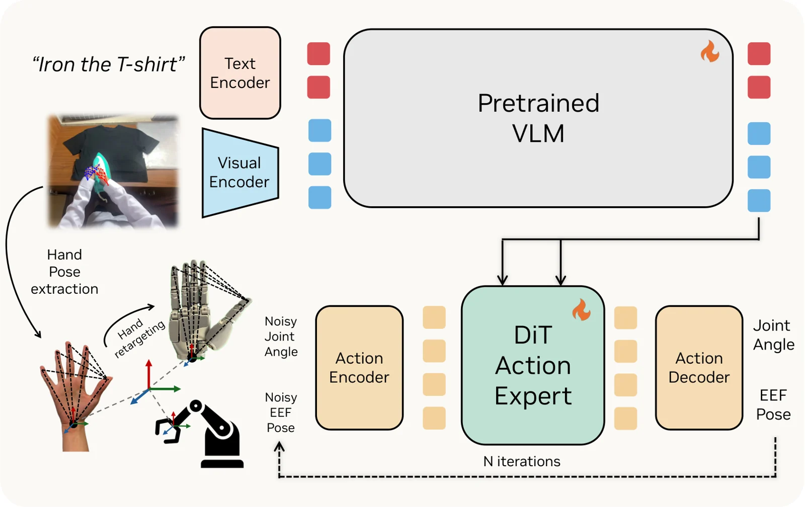

<!-- Generated by scripts/generate.py; edit data/works.json and data/media.json. -->

[← Back to the Awesome index](../../../README.md) · [Interactive website](https://chang-xinhai.github.io/Awesome-RGBDT-Manipulation/?collection=policy&item=egoscale#library)

# EgoScale

EgoScale: Scaling Dexterous Manipulation with Diverse Egocentric Human Data

**2026-02-18 · arXiv preprint · NVIDIA**

**[Paper](https://arxiv.org/abs/2602.16710)** · [Project](https://research.nvidia.com/labs/gear/egoscale/)

Studies human-video scale and alignment for a dexterous VLA transferred to real robots.

*EgoScale authors · [Figure source](https://arxiv.org/html/2602.16710v1) · Original rights retained.*

| Field | Reported value and source scope |
| :-- | :-- |
| Record type | policy |
| Policy family | Flow-matching vision-language-action [1](https://arxiv.org/html/2602.16710v1)  |
| Base model and architecture | Not reported [1](https://arxiv.org/html/2602.16710v1)  |
| Model size and component | Not reported [1](https://arxiv.org/html/2602.16710v1)  |
| Deployment inputs | Egocentric image and language, with robot state during robot adaptation. [1](https://arxiv.org/html/2602.16710v1)  |
| Action outputs and horizon | Wrist motion and dexterous hand actions. [1](https://arxiv.org/html/2602.16710v1)  |
| Training method | Pretrain on human video action labels followed by human-robot mid-training and robot post-training. [1](https://arxiv.org/html/2602.16710v1)  |
| Training data | 20,854 hours of action-labeled human egocentric video in the reported training corpus. [1](https://arxiv.org/html/2602.16710v1)  |
| Training duration | Not reported [1](https://arxiv.org/html/2602.16710v1)  |
| Training hardware | Not reported [1](https://arxiv.org/html/2602.16710v1)  |
| Inference and control rates | Not reported [1](https://arxiv.org/html/2602.16710v1)  |
| Evaluation scope | Real dexterous robot tasks and scaling-law analyses; human-only pretraining and robot adaptation are separate stages. [1](https://arxiv.org/html/2602.16710v1)  |
| Observations / modalities | RGB · Language · Proprioception |
| Evaluation domain | Real world |
| Embodiment | Dexterous hand |
| Release: code | Not verified [2](https://research.nvidia.com/labs/gear/egoscale/)  |
| Release: weights | Not verified [2](https://research.nvidia.com/labs/gear/egoscale/)  |
| Release: data | Not verified [2](https://research.nvidia.com/labs/gear/egoscale/)  |
| Release: license | Not verified [2](https://research.nvidia.com/labs/gear/egoscale/)  |
| Release: notes | Project and manuscript establish research results; no public model, data, or training implementation is assumed. [2](https://research.nvidia.com/labs/gear/egoscale/)  |

**Scope and qualifications**

- Human egocentric data and actual robot training/deployment observations are separate stages.

**Primary evidence**

1. [Author manuscript and initial submission](https://arxiv.org/html/2602.16710v1) — Original manuscript distinguishes human capture, training labels and deployment observations.
2. [Official project and release evidence](https://research.nvidia.com/labs/gear/egoscale/) — Current repository contents and access are assessed independently of paper claims.
