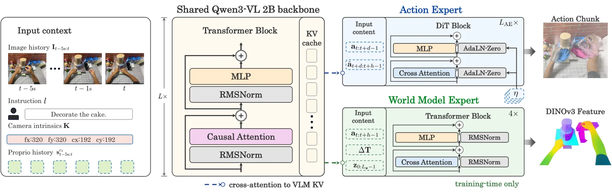

<!-- Generated by scripts/generate.py; edit data/works.json and data/media.json. -->

[← Back to the Awesome index](../../../README.md) · [Interactive website](https://chang-xinhai.github.io/Awesome-RGBDT-Manipulation/?collection=policy&item=egosteer#library)

# EgoSteer

EgoSteer: An Open-Source Full-Stack System Towards Steerable Dexterous Manipulation from Egocentric Videos

**2026-06-21 · arXiv preprint · Peking University**

**[Paper](https://arxiv.org/abs/2607.09701)** · [Project](https://egosteer.github.io/) · [Code](https://github.com/egosteer/egosteer) · [Data](https://huggingface.co/datasets/EgoSteer/EgoSteer-RealWorld) · [Weights](https://huggingface.co/EgoSteer/EgoSteer-3B-RealMan)

Scales a dexterous language-conditioned policy through egocentric human pretraining and robot post-training.

*EgoSteer authors · [Figure source](https://arxiv.org/html/2607.09701v1) · Original rights retained.*

| Field | Reported value and source scope |
| :-- | :-- |
| Record type | policy |
| Policy family | World-model-enhanced VLA [1](https://arxiv.org/html/2607.09701v1)  |
| Base model and architecture | Not reported [1](https://arxiv.org/html/2607.09701v1)  |
| Model size and component | 3B [1](https://arxiv.org/html/2607.09701v1)  |
| Deployment inputs | Head/chest RGB views, language and robot state; D455 depth supports calibration, not a verified policy depth stream. [1](https://arxiv.org/html/2607.09701v1)  |
| Action outputs and horizon | Camera-frame wrist trajectories and hand keypoints for bimanual robot control. [1](https://arxiv.org/html/2607.09701v1)  |
| Training method | 9.6K hours egocentric pretraining, robot post-training and DAgger corrections. [1](https://arxiv.org/html/2607.09701v1)  |
| Training data | Human-video corpus plus real teleoperation and correction episodes; released real-world data is a distinct subset. [1](https://arxiv.org/html/2607.09701v1)  |
| Training duration | Not reported [1](https://arxiv.org/html/2607.09701v1)  |
| Training hardware | Not reported [1](https://arxiv.org/html/2607.09701v1)  |
| Inference and control rates | Not reported [1](https://arxiv.org/html/2607.09701v1)  |
| Evaluation scope | RealMan and AgiBot G1 evaluations; 40+ language tasks and long-horizon adaptation. [1](https://arxiv.org/html/2607.09701v1)  |
| Observations / modalities | RGB · Language · Proprioception |
| Evaluation domain | Real world |
| Embodiment | Dexterous hand · Bimanual |
| Release: code | Available — policy, EgoSmith and robot stack [2](https://egosteer.github.io/) [3](https://github.com/egosteer/egosteer) [4](https://huggingface.co/EgoSteer/EgoSteer-3B-RealMan)  |
| Release: weights | Available — 3B base and 3B RealMan [2](https://egosteer.github.io/) [3](https://github.com/egosteer/egosteer) [4](https://huggingface.co/EgoSteer/EgoSteer-3B-RealMan)  |
| Release: data | Partial — real-world collection; 9.6K-hour human corpus not independently established as fully released [2](https://egosteer.github.io/) [3](https://github.com/egosteer/egosteer) [4](https://huggingface.co/EgoSteer/EgoSteer-3B-RealMan)  |
| Release: license | Apache-2.0 policy source and model card; verify third-party dependencies and data terms separately [2](https://egosteer.github.io/) [3](https://github.com/egosteer/egosteer) [4](https://huggingface.co/EgoSteer/EgoSteer-3B-RealMan)  |
| Release: notes | Actual policy/processing/robot source trees, checkpoint byte range and public dataset files checked. [2](https://egosteer.github.io/) [3](https://github.com/egosteer/egosteer) [4](https://huggingface.co/EgoSteer/EgoSteer-3B-RealMan)  |

**Scope and qualifications**

- Human egocentric data and actual robot training/deployment observations are separate stages.
- Do not infer a measured depth policy input from camera hardware, reconstruction, or data generation alone.

**Primary evidence**

1. [Author manuscript and initial submission](https://arxiv.org/html/2607.09701v1) — Original manuscript distinguishes human capture, training labels and deployment observations.
2. [Official project and release evidence](https://egosteer.github.io/) — Current repository contents and access are assessed independently of paper claims.
3. [Official code and release evidence](https://github.com/egosteer/egosteer) — Current repository contents and access are assessed independently of paper claims.
4. [Official weights and release evidence](https://huggingface.co/EgoSteer/EgoSteer-3B-RealMan) — Current repository contents and access are assessed independently of paper claims.
5. [Official data and release evidence](https://huggingface.co/datasets/EgoSteer/EgoSteer-RealWorld) — Current repository contents and access are assessed independently of paper claims.
