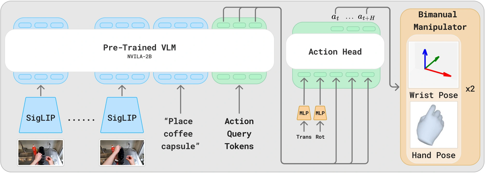

<!-- Generated by scripts/generate.py; edit data/works.json and data/media.json. -->

[← Back to the Awesome index](../../../README.md) · [Interactive website](https://chang-xinhai.github.io/Awesome-RGBDT-Manipulation/?collection=policy&item=egovla#library)

# EgoVLA

EgoVLA: Learning Vision-Language-Action Models from Egocentric Human Videos

**2025-07-16 · Preprint · MIT / NVIDIA / UC San Diego**

**[Paper](https://arxiv.org/abs/2507.12440)** · [Project](https://rchalyang.github.io/EgoVLA) · [Code](https://github.com/RchalYang/EgoVLA_Release) · [Data](https://huggingface.co/datasets/quincyu/EgoVLA-Humanoid-Sim) · [Weights](https://huggingface.co/rchal97/egovla)

Learns a unified human/robot hand-action space from egocentric video, then adapts to dexterous humanoid manipulation.

*EgoVLA authors · [Figure source](https://arxiv.org/html/2507.12440v3) · Original rights retained.*

| Field | Reported value and source scope |
| :-- | :-- |
| Record type | policy |
| Policy family | VLA [1](https://arxiv.org/abs/2507.12440)  |
| Base model and architecture | NVILA-2B VLM with action queries and human/robot hand-action heads [1](https://arxiv.org/abs/2507.12440)  |
| Model size and component | 2B VLM backbone; complete action-head aggregate not reported [1](https://arxiv.org/abs/2507.12440)  |
| Deployment inputs | Current/history egocentric RGB, language and human/robot proprioception [1](https://arxiv.org/abs/2507.12440)  |
| Action outputs and horizon | One-second30-step hand trajectories; robot IK plus direct hand actuation, 36D in humanoid simulation [1](https://arxiv.org/abs/2507.12440)  |
| Training method | Human unified-hand-action pretraining → robot adaptation and hand-action retargeting [1](https://arxiv.org/abs/2507.12440)  |
| Training data | Approximately 500k image-action pairs from TACO, HOI4D, HoloAssist and human video; target robot demonstrations for adaptation [1](https://arxiv.org/abs/2507.12440)  |
| Training duration | 20 human-video pretraining epochs, 115 robot post-training epochs; wall-clock not reported [1](https://arxiv.org/abs/2507.12440)  |
| Training hardware | 32 × NVIDIA A100 [1](https://arxiv.org/abs/2507.12440)  |
| Inference and control rates | 30 Hz action/control timeline; full policy chunk-replanning latency not reported [1](https://arxiv.org/abs/2507.12440)  |
| Evaluation scope | 12-task Ego Humanoid Manipulation Benchmark in Isaac Lab and real robot transfer/generalization [1](https://arxiv.org/abs/2507.12440)  |
| Observations / modalities | RGB · Proprioception · Language |
| Evaluation domain | Simulation · Real world |
| Embodiment | Bimanual · Dexterous hand · Humanoid |
| Release: code | Available [2](https://github.com/RchalYang/EgoVLA_Release)  |
| Release: weights | Available [2](https://github.com/RchalYang/EgoVLA_Release)  |
| Release: data | Available [2](https://github.com/RchalYang/EgoVLA_Release)  |
| Release: license | Apache-2.0 [2](https://github.com/RchalYang/EgoVLA_Release) [3](https://raw.githubusercontent.com/RchalYang/EgoVLA_Release/main/LICENSE)  |
| Release: notes | Availability reflects public source/model links; complete paper-scale reproduction and all dataset access terms were not tested. [2](https://github.com/RchalYang/EgoVLA_Release)  |

**Scope and qualifications**

- Paper reports0% success without robot-specific adaptation; human pretraining alone is not a zero-shot executable robot policy.

**Primary evidence**

1. [Primary manuscript and first-submission history](https://arxiv.org/abs/2507.12440) — Latest available full manuscript inspected; publication date retains the first arXiv submission. Sizes, training cost and deployment rates keep their experimental scope.
2. [Official policy implementation](https://github.com/RchalYang/EgoVLA_Release) — Source and checkpoint availability checked separately; no local policy execution was performed.
3. [Repository license file](https://raw.githubusercontent.com/RchalYang/EgoVLA_Release/main/LICENSE) — Code scope; model, data and third-party component terms can differ.
